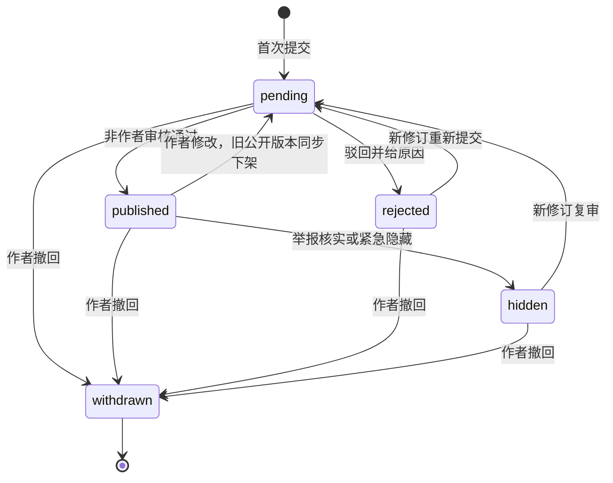

# 产品范围与业务规则

## 1. 定位与范围假设

面向全体学生，降低寻找教师、了解课程与核对开课安排的成本。用户已确认教师评分与课程查询为核心。首期以一个学校为数据边界，保留 `institution_id`，不承诺首发多学校运营。

“全体学生可查询”的设计假设是：基础教师、课程、开课与公开评价无需登录；登录只影响个人操作。公开访问也意味着互联网其他访问者可能读取这些资料，不能把匿名网页视为仅校内可见。如果校方要求仅学生可读，P0 改为认证读取，取消对应共享 CDN 数据缓存并重新压测。

姓名、任职学院、课程是有来源的教学资料；主观评价是学生意见。界面、AI 和搜索都必须区分两者。评分不能被表述为对教师能力或人格的客观结论。

## 2. 五权限组、资格与主要流程

权限组固定为以下五种，不再增加其他用户层级：

| 权限组 | 可执行操作 | 关键限制 |
| --- | --- | --- |
| 游客 `guest` | 查询教师、课程、开课、公开评价、评分说明与有效平台总结 | 未登录，无持久用户组记录，只得公开DTO |
| 用户 `user` | 登录独立平台账户、维护会话、查看本人记录/处理结果、撤回/申诉/删除请求 | 平台登录不证明学生身份，不自动有评价提交或学生AI数据权限 |
| 学生（认证）`verified_student` | 资格有效范围内新提交/重提交评价、点赞、使用受控search/evidence/validate；浏览器配置自己的模型 | 当前学生grant有效；模型Key仅本人浏览器，不授管理权 |
| 内容管理员 `content_admin` | 按获准capability/scope人工审核、举报/申诉、脱敏置信度辅助与教师总结内容治理/修正 | 不得自审/改学生原分；无系统授权、平台秘密、模型预算、恢复发布等系统能力 |
| 系统管理员 `system_admin` | 按获准capability/scope管理配置、账户权限、教学数据/导入、平台AI模型/预算、审计与受控运维 | 不是DB owner或万能角色；不读学生Key、平台旧秘密原值或真实学校身份，不能绕过审批/安全gate |

`mainGroup`是单值主分类，不使用数字等级或`group >= ...`判断。未登录guest；已登录非管理员按active学生grant派生user/verified_student；两管理员组显式授权且互斥，不能同时授予。管理员与学生grant独立：管理身份不证明学生条件，也不自动获评价/点赞/BYOK数据权限，仍需相同匿名认证。撤销管理后按已有grant回落，不凭曾是管理员恢复学生权。

组是固定职责上限，具体capability与学校/对象scope可在组内缩减；不能给content_admin加系统capability来制造第六种或变相system_admin。所有管理功能仍在同站 `/admin`，导航/页面/按钮由后端当前授权摘要决定，每请求及异步执行重验组、capability、scope与对象权限。进入管理前清学生BYOK Key/临时结果并完整加载严格CSP文档，详见[14](14-admin-workspace-and-security.md)。

### 2.1 匿名学生认证和“一人不得重复认证”

平台登录使用独立账户，不把校园账号/学校邮箱/SSO subject接成Supabase登录provider或写入auth.users/auth.identities。默认优先无真实联系方式的平台凭据/恢复方式，适配器P0验证；可选邮箱只接受独立非校园联系方式，已知学校域准入拒绝，不能从认证流自动填充或据此授学生资格。平台自愿联系方式另按平台用途处理。学生认证只接受可信issuer/proof成功，手填学号、邮箱控制权、未经可信核验材料或管理员勾选均不够；未就绪则不开新授予/评价提交/学生AI数据。

真实学校账号相关原文实行**零持久化**：学号、姓名、学校邮箱/账号、校园凭据、SSO subject/token和证明文件不进应用DB、Supabase身份、对象存储、日志/APM、队列、备份、导出或管理员页面，取消旧“认证材料最多保留7天”方案。仅专用隔离验证服务在一次性验证内存中短暂处理获准的稳定学生标识；既不要求平台保存学校密码，也不把学校登录连接到普通平台身份。

不采用MD5或普通无密钥hash。使用`HMAC-SHA-256(K_dedup_v, length_prefixed_encode(domain, institution, canonical_identity_namespace, canonical_stable_student_subject))`，由验证服务通过KMS/HSM产生完整tag；按[15](15-anonymous-student-verification.md)固定规范和编码。多个issuer必须归一到相同namespace/subject，不能把可切换issuer作为盐绕查重。只有隔离验证服务在获准流程短暂处理原文/调用查重key。查重集合仅tag+keyVersion，无appUserId/grantId/claimId/时间/IP关联列；平台grant按15仅含平台userId、随机grantId、schoolScope、验证策略/级别、active/revoked和版本，无tag或真实学校字段。

grant仅证明“首次验证时满足学生条件”，初版不自动过期/续证，不宣称当前在校或已修读。一次授予遵循15原子协议，保证同一学校权威稳定学生身份不向第二账户授予；无可靠同人标识时不夸大成跨身份/多学校全球自然人唯一。同账户响应丢失/重试返回已有状态，不消耗第二身份；无tag↔账户映射不能安全换绑/续证，相关功能关闭。撤销仅按平台原因恢复原账户原grant，不重新认证；删号留无关联tombstone，丢账号走平台恢复凭据，不能凭校园身份找回或给新账号重发。

HMAC去标识不等于绝对匿名：处理时点、网络元数据、证明issuer、服务串通、密钥泄露和用户自述均可能关联。产品只承诺设计中的最小持久化与权限边界，不宣称运营方技术上绝不可能关联。查重账本无管理员列表/搜索/导出，不提供真实学校身份调查或揭示，系统管理员也无此能力；平台只能按获准范围核查平台账户行为、执行内容/账号处置。

### 2.2 操作资格与流程

新评价/重提交/点赞/学生AI数据检查当前active且未撤销grant，不检查组数字等级；“active”不声明当前仍在校。本人记录/撤回/申诉/删除只需适当验证的平台账户控制权，grant撤销或账号受限不取消补救能力。账户恢复不收集校园密码或补存真实学校身份，安全冻结不永久阻止撤稿。

主要流程：检索教师 → 查看评分样本、课程与平台总结 → 阅读评价 → 登录并验证资格 → 提交评价 → 人工审核 → 发布。提交/修订事件同时异步触发平台分析供审核参考，不要求先等待AI；发布和来源变化另触发教师总结生成。

学生AI流程：页面选择供应商、输入自己的Key/模型名 → 确认目标与数据外发 → 浏览器直连模型解析 → 本站受控检索 → 自己的模型解释 → 当前证据验证 → 展示个人辅助结果。平台AI独立根据评价修订和发布事件做置信度辅助分析与教师总结，不接收学生Key或复用学生回答。

## 3. 首发与延期范围

| 首发必须交付 | 后续按需求进入 |
| --- | --- |
| 教师、学院、课程、学期与开课查询，稳定分页 | 多学校、个性化收藏与跨设备课表 |
| 教师与开课教师的歧义映射提示 | 实时余量同步、逐日期调停课 |
| 评价提交、审核、撤回、举报、申诉入口 | 捐赠、社区社交与通知抓取 |
| 已发布评价统计，口径与样本量可解释 | 向量检索、复杂多工具 Agent、外部网页搜索 |
| 学生BYOK浏览器直连筛选；平台评价分析与教师总结 | 自动排课、代选课、接入校内私人系统 |
| 同站完整管理工作区、数据/AI/安全/运维面板及权限审计 | 教室环境评分、教师人事决策工具 |

评价点赞可在 P2 后提供，不影响核心查询或准入。**积分系统正式取消**，不作为延期功能或扩展预留；不建设积分账户、签到、评价奖励、充值、积分流水或AI扣分。平台运营成本预算继续独立存在，不向学生折算积分。

## 4. 教师、课程与课表口径

- 教师身份以内部稳定 ID 和经过确认的来源映射为准；姓名相同不自动合并，学院变化不自动新建或覆盖。
- 课程、选课班/开课实例和单次上课安排是不同实体。一个开课实例可关联多名教师、多段安排；查询展示不得把每段安排计为一门课程。
- 显示来源、所属学期、导入时间与 `dataVersion`；人数与容量默认是来源快照，不承诺实时余量。
- 时间未知、周次已知、教师映射待确认分别展示。未知时间不能判定“无冲突”，未知评分不能判定“低分”。
- 同一筛选组合的排序必须有稳定 ID 作为次级排序键；无数据与数据源不可用分别提示。

## 5. 评价生命周期

状态针对评价聚合当前状态；每次内容变动创建不可变 `review_revision`。审核操作必须指定修订号和当前版本，旧审核请求不能批准新内容。`hidden` 与 `withdrawn` 不经普通审核直接恢复；撤回后再次发表创建新提交并遵守防重规则。

发布、撤回、重新提交和隐藏都通过数据库事务更新公开投影、公开版本与 outbox。作者编辑已发布评价时立即撤下旧版，避免公开内容与待审内容混淆。审核员不能审核自己的评价。举报进入 `report`，调查详情不公开；为教师和学生提供更正与申诉渠道，不自动满足任意删除要求。

原则上同一作者、教师、课程、学期只存在一个未撤回评价聚合；课程/学期必须能对应有效对象。是否要求实际修读证明待 P0 决定，未接入选课证明时不能标注“已修读验证”。

## 6. 评分和展示规则

首发四个维度：讲授清晰度、课程组织、反馈支持、考核透明度，均为 1–5 的整数，高分统一表示正向。难度、作业量、点名频率可作为描述性选择项单独展示，不混入正向总分。维度与标签字典版本化；历史维度不能未经核对按名称或 `6-x` 转换。

- 仅当前 `published` 修订参与统计；隐藏、撤回、待审和驳回不参与。
- 综合分为四维算术均值，再对有效评价求平均；服务端计算，展示一位小数，保留精确内部值。
- 少于 5 条有效评价只展示样本量及“样本不足”，不显示可排序综合分；首发不做全站“最佳/最差教师”榜单。
- 总分显示样本量、按学期分布、统计时间和口径版本。按总分排序先排达到阈值者，未达阈值置后；同分以样本量与 ID 稳定排序。
- 可疑刷分进入风控复核，不能悄悄改分。对外说明统计排除规则，并保留处理审计。
- 平台AI置信度表示文本证据强度/具体性/一致性，不是事实真伪或作者可信度概率；初版不自动改学生评分、不按置信度加权综合分、不因负面表达降低权重。

教师总结至少基于5条当前公开评价，明确学校/课程/学期范围、样本与局限。原始公开来源变化使旧总结立即失效，后台重新生成；学生自己的模型回答与平台总结明确标注不同来源。详细流程见 [AI总纲](07-ai-query-and-filtering.md)、[平台分析](13-platform-ai-analysis.md)。

以上维度、5 条阈值与防重规则是待产品确认的设计默认值，实施前通过 ADR 固定。旧分数不能在口径不兼容时直接纳入新汇总。

## 7. 体验与非功能要求

移动端与桌面端共用路由和数据契约；优先键盘可用、可访问标签、分页与失败重试。教师详情懒加载评价，不下载全站教师、评价或课表。搜索防抖并取消过时请求，保留已选择的课程与筛选条件。

管理区提供响应式列表/详情/差异/任务结果页，不以浏览器直连Supabase Console、生产shell或私有控制台代替。恢复/发布等展示目标、版本、影响、确认/必要复核与结果，低风险动作不统一加审批。初始至少准备两名独立system_admin，支持具体高影响双人流程；保护最后一个有效system_admin，但不赋予DB owner。首次信任根与灾难流程受审计，不开放匿名网页自举管理员。

普通查询、学生模型和平台分析分别降级：没Key或CORS不兼容仍可普通搜索；平台总结生成失败不影响已公开评价或学生自带模型；平台分析额度不足不阻塞人工审核。身份服务异常时关闭依赖身份的接口、保留允许公开的数据。具体指标见 [容量规划](06-capacity-and-performance.md)。

## 8. 待确认决策

| 决策 | 当前规划默认值 | 必须确定时间/责任人 |
| --- | --- | --- |
| 匿名公开还是仅学生查询 | 匿名读取公开教学投影 | P0，产品/数据负责人 |
| 学校、数据权利与教师申诉渠道 | 单学校；仅授权来源 | P0，产品/运营 |
| 匿名学生认证的可信issuer/proof与去重协议 | 零学校原文；独立grant与无业务关联列HMAC集合，不宣称绝对匿名；未就绪不开授予 | P0，身份/安全负责人，按15验收 |
| 同账户重试、删号tombstone与平台账户恢复 | 首次验证时学生；初版不自动过期/续证/换绑；不向第二账户重复授予 | P0，身份/隐私负责人，按15固定 |
| 修读证明与评价适用范围 | 资格不等于已修读；不虚假标注，也不持久收集学校证明原文 | P0，产品/数据负责人 |
| 评分维度、样本阈值、防重 | 本文第 5–6 节 | P0，产品/数据负责人 |
| 部署地域与访问延迟 | API、Redis、Supabase 尽量同地域 | P0，运维；需目标学生网络实测 |
| 后端缓存每日写Supabase | 后端统一管理并每日将缓存写Supabase已确定；默认03:00 Asia/Shanghai写非公开cache_persistence快照表。具体项目/角色、时刻和30小时预热年龄上限待实施固定；业务实时落库，权限/撤稿不等次日 | P0，产品/运维，按[16](16-backend-cache-and-daily-sync.md)验收 |
| 学生模型供应商兼容 | 浏览器直连已确定；registry/CORS/CSP支持范围待实测 | P3a 前，前端/安全 |
| 平台AI供应商、地域、预算与置信度展示范围 | 独立分析服务，脱敏最小输入，先审核辅助不公开真伪概率 | P3b 前，产品/安全/运维 |
| 评价与安全日志保留期限 | 见数据文档建议值 | 生产采集前，隐私负责人 |
| 是否导入旧用户和旧评价 | 不自动导入；先确认来源、授权与口径 | P1 前，数据负责人 |
| 五组内capability、scope与高影响工作流 | 五组已确定；system_admin/content_admin分权，同站升权与固定命令 | P0，产品/安全/运维，按14验收 |

待确认事项允许查询侧开发推进，不代表默认批准公开真实数据或跨服务传输个人信息。
