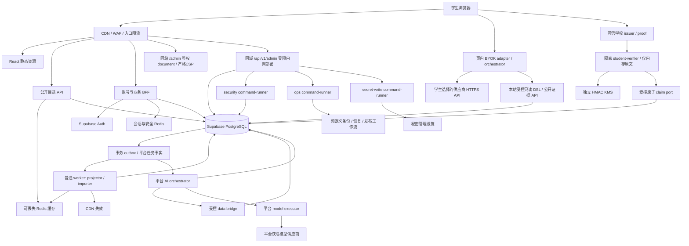

# 系统架构与职责边界

## 1. 总体方案

采用单仓、多后端应用、模块化单体，**前端统一为同一个站点 `apps/web`**。学生功能与 `/admin` 管理 workspace 均从该站点进入，不建设独立管理站或管理域名；只有数据库当前有效的管理员可进入并按能力操作。前端是否显示导航不作为授权控制。

普通检索、评价与权限由 BFF 和数据库负责；AI 分为学生浏览器 BYOK 与平台后台分析。学生 key 仅由浏览器直连选定供应商，本站绝不接收、转发或保存。平台运行密钥由秘密管理设施保管，仅平台 AI executor 获准读取；管理页面可通过专用写入命令替换平台秘密，但不能取回原值。

图中箭头表示能力调用，不表示对公网开放。入口将同域 `/api/v1/admin/**` 专门转发至内网 admin-api，普通 API 不注册管理路由、不持管理凭据。两种 API 可复用产物，但角色、连接池与网络能力独立；admin-api 本身也没有 owner、service_role、通用 SQL/shell 或基础设施万能凭据。安全、运维和秘密写入命令分别由 `apps/command-runner` 的受限运行模式执行。

学生供应商调用不经过本站 relay，本站只读工具不调用模型。`apps/worker` 负责投影与导入，`apps/ai-worker` 负责平台分析，二者不共用供应商密钥、执行队列、费用预算或运行账号。

平台 AI 产物进一步以独立进程运行 orchestrator、data bridge 和 model executor：前者只管理平台作业/预算，bridge 只提供被授权的脱敏数据，executor 仅持平台供应商 key、无数据库/Redis/身份凭据。不能把同进程内“不 import 数据库”的模块约定当作凭据隔离。首期不需要 Kubernetes、服务网格、独立向量库或消息中间件集群。

## 2. 分层

| 层 | 拥有的职责 | 不允许的依赖 |
| --- | --- | --- |
| view | 组件、可访问性、响应式展示 | 直接查库、业务授权、评分口径 |
| frontend data | 本站 HTTP、查询状态、DTO 适配、取消/重试 | 后端源码、SQL、平台供应商密钥 |
| browser AI | 页内学生 key、供应商直连、受限计划编排、解释校验 | 服务端 relay、数据库 SDK、持久保存 key、平台预算 |
| contracts / ai-contracts | 纯类型、路径/错误码、DSL 与协议常量 | React、Fastify、数据库 SDK、环境读取、凭据 |
| gateway | 会话、CSRF、输入校验、限流、请求上下文 | 接收学生 key、拼领域 SQL、调用学生模型 |
| admin workspace | 按当前能力显示面板、确认操作、跟踪受控任务/审计 | 以隐藏按钮授权、直接provider SDK、SQL/shell、读取秘密原值 |
| admin-api / command-runner | 当前权限与升权验证、类型化intent/任务、限定工作流 | 通用执行入口、前端自报角色、普通API持管理凭据 |
| student-verifier | 可信校园proof校验、内存规范化、历史HMAC候选与原子领取 | 原文持久化、学校登录接平台Auth、公开MAC oracle、管理/AI读取tag |
| domain | 教师/课程/评价/审核、证据与平台分析规则 | 前端源码、其他域内部 repository |
| backend adapters | 参数化 SQL、缓存、Auth | 决定某个学生的业务权限、学生模型代理 |
| ordinary worker | outbox、导入、评分聚合与修复 | 平台模型 key、学生查询作业、积分奖励 |
| platform AI | 置信度辅助分析、教师总结、独立作业/预算 | 作者映射、自动裁决真假、改原始评分或自动审核评价 |

跨域使用显式 port、应用编排或事务 outbox。编排可在同一个数据库事务中调用多个域公开接口；禁止循环导入 service 或把通用 repository 当作跨域后门。共享包只包含纯协议，各端自行实现运行时 schema，CI 校验一致性。

## 3. 业务域与数据所有权

| 域 | 核心职责 | 主拥有数据 |
| --- | --- | --- |
| identity | 独立平台会话、账号状态、匿名学生资格 | profiles、student_grants、student_verification_challenges、sessions 元数据 |
| student-verification | 可信proof、无关联查重、受控首次授予 | dedup.student_claim_tags、student_keyring_registry；无校园原文或tag↔user表 |
| catalog | 学校、学院、课程、学期字典 | institutions、departments、courses、terms |
| teachers | 教师身份、公开教学资料 | teachers、teacher_source_links |
| timetable | 开课、共同授课、安排、冲突判定 | sections、section_teachers、meetings |
| reviews | 提交、修订、撤回、公开内容与评分 | reviews、review_revisions、published 评价投影 |
| moderation | 人工审核、举报、申诉、紧急隐藏 | moderation_actions、reports、appeals |
| student-query | 验证受限 DSL、查公开候选/证据、校验当前版本 | 无学生模型作业、key、问答历史或费用账本 |
| platform-ai | 评价证据强度分析、教师总结、平台调用预算 | platform_ai_jobs、platform_ai_budget_reservations、platform_ai_provider_calls、review_ai_assessments、teacher_ai_summary_evidence、teacher_ai_summaries |
| ingestion | 导入批次、校验、来源映射与数据发布 | import_batches、source_records、source_mappings |
| administration | 管理能力、升权会话、授权与平台行为核查、受控任务和审计 | role_bindings、capability_bindings、admin_sessions_metadata、operation_intents、admin_command_jobs、audit_events |
| platform | 健康、配置、事务/缓存/观测基础设施 | outbox_events、job_leases、idempotency_records |

域是代码模块，不等于独立服务器。积分、签到奖励与消费扣款已正式取消，数据库、接口、任务和配置均不保留可误启用的奖励通道。通知等其他校园业务不进入本期。

## 4. 关键链路

### 4.1 公开查询

`/api/v1/public/**` 只按白名单读取去身份化投影。浏览器使用 `credentials: omit`；入口仅对显式白名单剥离 Cookie/Authorization，再按规范化 query 缓存。公开 handler 忽略身份且不设置 Cookie，不按登录态、实验分组或权限改变正文。

目录和普通评分摘要可 CDN → Redis → SQL 回源；评价正文和平台教师总结 HTTP 均为 no-store。每次正文、学生 AI 证据及总结读取，先由主库验证当前公开状态、修订/generation 和依赖范围版本，再取精确版本内容。检查失败时拒绝旧内容，不能从缓存或延迟副本获取授权状态。撤稿保证针对提交后开始授权的新读取；已授权在途响应和已下载/已发送到外部供应商的数据不能保证收回。目录统计可短暂陈旧，预算见 [06](06-capacity-and-performance.md)。

### 4.2 身份与写入

浏览器 → 同源 BFF 登录 → Supabase Auth → 后端保管身份令牌 → `__Host-sc_session` 不透明会话。管理员以同一站点登录身份完成经验证的 aal2/最近认证后，另获短期 `__Host-sc_admin` 升权会话，绑定同一subject、roleVersion、sessionEpoch及失效时间。两个Cookie均host-only、Path=/；不同名称与页面路径不构成同源XSS隔离。学生供应商key与这两类会话无关。

业务写入校验会话、Origin/CSRF、动作资格、额度、参数、对象权限与版本；新评价/点赞和学生 AI 工具要求有效学生资格，撤回/申诉/删除请求保留本人补救能力。状态、公开投影、outbox、审计、幂等记录同事务提交；不在事务内调用 Redis 或模型。

主权限组固定为system_admin/content_admin/verified_student/user/guest；管理两组互斥且不构成数字等级，非管理账号按独立active学生grant派生学生/用户。管理员执行学生动作同样需grant。认证前BFF创建无校园数据challenge，可信校园proof只送独立`apps/student-verifier`，不作为Supabase登录provider。verifier在内存规范化身份、计算全部历史HMAC候选；受控单PostgreSQL事务校验challenge/keyring、查重/插入当前唯一tag并创建grant。标签与账号无业务join，原文/密文不进DB、Auth、日志、队列或备份。grant仅证明首次验证时学生，无自动到期/续证；删号不释放tag，原账号凭平台恢复方式补救。并发、密钥轮换、恢复水位和侧信道限制见[15](15-anonymous-student-verification.md)。

### 4.3 审核与撤稿

管理员在同站 `/admin` 面板经强认证操作，后台逐次检查当前 capability、institutionScope、对象权限和版本；普通 API 不注册管理路由。审核指定修订号和 expectedVersion，公开内容变更与撤除同事务生效。撤回、隐藏、重提交同时提升正文 generation 和受影响教师总结的 scope epoch，使已生成总结立即失效；outbox 再触发投影重算和平台总结重建。撤稿成功不能只依赖异步清缓存。

### 4.4 学生 BYOK 查询

页面 registry 约束供应商的精确 HTTPS endpoint、协议和 CSP `connect-src`。学生填写供应商、key、模型名，key 只存在当前页专用内存；browser adapter 直接向供应商请求受限 DSL。应用将校验后的 DSL 发送 `/api/v1/ai/student/search`，按候选请求 `/api/v1/ai/student/evidence`，供应商基于获准公开证据生成解释；展示前再请求 `/api/v1/ai/student/evidence/validate` 校验来源与当前状态。

这三个本站接口只接收供应商无关的受控 JSON，重复校验 schema、资格、查询复杂度和证据公开状态，未知字段及 `providerKey`、`apiKey` 等凭据字段一律拒绝且不回显。evidenceReceipt 签名绑定主体及完整证据集合摘要，有效期 2 分钟；每次 validate 仍查主库，票据不是权限或仍然公开的替代证明。只读工具不拥有任意 SQL/网页调用能力。服务器不接收学生原始模型请求、供应商 token 或流，不创建学生 AI job、不记模型预算账、不提供服务端 SSE。

供应商不支持浏览器 CORS 或不在 registry/CSP 中时，该选项禁用并引导更换；绝不回退到本站代理、通用代理或 `no-cors`。key 不进入 localStorage、sessionStorage、IndexedDB、URL、Service Worker、日志、埋点或错误报告；离页/退出/切换 key 时中止请求并清理引用。供应商费用由学生与供应商结算，平台只限制自身检索 API，普通搜索不依赖任何模型。细节见 [12](12-student-byok-ai.md)。

### 4.5 平台 AI 分析

业务 outbox 以修订 ID/版本或教师 scope epoch 创建去重的平台作业。orchestrator 预留平台预算，通过 data bridge 取得最小脱敏证据，交给无数据库能力的 executor 调用平台模型，返回值始终作为不可信输入校验。

评价分析只评估内容证据强度、内部一致性和可解释置信等级，不裁决事实真伪、不自动改学生原分、不自动审核或发布评价。指定 pending 修订可进入受限私有分析；结果只供获准审核用途，普通公开 API 和学生工具永远不可读取 pending 数据、作者映射或私有分析结果。

教师总结只采用当前 published 证据。完整依赖清单、实际使用修订/generation、范围 epoch 与模型/策略版本一起保存；公开引用几条评价不能代替完整依赖。新增 published 评价、撤回、隐藏、重提交和相关来源变化都在业务事务中提升 scope epoch。合格候选经过自动 schema、逐句来源、内容安全、完整 manifest 和 epoch 校验，由受控应用命令公开；executor 无发布权，敏感、低证据或争议内容转人工或拒绝，不把每条总结人工审批设为依赖。发布和每次读取均经主库 gate，依赖或范围不符立即不返回旧总结。HTTP no-store；有效总结生成 p95≤15 分钟是后台目标，不是旧总结可继续公开的窗口，评价分析 p95≤5 分钟。平台队列、并发、费用预留、未知上游调用对账与普通 worker 隔离；不扣学生积分或调用学生 key。细节见 [13](13-platform-ai-analysis.md)。

### 4.6 同站管理 workspace 与受控命令

同一前端构建提供 `index.html` 和 `admin.html` 两个document入口。进入 `/admin` 使用顶层 document navigation，入口服务先验证站点身份和当前 `admin:enter`：未登录走统一站点登录及固定returnTo；非管理员403；当前管理员尚未升权时只返回同样严格CSP的最小MFA/重新认证页，成功后才加载workspace与数据。`/admin.html`、嵌套管理路径和HTML别名同样经过gate，不能从静态/CDN路径绕过。HTML与管理数据均no-store；下载到管理JS字节不等于取得权限。

管理document使用独立严格CSP，`connect-src 'self'`，不装载学生BYOK适配器或供应商脚本；学生document按registry允许供应商。不能只在SPA内切路由然后声称CSP已变严。进入前abort学生模型请求、清key及未交付解释；管理退出/降权清管理内存与升权会话，以document navigation返回普通页。该设计减少能力混用，但同源任一页面XSS仍可能影响管理会话，不能宣称路径/Cookie名称完成安全隔离。

管理员仅system_admin和content_admin两组，其他三组无管理权。system_admin负责获准系统配置、权限、数据、AI预算/秘密及运维；content_admin仅获准内容治理，不能增授系统capability。两组均非数据库owner，逐动作授权而非自动全权。导航/面板按后端当前能力摘要显示；每个HTTP动作由DB当前组内capability:scope、对象授权、aal2/最近认证、roleVersion/sessionEpoch、CSRF、expectedVersion和审计决定，禁止以user_metadata或布尔isAdmin放行。精确矩阵见[14](14-admin-workspace-and-security.md)。

所有日常管理能力均有站内面板：审核/举报/申诉；教师课程与同名映射、导入；匿名grant状态/封禁；AI分析/总结治理、供应商registry/模型/预算；组权限、审计及平台行为核查；开关、限流、缓存、队列；备份、恢复与发布等类型化任务。不提供学校身份揭示或查重标签查询。UI展示差异、风险、状态和审计，不直接调用数据库、供应商SDK、SQL或shell。初始两名system_admin引导与灾难break-glass是有审计的受控运维例外，不能成为缺少日常管理页面的理由。

短事务低影响修改直接走受控JSON route，验证当前权限、CSRF、对象版本、幂等与审计。长时/高影响动作先建立绑定actor/范围/目标/参数摘要/版本/期限的intent，再确认执行或建command job；领取、关键副作用与授权提交前重验发起人和必要复核者当前权限、升权/确认有效性。撤销阻止未执行特权步骤，不拿旧快照续权；仅具体高敏策略需要独立第二人，不给普通审核/编辑加统一审批。

平台秘密面板只显示keyRef、密管版本和配置状态，不保存或回显秘密值片段/值hash。授权者输入新替换值，经专用no-store端点交secret-write进程直写密管；原值不进DB/队列/日志/回显。普通admin-api只保存/转交引用和结果摘要，无密管通用读取能力。学生BYOK Key仍只在浏览器直连，不流入该平台秘密流程。

## 5. 信任与进程边界

1. 浏览器、模型输入输出与导入文本均不可信；客户端不能决定身份、SQL、角色、作者或公开状态。
2. BFF 与 PostgreSQL 分别执行业务授权和 grants/RLS/命令函数防护；运行时角色无 owner、DDL、BYPASSRLS 或任意管理能力。
3. 公共 API 进程无管理员或模型凭据；admin-api也不是万能执行器。安全/运维/secret-write按能力和工作负载凭据隔离，system_admin组不等于真实DB owner。学生工具只读公开证据；学生proof与去重key仅verifier处理，不能授予普通API/admin/AI。
4. 学生 key 的唯一接收方是学生明确选择且 registry 允许的供应商；页面不得包含能读取该内存的无关第三方脚本。浏览器端 XSS/扩展风险不能靠“内存保存”自动消除。
5. 平台 orchestrator、data bridge、executor 以及普通 projector/importer 分进程、账号、队列和资源预算；executor 无数据库/身份秘密，bridge 不取得作者映射。私有分析输入不会通过公开证据 port 透传。
6. 平台分析提示词不是授权边界，模型结果不直接成为审核决定、评分贡献或公开总结。管理能力也不来自前端路由/隐藏按钮或Cookie存在本身。

API 完全失陷后仍可能伪造其可用的用户上下文；RLS 不保证抵挡完整受信后端失陷。拆分凭据、压缩可达能力、参数化 SQL、审计与轮换共同降低影响面。

## 6. 部署与演进

API无状态扩容、会话外置。同一站点经可信入口将公开/普通业务与 `/api/v1/admin/**` 分流到各自内网部署，管理HTML使用鉴权document入口；同域不等于共用管理凭据。公开查询、学生工具、私有写入、管理、command-runner与平台AI各有连接/并发预算。学生供应商配额不计入平台模型容量；平台不承诺替学生精确控制供应商账单。平台持久任务/费用与管理intent/作业事实位于PostgreSQL，Redis只作加速和短期协调。

普通 worker 与平台 AI 可独立关闭、发布和恢复，平台 AI 故障不阻断普通查询或人工评价流程。新增供应商需经协议、CORS、endpoint、CSP、数据外发范围和错误脱敏验证；不能以新增适配器为由引入学生 relay。其余拆分依容量和权限证据决策，见 [ADR](11-architecture-decisions.md)。
