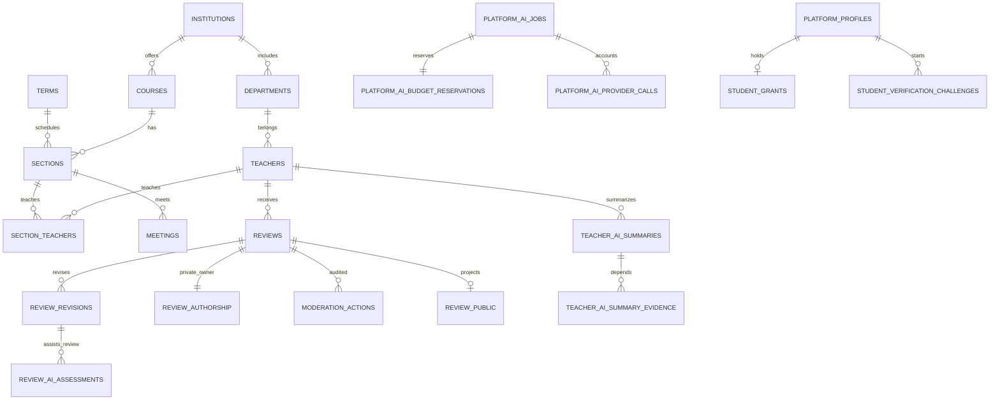

# 数据模型与 Supabase 边界

状态：设计基线 v0.4，2026-10-18，待实现。五个权限组和学生一次性匿名认证以 [15 匿名学生认证](15-anonymous-student-verification.md) 为准；本文落实其数据、角色、事务及恢复边界。

## 1. 数据访问决策

Supabase提供PostgreSQL和Auth。统一站点apps/web包含学生页与/admin workspace，均通过同域BFF访问数据，不在前端直连Supabase或管理provider SDK。入口将 `/api/v1/admin/**` 分流至独立受限admin-api，普通API无管理凭据；高权限安全/运维工作再分派限定command-runner，admin-api无owner/service_role或任意执行能力。学生模型仍是浏览器BYOK直连供应商，不经本站代理。

新项目单独建立 Supabase 项目，禁止套旧 SQL 覆盖旧库。业务对象位于未暴露的 `core`、`private`、`published` schema，匿名查重对象另在同样未暴露的 `dedup` schema；关闭不用的 Data API，同时撤销不必要的 `anon`、`authenticated`、`PUBLIC` 和默认对象授权。Auth 与 Data API 开关分别核验。[Supabase API 安全说明](https://supabase.com/docs/guides/api/securing-your-api)

**学生供应商 key 不属于本站数据模型。** 不创建 key 密文、key hash、用户模型设置秘密、学生 AI job、费用 reservation、模型问答历史或学生 AI 结果表。本站学生工具只接受受限 DSL 与公开证据请求，不接收 providerKey/apiKey 等字段、原始模型请求或模型回答。积分、余额、签到奖励、消费规则、积分流水和奖励函数已取消，不建表、不迁入旧数据、不提供后台扣款路径。

**学校真实账号相关数据零持久化。** 学号、姓名、学校邮箱/登录名/密码、学校 SSO subject、断言/token、证明材料及其密文副本不得进入业务表、Auth 身份/metadata、Redis、对象存储、队列、日志/采样或备份。平台 Auth 仅管理独立平台身份；学校验证由 `apps/student-verifier` 专用进程短暂处理，不配置为 Supabase 登录 provider 或调用 linkIdentity，防止 `auth.identities`、provider_token/email 等自动落库。获准学校 pairwise subject 也只在验证内存使用，不因为已经假名化就允许保存。可信来源、规范化和侧信道限制见 [15](15-anonymous-student-verification.md)。

## 2. 实体和关系

`dedup.student_claim_tags` 故意不画到用户、grant 或 challenge 的关联线：不存在对应 FK、join 表或可反查账号的列。tag 是需保护的假名数据，不是密码学不可关联证明；同事务 WAL、物理备份和时序仍可能形成侧信道。

## 3. 表规划

这是逻辑模型，不是已建表或可执行 DDL。内部主键 UUID，公开对象另有稳定 `public_id`；难猜 ID 不替代鉴权。使用服务端 `timestamptz`，学期周次和课时遵循学校时区。数据库列采用 snake_case、API DTO 采用统一 camelCase 映射。

| schema / 表 | 主要字段与约束 |
| --- | --- |
| core.institutions / departments | 学校 ID、学院学校 FK、来源编码；同学校学院编码唯一 |
| core.teachers | 学校、学院、规范姓名、公开 ID、active、source_version、teacher_scope_epoch；不按姓名唯一 |
| core.teacher_source_links | 来源系统/key、候选、resolved_teacher_id、match_status；来源 key 唯一，歧义不强配 |
| core.courses / terms | 学校内课程代码唯一；学期代码、起止时间、时区、来源 |
| core.sections | 学期、课程、来源选课号、性质、学分、校区、容量快照、source_version；学期+来源选课号唯一 |
| core.section_teachers | section_id、teacher_id、角色、来源、映射状态；明确共同授课与未知映射 |
| core.meetings | section_id、周次、星期、起止节、地点；星期1–7、周次1–53；时间字段全部存在或全部未知 |
| core.reviews | public_id、teacher/course/term/section、current_revision、state、version、publication_generation；作者不放公开对象 |
| core.review_revisions | review_id、revision_no、正文、四维分、描述项、rating_schema_version；不可变，review+revision唯一 |
| private.review_authorship | review_id唯一、auth_user_id、创建时间；公开/普通审核/平台模型均不可读取作者映射 |
| private.review_slots | author_id、teacher_id、course_id、term_id、active_review_id；唯一约束保证一个活动聚合 |
| core.moderation_actions | review/revision、actor、action、reason_code、前后版本、时间；人工动作追加审计 |
| core.reports / appeals | 被举报公开ID、提交者、私有说明、状态、处理记录；本人只看有限摘要 |
| core.teacher_rating_aggregates | 四维精确sum/count、口径版本、聚合水位；仅聚合维护角色可写，普通reader/AI不可读 |
| private.review_rating_contributions | review、last_applied_version、teacher、口径版本、当前绝对贡献；去重及乱序处理 |
| published.teacher_summary | 教学资料白名单、样本、阈值允许的显示分、rating_version、stats_updated_at；不含低样本sum/均分或AI总结正文 |
| published.course_sections | 去除来源原始行/内部映射的公开开课投影、data_version、导入时间 |
| published.review_public | public_review_id、teacher/course/term公开ID、当前revision、正文、评分、published_at、generation；无作者关联 |
| private.profiles | 平台auth_user_id、平台账号状态、session_epoch及必要平台资料；无学校账号/真实身份字段，不从学校认证自动填充资料 |
| private.student_grants | app_user_id唯一、随机grant_id、institution_scope、status(active/revoked)、version、assurance固定verified_at_claim；app_user_id对应独立平台账号UUID，无tag/学校subject/姓名/学号/邮箱/认证方法证明指纹/学校凭据，无自动expiry或续证字段 |
| private.student_verification_challenges | 随机challenge摘要、平台app_user_id/app_session绑定、session_epoch、nonce/用途、scope提示、expires_at及消费状态；默认5分钟，无tag、学校账号、subject、断言/token或证明原文 |
| dedup.student_claim_tags | 仅key_version、完整32字节HMAC tag，UNIQUE(key_version,tag)；不含user/grant/challenge/state/time/IP或其他关联列，无账户FK/级联删除 |
| dedup.student_keyring_registry | 受控历史检查版本集合、当前写版本、keyring_generation及必要KMS引用/策略；无个人记录；只供专用验证/信任根流程，不返回管理DTO或通用配置/导出 |
| private.role_bindings | subject、显式管理组(system_admin/content_admin二选一)、学校范围、有效期、grantor、version/revoked_at；当前有效管理组互斥，student/user/guest不作为可编辑绑定 |
| private.capability_bindings | 用户/管理组、组内具体capability、institution/object scope、有效期、version、grantor/撤销；只能缩减组内上限，不能给内容管理组追加系统管理能力 |
| private.admin_sessions_metadata | session HMAC索引、subject、关联站点session/epoch、有效role_version、经验证aal/auth_time、短时有效期、revoked_at；无原始Cookie/provider token |
| private.operation_intents | actor、固定command_type、所需capability/scope、对象/expectedVersion、规范参数摘要/受控引用、有效期、确认及按类型必要的审批引用；不含秘密原值/SQL/shell |
| private.admin_command_jobs | intent、command_type、actor、学校/对象范围、入队role/session版本、state、lease/fence、attempt、执行阶段/受控结果摘要、request/audit引用；仅执行白名单工作流 |
| private.managed_settings | registry/模型策略/预算/功能/限流/队列等枚举配置类型、受schema约束的非秘密值、draft/published版本、scope、变更摘要；不是任意key-value/脚本存储 |
| private.platform_secret_metadata | 用途/供应商scope、key_ref、密管版本、配置状态/最近轮换、审计引用；无原值/值片段/值hash/密文或取回接口 |
| private.platform_ai_jobs | kind、学校、目标revision/scope、目标version/epoch、manifest引用、模型/prompt/rubric/策略版本、去重键、execution_state、result_state、lease/fence/attempt、加密候选结果及摘要；仅平台任务 |
| private.platform_ai_budget_reservations | job唯一关联、周期/供应商/任务类型、币种、价格版本、预留最坏费用、settlement_state、确认用量；与学生积分/余额无关 |
| private.platform_ai_provider_calls | job+call_index唯一、fence、供应商request_id、prepared/sent/running/uncertain/终态、token/响应/执行上限及确认用量；持久保留未知调用占用 |
| private.review_ai_assessments | review+revision、目标version、结构化支撑程度/一致性/置信等级、证据span、limitations、模型/rubric版本、人工动作引用、result_state；只供授权私有辅助 |
| private.teacher_ai_summary_evidence | summary/job、教师scope、完整source manifest、每来源revision/generation/dataVersion、集合摘要、scope_epoch、选样/中间步骤版本；不只存最终引用几条 |
| published.teacher_ai_summaries | 教师/课程/学期公开scope、门禁获准句子/引用、eligible/used样本、覆盖/限制、summary_version、evidence_generation、scope_epoch、data_version、质量/发布策略版本、发布方式automatic/reviewed、门禁摘要、可选有效期/生成时间；仅经gate可读 |
| private.outbox_events / job_leases | event、类型、aggregate/version、最小payload、attempt、available_at、lease_until；普通与平台AI消费通道和权限分开 |
| private.idempotency_records | actor、route、key摘要、请求摘要、状态、业务资源ID、结果摘要、expires_at；actor+route+key唯一 |
| private.import_batches / source_records | 来源、内容digest、格式版本、dry-run、发布版本、失败原因；原始行不公开 |
| private.audit_events | 平台主体、范围、对象、动作、结果、request_id、时间；仅平台账户行为case追加审计，无学校身份/tag/证明或可连接查重行的payload |

后端每日将获准运行缓存写回Supabase的**独立缓存表**：`cache_persistence.snapshots`保存scope/固定缓存版本/源水位/sourceAsOf、schema/策略、总计数/大小/摘要、staging/ready/invalidated；`cache_persistence.snapshot_chunks`保存有界序列化缓存分片，UNIQUE(snapshot_id,chunk_no)，同编号同摘要才可幂等重写。`private.cache_sync_jobs`保存目标/日槽位/租约fence/重试阶段，`private.cache_snapshot_manifests`保存完整验证清单与active指针。仅白名单目录，无整库Redis dump/私有账号/认证/秘密；不能反向覆盖core等事实表。

cache_persistence不加入Supabase Data API exposed schemas，撤PUBLIC/anon/authenticated授权及default privileges、RLS默认拒绝。后端专用SQL身份仅经受控分片写/校验/激活/加载/清理port操作，普通member/管理API/AI无快照表权限。日槽位唯一，完整校验后同库短事务标ready、CAS切active并记job成功；批写不等于已可加载。独立批大小/连接/IO/WAL/保留上限，cache与业务同Supabase故障域。协议见[16](16-backend-cache-and-daily-sync.md)。

完整DDL/索引在P1迁移给出。`auth.users`由Supabase管理，不自行存密码或改系统表，删号前执行应用清理。平台优先采用不依赖真实联系方式的受支持凭据/恢复适配器（P0验证）；可选平台邮箱只接受独立非校园联系方式，已知学校域准入拒绝，不能从学校断言填姓名/邮箱/metadata。平台联系方式按自己的用途处理，不作学生证明。旧“认证原件最长7天”取消，人工也不收存档材料。

用户层级固定五组：`system_admin`（系统管理员）、`content_admin`（内容管理员）、`verified_student`（学生认证）、`user`（用户）、`guest`（游客）。`mainGroup` 为单值：有效显式管理组优先，否则按当前active grant派生学生/用户；未登录为guest且不建游客行。管理两组互斥，以受控命令和约束锁定同主体防并发双组；不能只建subject+group唯一键后允许两组同时生效。组不是有序数值，不能用role≥student授权。管理员执行学生专有动作仍须独立active grant，不能越过一次性验证。组和能力上限详见 [15](15-anonymous-student-verification.md)。

关系约束：跨学校引用使用包含 institution_id 的复合 FK 或等价命令约束；review 的 teacher/course/term/section 必须对应有效授课关系。current_revision 必须属于当前review，审核/分析目标(review_id,revision_no)引用同一不可变修订。公开投影只对应当前获准修订/generation。四维分 NOT NULL integer CHECK 1..5；教师、课程、开课和人工审核事实默认归档/RESTRICT，不级联抹掉审计链。

平台 `execution_state`、`result_state`、`settlement_state` 是三个独立维度：作业完成不代表分析仍有效，结果失效不表示供应商费用退回。执行状态含queued/running/completed/failed/cancelled/superseded/expired；结果状态为unavailable/candidate/needs_review/available/invalidated/expired，failed属于执行维度。kind限定评价分析/教师总结；结果绑定目标、证据、模型和策略版本，模型不能填actor、状态、价格或批准字段。具体协议值与[13](13-platform-ai-analysis.md)一致。合格总结由受控应用命令自动发布，敏感或有争议的例外转人工；学生评价仍须人工审核。

## 4. 运行时角色与 RLS

| 登录/执行角色 | 可达能力 | 明确禁止 |
| --- | --- | --- |
| soclear_api → reader/member | 公开目录投影、受控正文/总结gate、学生公开证据工具；member本人对象/提交函数、创建无学校原文challenge及读取本人grant状态 | 管理SET ROLE、DDL、学校身份/tag查询、直接写grant或伪造claim、模型调用、私有平台分析 |
| soclear_admin_api → admin_gateway / moderation_commands | 管理会话gate、当前能力摘要/作用域DTO、intent/任务状态、固定内容治理命令 | owner/service_role、任意SQL/shell、作者映射通用查询、直接改授权/执行运维、秘密原值读取 |
| soclear_security_commands | 按intent执行固定组授权/封禁、同一账号grant撤销或受控恢复、平台账户行为case；重查actor当前组内capability/scope | 任意GRANT/SET ROLE、新建未经验证grant、renew/换绑/删tag、还原学校身份、任意遍历作者映射、运维/模型万能key |
| soclear_student_claim_verifier | 仅apps/student-verifier持有的claim工作负载身份，通过受控port核验challenge/keyring并原子检查标签、首次创建grant；KMS只对已验证proof计算候选 | 对外MAC/tag oracle、公开/管理ledger读取、学校原文入DB、通用写profiles/授权、学生资格换绑/续发/删tag |
| soclear_ops_commands | 固定备份/恢复/发布/功能/资源工作流，调用白名单运维port | 通用shell/SQL、用户给定endpoint/脚本、学校身份调查、作为DB owner常驻连接、清查重事实重置认证 |
| secret-write，无业务DB角色 | 验证有界授权写票据后向密管创建指定用途secret版本，只返回keyRef/版本/配置状态 | 通用密管读取、保存/回显原值或片段/值hash、代存学生BYOK key |
| soclear_projector | 普通outbox、摘要增量/校准、限定投影 | 平台模型key/调用账本、身份令牌、任意导入 |
| soclear_cache_sync_worker | 固定版本后端目录缓存序列化，日槽位/租约/fence；通过窄port分批写Supabase cache_persistence、校验/条件激活/清理；加载port单独限制scope | 评分/正文/registry/私有账号/权限/grant/tag/原文/秘密落缓存，通用SQL/任意schema/项目、反写业务事实，owner/BYPASSRLS/service-role或清安全存储 |
| soclear_importer | staging校验与受控数据发布 | 修改评价/授权、平台模型调用 |
| soclear_platform_ai_worker | 平台种类任务、租约/fencing、预算/调用账本、条件提交/总结发布gate命令 | 任意读待审正文、作者/资格/会话、任意UPDATE公开总结、发布学生评价或改评分 |
| soclear_platform_ai_reader | 受控bridge函数返回任务绑定的指定脱敏修订/公开manifest | 任意遍历私有评价、作者映射、改jobs/预算/审核 |
| 平台model executor，无数据库角色 | 接收有界脱敏payload，以平台key调用供应商 | DB/Redis/学生会话凭据、任意工具/SQL/文件或管理API |
| soclear_migrator / 对象owner | 版本化schema变更 | 作为运行时连接身份 |

登录账号NOINHERIT，只有白名单成员资格；reader/member/admin_gateway/moderation_commands等SQL执行角色NOLOGIN、非owner、NOBYPASSRLS，SET ROLE范围在目标Supabase验收。表中的SQL角色/runner/workload不是用户组，也不增加第六种用户层级。用户仅有固定五组，管理绑定仅system_admin/content_admin；capability只能在对应组上限内缩减及限scope，不能映射真实DB owner或成为隐式全权。能力矩阵以[14](14-admin-workspace-and-security.md)、[15](15-anonymous-student-verification.md)为准。敏感表RLS缺省拒绝，不能用owner测试替代。[PostgreSQL行安全](https://www.postgresql.org/docs/current/ddl-rowsecurity.html)

直接 SQL 不自动获得 Supabase 用户上下文。事务封装在同连接同事务中切白名单角色，再用 `set_config('app.user_id', verifiedSubject, true)` 注入后端验证的UUID；每次重设actor/request/学校提示/认证等级，无身份显式设空，授权范围从当前DB记录取得。RLS helper缺失主体时拒绝；不能注入HTTP自报user_id/role或仅decode的JWT，也不能假设auth.uid()有值。异常rollback，池复用、超时、嵌套和worker路径都测试不串身份。

平台后台以独立工作负载身份处理，不伪装学生。bridge函数核对当前持久job的kind、目标revision/scope、学校、lease/fence、有效期和用途，队列payload不能自行授予读取权。指定pending修订只在评价分析用途下返回脱敏白名单；学生工具与普通公开reader没有这项权限。自述正文中无法可靠去除的身份线索转人工、跳过外发；不让外部模型先接收原文来“脱敏”。

成员写评价仅获命令EXECUTE，无状态/投影任意UPDATE。必要SECURITY DEFINER使用专用非登录最小权限owner、固定安全search_path、全限定名、撤销PUBLIC EXECUTE。不得自审在命令内部最小读取作者映射判断，不向审核员返回。公开总结和私有分析通过专用读取/提交函数返回白名单，不能给reader通用SELECT后寄希望handler记得检查gate。[PostgreSQL函数安全](https://www.postgresql.org/docs/current/sql-createfunction.html)

`student_grants` 的创建/首次active只能由可信claim工作负载调用的专用原子函数完成，不授普通member、admin_gateway或security runner任意INSERT/UPDATE，也不接受app.*自报verified/group。受控撤销/恢复只在原grant与同一平台账号内处理平台处置，不创建新grant，不查校园证明来恢复。dedup schema全部默认拒绝，受控claim owner仅有必需的历史存在检查/当前tag插入和grant创建能力；任何管理组、AI、导出/审计、通用SQL/RPC均无tag查询/枚举/删除或keyring配置返回能力。

RLS管行、grants管对象/列、DTO管出口，不能互代。view显式验invoker/owner语义；物化投影独立授权，底表RLS不会自动替投影过滤。公开投影不含作者数据；总结表即使位于published schema也只能经权威gate。Data API特殊集成须单独ADR与安全验收。[Supabase RLS说明](https://supabase.com/docs/guides/database/postgres/row-level-security)

### 4.1 管理会话与即时权限

站点 `__Host-sc_session` 与短时升权 `__Host-sc_admin` 都是host-only、Path=/。admin记录绑定当前站点subject、sessionEpoch、有效roleVersion和供应商真实验证的aal2/最近认证，不保存原始Cookie，不接受前端自报user_metadata/isAdmin/aal。Cookie只定位记录，不能替代当前DB权限。roleVersion来自当前绑定/模板版本计算或同步维护；授权模板/绑定变更不得只异步刷新缓存。

进入/admin入口时，未登录走统一站点登录；非当前管理员403；拥有当前admin:enter但未升权可看严格CSP的最小MFA/重新认证页，成功后才取得workspace/数据。每个管理读写命令均检查当前active admin、具体capability:scope、对象、升权/最近认证、roleVersion/sessionEpoch；写入再验CSRF、expectedVersion/幂等及审计。正向角色缓存不能覆盖撤销，停用/撤权/epoch变更在事务提交后阻止新授权动作。

管理页面能力摘要只决定导航和按钮呈现，不是授权票据。adminCookie与学生Cookie同源发送，不构成XSS安全隔离；普通API忽略管理升权身份，公共共享缓存不携任何Cookie。管理HTML/DTO/任务/配置/秘密元数据均no-store，不放共享CDN或Service Worker，详情见[14](14-admin-workspace-and-security.md)。

### 4.2 受控intent、命令作业与秘密

低影响短事务管理动作直接走当前授权/CSRF/版本/幂等/审计route，无须先建intent。长时/高影响作业的intent绑定固定操作/actor/范围/目标版本/参数摘要/期限，只有明确高敏策略再要求独立复核；不能用已审批布尔值批准任意参数，也不把所有普通管理修改都变成预览审批。

admin job只引用intent与最小参数/资源。runner领取、关键副作用和业务授权提交前重查actor能力/scope/升权/epoch、intent/目标版本；需第二人的还重验复核者当前能力/scope与批准有效性。撤销/过期阻止新特权步骤或进入needs_reauthorization；已经发生的副作用、费用与审计仍由受限工作负载如实记录/核对，不因撤权冻结事实账本。重领不透明重复外部动作，无任意SQL/shell/脚本/路径/URL参数。

所有日常治理能力在同一/admin面板完成对应读取/低风险修改或高影响预览/intent/job及审计，不能只留CLI。首次信任根引导至少两名独立可完成初始授权/复核的管理主体（至少一有效system_admin），避免日常双人授权无人复核；并发撤权/封禁/组变更/到期策略须事务保护最后一个有效system_admin。灾难break-glass为受审计基础设施例外，恢复后回填记录。系统管理员不是数据库owner或密管万能账户。任何管理组均无学校实名调查、身份reveal或tag反查能力；case仅处理既有平台账号行为，不生成校园实名映射。

平台秘密替换是独立同步链路：按当前capability/升权签发一次性写票据，绑定keyRef/expectedSecretVersion/origin；专用no-store端点交secret-write直写密管，原值不进intent/job/DB（含密文）、日志或回显。DB只存keyRef/密管版本/状态，无值片段/值hash；失败不从任务表恢复明文。写入身份无通用读取权，executor按用途读取运行版本；普通配置不能反查原值，学生BYOK Key从不进入该链路。

registry/模型配置变更使用受schema约束的版本化managed_settings，禁止借配置保存秘密或任意可执行内容。新增浏览器endpoint需CORS/HTTPS/协议及CSP验证，发布配置和document CSP同步；管理document始终connect-src self，不因registry扩大管理页出网。运维恢复后使旧admin升权态失效，重放授权撤销/删除/撤稿事实，重新核验旧intent/job后才恢复执行，避免备份复活权限。

### 4.3 学生认证的一次性原子claim

`apps/student-verifier` 通过独立、短时、有界的claim port工作，不共享普通API/admin/AI凭据；学校proof不经普通队列/任务/日志。可信issuer、当前学生条件、签名/aud/nonce/期限及规范稳定subject均验证后，verifier才请求KMS对全部历史版本计算HMAC-SHA-256候选。消息域、学校canonical namespace、稳定subject规范化和全部历史检查版本固定，不能让用户切issuer/学校/大小写规则绕过一次性约束。普通输入学号/MD5/裸SHA摘要不算证明；真实学校信息及subject只在隔离内存处理，学校SSO不写入Auth身份。

验证前创建默认5分钟的appSession绑定challenge；验证成功后在同一DB事务依次锁定keyring配置、平台资格/账号与challenge，核验会话epoch、nonce、proof用途/期限、受信scope及keyring_generation。keyring读用共享锁，轮换激活更新同一配置记录并与claim互斥；旧generation的内部准备拒绝后重新计算，不能让新旧节点分别插入不同版本而同时成功。已有active grant只返回当前状态、不再消耗新身份；已有revoked/历史grant不重新领取。对全部规定历史tag检查，任一存在则统一拒绝第二份且不揭示原平台账号；仅插入当前写版本的唯一tag，同时创建grant、消费challenge并commit。跨账号并发最终争同一当前tag，唯一冲突回滚整笔，不能漏检查历史版本。SQL参数、异常detail及慢查询采样不得打印tag或内部断言。

不能先写tag再异步发“领取资格”的票据。事务失败全部回滚；commit后响应丢失，原账号读取本人grant恢复，不再次认证，不保存tag↔user映射。nonce/challenge不能跨账号、会话epoch、scope或有效期使用；消费后最小状态只回绑定账号，短期清理不产生带tag的幂等记录。数据库事务不跨学校/KMS网络调用持锁；先在验证内存准备内部断言，再由专用工作负载与受控函数复验并提交。协议细节和故障矩阵见 [15 第5节](15-anonymous-student-verification.md#5-原子领取并发防重与响应丢失)。

grant的assurance为`verified_at_claim`，仅证明首次验证时符合学生条件，不能宣称持续在校或已修读。初版无自动到期、续证、renew-if-tag-exists、重新报名/换绑接口；会话过期/同一平台账号恢复不丢grant，撤销后按平台处置可恢复原grant而不新认证。全部平台恢复凭据丢失时，无法从tag-only账本找回原账号，不以校园证件、学号或管理员重发资格补洞。

## 5. 一致性、幂等与评分

- 提交：平台身份/active学生grant及scope → 活动槽位 → review/revision → outbox+幂等记录同事务。管理员组不代替学生grant；作者、时间和审核状态由服务端决定，评价分析失败不阻止人工审核。
- 学生claim：受信verifier断言+当前keyring/challenge → 历史tag检查/当前唯一tag插入+首次grant创建+消费challenge同事务；普通API/管理命令不得强造学生组，零学校原文/标签关联出站事件。
- 审核：锁review，验非作者、expectedVersion、指定revision与角色范围；状态、公开投影、人工审计、outbox同步提交。AI分析不能调用该命令。
- 隐藏/撤回/重提交：同步撤掉公开正文、提升generation、释放应释放的活动槽位，提升受影响teacher_scope_epoch；最终一致不用于继续公开旧正文/总结。
- 普通评分：事件携带目标绝对贡献，锁review contribution及教师摘要，减旧加目标、更新已应用版本/事件去重，忽略低版本；跨教师固定ID锁顺序。校准用一致快照与水位/版本栅栏，重放后切换，不能覆盖并发更新。count=0时显示NULL。平台AI置信度不改变贡献、不加权原分。
- 点赞：review+user唯一，检查当前公开；计数可短暂滞后，不刷重复。
- 导入：校验→staging→差异预览→原子版本切换；相关教学来源变化同步提升教师总结scope epoch，不能半批生效。
- outbox：至少一次投递、租约重领、重试有界/毒任务隔离。普通事件和平台AI事件分type、claim权限、队列、连接与资源预算；同库不代表通用任务worker可互相领任务。
- 管理：授权/停用变更与有效权限版本、会话撤销、审计同事务；intent/命令作业绑定摘要与版本，runner每次执行按当前DB能力裁决。已发布配置变更和受影响scope epoch同步更新，不能凭旧配置/旧批准恢复失效总结。

修改幂等键至少24小时，绑定主体/route/摘要，同key异正文409；过期仍有业务唯一约束。平台评价job键含kind+reviewId+revisionNo+reviewVersion+data/model/prompt/rubric/policy版本，总结job键含kind+教师scope+scopeEpoch+data/model/prompt/sampling/policy版本；同修订状态变更后的新reviewVersion可重新准入。供应商调用job+call_index唯一。fence只挡旧提交；uncertain并发在确认结束/验证硬窗口后释放，费用仍未知则继续usage_pending/保守占预算，不能因时间到而退款，详见[13](13-platform-ai-analysis.md)。

数据库事务不等待Redis、CDN、模型或外部HTTP。候选模型结果通过条件提交函数核对当前job/fence/目标/来源版本，不允许不带条件的“检查后再UPDATE”。平台作业费用由平台承担，与学生浏览器费用各自独立。

## 6. 学生证据与平台分析数据边界

### 6.1 学生只读工具

`/api/v1/ai/student/search`、`/api/v1/ai/student/evidence`、`/api/v1/ai/student/evidence/validate` 只读公开教师/课程/开课/获准评价证据。输入白名单没有key、provider request、自由SQL、私有状态或任意字段选择；原始body不进访问日志，schema错误不回显未知字段值。解释正文和完整模型回答只在学生当前页内存，不上传或存储本站；validate仅提交契约允许的引用、结构化数值及票据做来源比对，不记录为问答历史或结果表。

evidenceReceipt签名绑定当前subject、学校、完整证据集合摘要和到期时间，默认2分钟；不是数据库记录、不是访问私有信息的凭证。每次验证仍从主库核对当前公开revision/generation/范围；签名和未过期不能替代可见性。会话/资格/封禁检查遵循学生工具契约。只读查询可有公开候选缓存，但不带学生key、模型回答或跨用户私有状态，证据HTTP no-store。

### 6.2 评价内容分析

只分析指定pending或当前published修订的脱敏内容支撑程度、具体性、内部一致性和有解释的置信等级；不鉴定事实真假、不输出未经校准的“真实概率”、不评价作者诚信。`review_ai_assessments`绑定review/revision/version及rubric/脱敏版本，条件提交再次验目标仍有效。目标改稿/撤回/隐藏或用途失效时结果失效，不能将旧修订结果当当前结论。

结果只供授权审核员脱敏读取，人工采纳/不采纳另有审计。不得直接改评价状态、原始四维分、统计贡献或排序，不把私有置信度标签混入公开教师总结。作者映射、学生身份、会话、原始行为轨迹均不发模型。受限规则信号只给枚举和限制，由独立获准流程产生，bridge不借分析遍历作者关系。

### 6.3 教师总结和撤稿gate

总结只用当前published评价/公开教学资料。达到样本门槛后按版本化、有界、可复现规则选样，显示eligible/used数量及范围，不宣称少量节选代表全体。完整manifest记录所有影响选样、计数、模型输入或中间结果的来源；逐句引用仅其子集。大清单可用可展开的版本化manifest引用，不能仅存不可展开hash或最终引用几条。

初版以 `core.teachers.teacher_scope_epoch` 为保守权威水位：该教师任何总结scope所依赖的published来源集合变动，包括**新增**、撤回、隐藏、改稿、相关公开教学资料/课程/学期/选样条件变化，都在同一业务事务提升epoch；会多失效一些scope，不能漏失效。若未来细分scope水位，需证明相同覆盖能力再迁移。

平台总结候选先存private job，自动校验schema、逐句来源、范围、数值、内容安全及完整manifest，固定摘要/版本；合格者由受控应用命令发布，actor为平台应用身份而非模型。发布函数同事务核对当前epoch、完整依赖、dataVersion、期限/策略才写published。敏感/争议者needs_review或拒绝，人工使用独立当前授权命令按expectedCandidateVersion+摘要/manifest/epoch复验，不复用已结束worker租约；改写建新候选版本，来源变化后旧批准无效。每次读取主库gate，不符不返旧总结。用epoch省逐项查询前须证明全部依赖变更同步提升，否则逐项检查。

总结正文不嵌入可缓存教师目录/普通评分，不进CDN/Service Worker/持久浏览器缓存，HTTP no-store；内部精确版本缓存仍每次gate。来源变动后后台p95≤15分钟生成并通过门禁的有效总结是待测目标，不允许旧总结在此期间继续公开。评价分析p95≤5分钟；需要人工处理的例外单独显示状态和等待，不用延长旧总结有效性。模型原文、pending分析和作者关联均不进入公开总结表。

## 7. 查询与连接策略

核心索引匹配学校/学院/规范姓名、来源key；开课学期/课程/教师；公开评价teacher+published_at+public_id；本人author+created_at；审核state+submitted_at；普通outbox available_at/lease、幂等唯一键。管理索引覆盖subject+管理组互斥/组内capability/scope/有效期、admin session HMAC/epoch、intent actor/type/expiry、command job state/available/lease/intent唯一。学生grant按app_user_id唯一并索引status/scope；challenge按随机摘要/应用会话/expiry有界查找；dedup只有key_version+tag唯一索引，不添加账号/时间索引或tag关联索引。平台单独索引jobs kind/state/available/target version、provider_calls uncertain、reservations周期/供应商、assessment目标唯一版本、summary teacher/scope/epoch及manifest来源反向关系。gate使用小连接预算与超时，不读取全量文本或在GET触发模型。

中文搜索使用规范名/别名和受控trigram/前缀，实测pg_trgm可用性；英文分词不当中文方案。限制关键词、ID集合、排序、分页和昂贵count，按目标角色EXPLAIN。公开候选SQL有界；LLM不能扩展SQL模板。

持久API实例使用小应用池，direct/session/transaction连接按网络和平台能力选。transaction pooler禁用不兼容命名prepared statements/会话特性，但仍必须参数化；身份仅事务级，不依赖跨事务SET、LISTEN或会话锁。普通API/worker、平台orchestrator/bridge和student-verifier分别预算；executor不连接DB。verifier只调用有界claim port，学校/KMS网络处理不占事务池，连接串/SQL参数也不能落入采样日志。[Supabase连接指南](https://supabase.com/docs/guides/database/connecting-to-postgres)

## 8. 旧数据导入与保留

只导出所需获准字段和清单，先确认数据权利。旧密钥、Auth密码/身份、学生元数据/认证材料、学校SSO/邮箱/学号及其密文、积分余额/流水/规则和未知document_chunks均不复制。旧“已认证”布尔值不能导入成新grant绕过匿名一次性claim；仅教学对象的old_id→new_id映射用于同名、课程FK、评分版本/审核状态dry-run，不能添加旧校园身份→新账号映射。无匹配不退第一门课，历史点赞无明细仅标识基数，不伪造用户。

下表是生产采集前待批准的保留建议，不是法律结论；学生BYOK key和真实学校账号相关数据“不可保存”是架构边界，不能以保留政策批准加密代存、原件短存或认证材料诊断采样。

| 数据 | 建议默认值 | 清理/限制 |
| --- | --- | --- |
| 学生供应商key | 只在当前页面内存 | 本站任何DB/日志/URL/Storage/SW均不接收不保存，离页清引用 |
| 学生模型提问/回答 | 当前页临时内存与学生选择供应商 | 不建本站历史或结果表；本站仅处理不含key的受限DSL/证据请求 |
| 已公开教学资料/评价 | 有效业务期；支持申诉/撤回/账号删除 | 按批准政策匿名化或清理事实/映射 |
| 未发布/撤回正文 | 处理结束后90天 | 无未结申诉则清理，保留最小动作摘要 |
| 作者映射 | 平台反滥用/申诉必要期间 | 只连接随机平台账号，不含校园身份；删除账号时删除或按批准保全范围隔离 |
| 平台模型原文/输入包 | 不长期保存；任务完成即清理 | 诊断采样需脱敏授权，最长7天；不含作者/身份秘密 |
| 平台结构化分析/候选/完整manifest | 目标修订、有效用途与批准保留期内 | 目标变化即失效；随修订/政策清理，不能遗漏manifest与缓存 |
| 平台有效总结 | 当前依赖和发布策略有效；若另设公开过期策略则按其停止返回 | 每读gate，来源变化立即不可取；候选24小时发布窗不是已发布总结每日失效/付费重生周期，旧版按审计政策隔离 |
| 平台费用/供应商调用账本 | 财务核验与故障恢复必要期间，由运营确认 | 无原始正文/key；unknown用量在核对前保守占预算 |
| 学校账号/subject/学号/姓名/邮箱/凭据/SSO断言token/认证材料 | 零持久化，人工同样禁止原件留存 | 只在获准verifier隔离内存短用；不入Auth身份/metadata、DB/Redis/队列/对象/日志/采样/备份，无密文副本 |
| 学生匿名grant | 平台账号有效用途内，active或revoked状态 | 仅app_user_id/grant_id/institution_scope/status/version/verified_at_claim；不自动到期/续发，账号删除按政策清理 |
| 认证challenge | 默认5分钟且一次消费，短期清理 | 只有平台主体/会话nonce/epoch/用途/expiry，无tag或学校原文；不保存可join标签的审计/幂等payload |
| 已消费HMAC tag tombstone | 维持历史一次性保证所需期间，不随删号/撤销释放 | 独立dedup schema、无账号FK/级联；不得被普通删除/清缓存/管理UI导出或清表 |
| 查重keyring/历史KMS检查能力 | 所有仍代表已消费记录的历史版本必须可校验 | 不可因轮换删除历史检查集，不进管理DTO/通用配置；丢失或不完整时关闭新认证 |
| 普通访问日志 | 14天，IP截断/轮换HMAC | 自动过期，无Cookie、密码、学生key、学校认证原文/subject/tag/断言或正文 |
| 审核/授权安全审计 | 180天，待组织确认 | 访问审计/完整性校验，保全独立锁定 |
| admin升权会话元数据 | 当前短期有效会话及最小撤销记录 | 原始Cookie不落库；过期/撤销不可恢复授权，具体期限见14 |
| operation intent / admin command job | 故障恢复、审计与必要追责期间，按类型确认 | 保留摘要/版本/结果，不留secret原值；过期/恢复后重验不自动执行 |
| 非秘密管理配置 / 平台secret元数据 | 当前生效与审计必要版本 | 仅受控配置/keyRef/密管版本/状态，无值片段/值hash/原值密文；本体由密管保留/销毁 |
| 幂等记录 | 至少24小时 | 过期清理，不删业务唯一约束 |

删除覆盖PostgreSQL、Redis、CDN、平台AI任务/分析/manifest、搜索与导出；恢复后重放删除/撤稿清单，不让旧评价/总结复活。账号删除可清理grant和平台作者映射，但无关联的已消费tag tombstone继续保留，不建FK或级联路径；撤销grant也不释放tag，不能删号后在第二账号重领。保留查重痕迹与“删除一切查重记录”不能同时满足历史防重；用途/政策须事前说明，不能隐瞒这种取舍。

查重密钥与集合是独立安全事实，不可套用普通业务RPO丢失窗口。没有身份原文就无法离线把旧tag重算到新Key；每次新claim计算全部历史检查版本并检查，只写当前版本，keyring_generation锁与激活线性化，拒绝旧节点。恢复要证明覆盖所有成功grant的spent tags、历史keyring和消费恢复水位，通用RPO≤15分钟不能容许丢掉这15分钟的tag。不能以tag+appUserId外部复制事件补账；历史Key丢失/泄漏、恢复回退或完整性不能证明时关闭新认证，保留可安全验证的既有grant和基本查询，禁止清表/换盐/renew重置额度。完整灾难模型见 [15 第7节](15-anonymous-student-verification.md#7-密钥轮换与灾难恢复)。

学生浏览器已发送供应商的数据按供应商约定处理，本站没有学生key代其删除，不能承诺召回外部或已下载副本；平台供应商副本按已批准能力处理。学校原文从未进入本站备份，HMAC Key与tag备份分权；即使业务表无显式join，WAL/备份和事务时序仍可能关联假名数据，不宣称绝对匿名。其他备份保留与运维见 [09](09-deployment-and-operations.md)。
