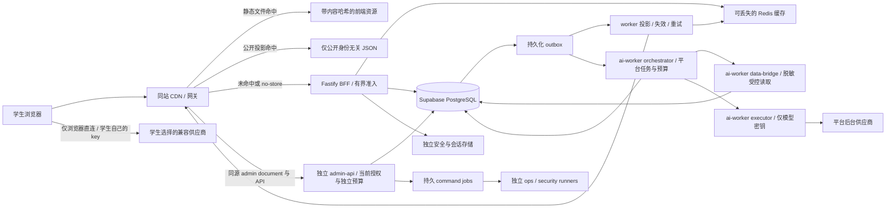

# 容量、性能与流量治理规划

> 状态：待实现、待压测的设计目标。本文中的流量、时延、配额和故障恢复数值均不是已验证容量或供应商承诺。适用产品为教师评分与课程查询；基础架构见 [系统架构](02-system-architecture.md)，运行方式见 [部署与运维](09-deployment-and-operations.md)。管理界面统一在 `apps/web` 同源 `/admin` 工作区，权限见 [管理工作区](14-admin-workspace-and-security.md)；学生资格按 [匿名认证](15-anonymous-student-verification.md) 处理，禁止真实学校账号原文落盘。AI 容量分为 [学生浏览器 BYOK](12-student-byok-ai.md) 与 [平台后台分析](13-platform-ai-analysis.md)，两者不共享模型调用链、队列、密钥和费用预算；职责总纲见 [AI 设计](07-ai-query-and-filtering.md)。

## 1. 先定义负载，再决定规格

10,000 名在线学生不等于 10,000 个同时执行的请求。浏览停留、分页、重复查询和选课时段集中访问会产生不同的请求模型。使用 `并发中的请求数 ≈ 每秒请求数 × 平均请求耗时（秒）` 估算稳态请求占用；该关系只用于容量分析，不替代对尾部时延、突发和连接占用的测试。

首轮规划使用以下假设，数据规模及学校数量需在导入样本后修订：

| 负载 | 首轮验证目标 | 约束与解释 |
| --- | --- | --- |
| 在线用户 | 10,000 名 | 活跃会话/页面连接指标，不作为数据库连接数 |
| 公开 GET 持续流量 | 2,000 RPS，持续 15 分钟 | 教师/课程公开投影，经真实 CDN 路径；排除静态资源 |
| 公开 GET 突发流量 | 5,000 RPS，持续 60 秒 | 验证边缘命中与限流，不假设这些请求全部进入数据库 |
| 普通业务写入 | 50 RPS，持续 15 分钟 | 已验证学生提交评价等合法混合负载；重复提交、审核分别统计 |
| 管理混合负载 | 起始场景为 20 个管理员会话、管理 GET 50 RPS、命令提交 10 RPS，15 分钟 | 待测假设；同时叠加公共 GET 2,000 RPS。命令返回持久任务接收结果，不等于外部恢复/部署等操作已完成；所有操作按 capability+学校 scope 独立准入 |
| 学生匿名认证 | 独立 verifier/issuer/去重账本容量场景，启用前确认可信 issuer 配额 | 不沿用公开 GET RPS；按平台会话、来源网络、school/issuer 和验证成本分别有界准入，raw 不可入队等候或以落盘缓冲换吞吐 |
| 每日缓存同步 | 后端每天一个公开目录快照计划槽位，默认Asia/Shanghai 03:00 | 服务商待选；导出/上传有独立DB连接、IO/出网、条数/字节与deadline预算，多副本/重试不重复激活；不把评分/安全状态放日快照 |
| 学生 AI 数据 API | search/evidence/validate 单独压测与限流 | 只接收有界 DSL、公开对象和证据 manifest，不调用模型；按学生、路由、查询成本及全局 DB 预算计量，不包含在公开 GET 缓存命中结果中 |
| 学生浏览器模型请求 | 不设本站模型并发承诺 | 浏览器直连学生所选供应商；本站没有代理、模型持久 job、模型 SSE、学生模型费用预留或计费对账 |
| 平台后台模型执行 | 全局同时执行上限 20 | 仅跨全部 `apps/ai-worker` 累计；实际取平台供应商并发、RPM、TPM、余额与平台预算允许值中的更小值 |
| 平台 AI 调度器短等待 | 最多 20 个等待执行槽位的任务，单次等待 ≤ 2 秒 | 仅约束派发器的短等待；拿不到槽位即回到有界、可观测的持久待调度状态并退避，不把数据库积压变成无界内存队列 |

上述 GET 目标对应以目录、结构化筛选与评分聚合为主的公开访问。评价正文、个人记录、管理员操作、学生 AI 数据 API 和平台总结读取必须单独设场景，不能将其性能混入高命中率的公开目录结果，宣称所有接口都可达到 5,000 RPS。每次报告写明热度分布、CDN/Redis 命中率、学校/学期维度、读写比例、正文/派生总结流量占比及数据库实际 QPS。学生的供应商 HTTP 流量不经过本站，不能计入本站吞吐，也不能由本站的 RPS 反推其模型费用。

容量报告至少记录：数据行数和索引大小、机器规格、副本数、运行时版本、数据库/连接池实配上限、网络区域、压测生成器配置、提交版本和数据快照版本。未获得供应商实际配额时，不填猜测值、不发布容量保证。

## 2. SLI、SLO 与测量口径

| 指标 | 设计目标 | 测量边界 |
| --- | --- | --- |
| 公共 GET 月可用性 | ≥ 99.9% | 从部署服务区域内的真实边缘入口观测；按有效请求成功率计算，同时配置外部合成探测 |
| 公开列表 API 时延 | p95 ≤ 300 ms，p99 ≤ 800 ms | 区域客户端从发送请求到收到完整 JSON；包含 CDN、网关、BFF 和后端，排除 DNS/TLS 首次建立与页面渲染 |
| 普通写入时延 | p95 ≤ 800 ms | 从发送请求到持久化事务提交并返回；后续人工审核与投影发布单独计时 |
| 管理查询 / 异步命令受理 | 起始 p95 ≤ 800 ms / ≤ 800 ms | 经当前管理员 gate、capability+scope 与 CSRF/intent 校验后，至查询返回/持久 command job 提交；后台实际执行、预览/二次认证及双人流程另计，不使用“已受理”冒充完成 |
| 平台 AI 派发器短等待 | ≤ 2 秒 | 仅派发器尝试取得执行槽位的等待；持久 job 等待另以最老任务年龄和积压衡量 |
| 平台 AI 供应商首 token / 单次生成执行 | ≤ 8 秒 / ≤ 45 秒 | 仅 `apps/ai-worker` 生成阶段内部指标；不包括持久积压，不是学生页面等待时限，超时按平台任务取消/记账规则处理 |
| 平台教师总结生成 | 公开 scope 变化后 p95 ≤ 15 分钟 | 至通过自动门禁的有效结果可用，包含 outbox/持久积压/生成；需人工的争议 case 单列，不以 15 分钟窗口继续展示旧总结 |
| 平台指定评价修订分析 | 有效修订提交后 p95 ≤ 5 分钟 | 至可供审核员参考的分析，不包含评价人工审核等待；旧修订结果不能用于新修订，不阻塞学生提交或替代人工审发 |
| 常规目录/评分聚合投影新鲜度 | p95 ≤ 30 秒，最大允许陈旧 60 秒 | 从业务事务提交到公开投影可见；超过阈值告警并暴露更新时间，不用于正文可见性授权 |

有效公共请求为格式合法、访问存在的公开路由、在发布容量范围内的非攻击请求。其 5xx、网络失败、超时、非预期 4xx，以及系统过载造成的 429/503 都计为不可用。无效参数、明确不存在资源、已识别攻击和用户自行超过个人配额可从可用性分母排除，但必须分别计数并披露规则。系统性限流不能事后标成“用户配额”规避错误预算。公共路由错误泄露私有字段即安全失败，即使 HTTP 200 也不能视为合格。

分开报告“成功请求时延”和“所有已发请求时延”，防止快速失败拉低时延。达到负载但大量返回 429 不算达到可用性目标。月度请求 SLO 与合成探测的时间可用性分别展示；99.9% 不能直接推出所有接口或整月每分钟都有相同体验。

学生 BYOK 的模型时延、可用性、取消与费用由学生设备、网络、模型及供应商决定，不属于本站模型 SLO。本站只为三个受限数据 API 定义可用性、响应时延、身份/权限与成本保护；浏览器建议只保留一个活动编排、限制输入/输出和显式重试，但恶意浏览器可绕过这些前端限制，本站不能硬控它直接向供应商发请求。

平台 AI 的时延/新鲜度是待验证目标，供应商选型、网络实测和配额确认后才能转为发布门槛。供应商失败、拒绝、取消、预算不足、输出不合规和成功应有独立终态。预算不足可以延迟生成或显示“暂无有效总结”，不影响原始评分与普通查询。

后台容量还必须证明队列稳定：`λ_ai = 唯一有效修订任务率 + 合并后的教师总结任务率`，`μ_ai ≈ 可用执行槽 / 实测平均执行秒数`，长期需要λ_ai低于含余量的μ_ai并满足token/费用预算。20个槽不能自动支撑50次/秒全部为新修订的写峰值；必须在这种最坏混合场景测积压年龄、合并率、过时任务丢弃和恢复。基础写入继续成功，AI可显示待分析，但不能宣称此时仍满足5/15分钟目标。新鲜度报告同时列出全部有效事件、已分析、待处理、预算延后、失败和人工例外，不能只对成功任务算p95隐藏积压。

## 3. 各层如何承担流量



### 3.1 缓存契约

所有数据库缓存的策略、键、TTL、刷新/失效及服务商发布由后端cache-management统一控制，前端只有当前页渲染/请求去重状态，不维护数据库缓存或直连provider。下表的CDN/Redis均为后端控制的缓存层；每日服务商同步另按[16](16-backend-cache-and-daily-sync.md)发布白名单目录快照，不将当前查询新鲜度改成一天。

| 内容 | 策略 | 失效或异常时的行为 |
| --- | --- | --- |
| 带内容哈希的 JS/CSS/字体 | 长期公开缓存；发布后新文件名 | HTML 保持短缓存或重新验证；保留旧构建支持回滚 |
| `/api/v1/public/**` 中明确允许的教师/课程目录、评分聚合 | 身份无关投影；后端控制边缘TTL初始30秒、总体最多陈旧60秒；浏览器响应no-store | 仅在部署验证共享边缘缓存与浏览器不存分离后启用CDN，否则后端Redis/有界回源并重测；显式白名单/版本，不通配放行 |
| 评价正文及其详情/正文分页 | 首发 HTTP 采用 `Cache-Control: no-store`，不进入 CDN、Service Worker 或持久化浏览器缓存；内部可按精确 generation 使用短 TTL 缓存正文 | 每次返回前从主库确认当前可见性及内容版本；确认失败则拒绝返回，旧 Redis/读副本不能证明内容仍可见 |
| 平台教师 AI 总结 | 独立接口 `no-store`；不内嵌教师目录、评分摘要或任何 CDN 可缓存 DTO | 每次从主库验证完整输入证据 manifest、generation 与 teacherSummaryEpoch；不一致立即拒绝旧总结，不能 stale 放行 |
| `/me`、`/admin`、`/auth`、`/ai` | `Cache-Control: no-store`，CDN 强制绕过 | 依赖故障按安全规则关闭相关能力 |
| `/admin` document、管理 DTO、预览/intent/command 状态 | 后端当前管理员 gate 后返回 `admin.html`；私有响应均 `no-store`，不预取/离线缓存 | 管理入口是同站完整 document 导航，不能复用普通 SPA document 的 BYOK CSP；缓存与 bundle 是否可取不决定授权 |
| 学生认证入口/callback/短期断言 | 全链路 `no-store`；raw 只在独立 verifier 内存暂态处理，不进缓存、Service Worker、持久队列或临时文件 | 从入口/代理即禁原始 URL query、body、callback code、header/trace 采集及请求体落盘；issuer/账本/KMS 状态不明时关闭新认证，不能降级为自填学号 |
| Redis 查询缓存 | 有界容量、短 TTL、随机抖动；仅存批准的公开 DTO | 可全部删除重建；不作为业务提交成功或内容仍可见的证据 |
| 服务商每日目录快照 | 后端每日导出并验证后激活一个私有不可变版本；只含获准目录字段，不含评分/正文/权限/registry；初始最大源数据年龄30小时 | 仅作预热，使用前证明当前版本并满足当前API新鲜度；超龄/版本未知不加载，有界回源或503，不能将重新上传时间当新鲜度 |
| 会话、风控计数、平台 AI 全局槽位 | 独立安全存储，使用独立实例/资源预算、凭证和故障策略；平台 AI 与学生数据 API 的计数命名空间/预算隔离 | 不允许被查询缓存驱逐；不可用时相关鉴权/写入/学生数据 API 或平台任务准入按依赖范围 fail closed |

学生页面配置的供应商、自己的 key 和模型名只用于当前页内的模型连接。key 仅存当前页内存，不进入本站 API、日志、分析、错误追踪、session replay、URL、Cookie、localStorage、sessionStorage、IndexedDB、Service Worker、缓存或服务端配置；离开/刷新后重新输入。学生模型结果默认仅页面内存，不跨用户共享、不上传本站持久化。供应商不支持所需浏览器 CORS 时提示不兼容；不使用 `no-cors`、本站 relay/代理或服务器 fallback。[浏览器 CORS](https://developer.mozilla.org/en-US/docs/Web/HTTP/Guides/CORS)、[Request.mode](https://developer.mozilla.org/en-US/docs/Web/API/Request/mode)

公开投影响应必须满足：结果不随用户身份改变、不读取 Cookie 中的身份、不含 `Set-Cookie`、个人标识、学生认证信息、权限状态或未审核内容。边缘在明确的公开路由上剥离 Cookie/Authorization 后再查缓存与转发；登录用户看到相同公开响应。`Vary: Cookie` 不能替代这项边界，也不能以拼入用户 ID 的方式把私有数据放入共享缓存。

缓存键采用版本化命名空间，包含允许列表中的规范化参数：学校、教师/课程 ID、学期、筛选、排序、游标、每页大小和 DTO/schema 版本。Redis/L1 可由受信任的投影指针选择含版本的 key；CDN 请求 key 基于路由和白名单参数，源站投影版本通过 ETag/表示元数据、失效 tag 和新鲜度期限管理，不假设 CDN 在命中前知道最新数据库版本，也不能信任客户端自报内部版本。拒绝未知参数；限制查询长度和组合数量；参数规范化后再限流及生成缓存键。响应中仅暴露适合公开的投影版本和更新时间。任意排序表达式、任意 SQL 字段、无上限全文条件和无限 offset 均不开放。

30/60 秒新鲜度预算覆盖“outbox 延迟 + 投影生成 + Redis + CDN”的总链路，不能每层各自续期 60 秒。投影携带可信的 snapshotAsOf/validUntil，下一层只能使用剩余预算；源投影已过期时重建或拒绝回源，不能用新缓存写入时间伪装成新数据。CDN 的 `stale-while-revalidate` / `stale-if-error` 不得越过 validUntil；若平台不能保证该上限，则不启用对应 stale 策略。

公开缓存响应不能带每次请求不同的 requestId 并在 CDN 命中时误报为本次追踪 ID。追踪 ID 应由边缘响应头生成或采用可区分的 originRequestId；共享 JSON envelope 中不能放登录态、用户特定诊断或动态权限。ETag/304 与完整 JSON 使用相同的可见性判断；正文不能通过旧 ETag 绕过撤回检查。

### 3.2 防击穿、冷启动与回源预算

- 热点键在 BFF 内使用 single-flight；跨实例可以使用短租约合并刷新，但抢锁失败不能无限等待。刷新失败时释放或等待租约过期。
- 普通公开目录可以在批准的 60 秒陈旧窗口内返回旧快照。无旧快照且回源额度耗尽时返回 503 和合理的 `Retry-After`；前端展示繁忙状态。
- 缓存未命中设置独立并发闸门和数据库预算。Redis 不可用时禁用全量穿透，优先服务仍有效的 CDN 内容，对剩余回源限量。
- 404 仅对确定不存在的公开 ID 做极短负缓存；不得缓存 401/403、5xx、数据库超时或权限判断异常。
- 热门学院、学期、教师首页可根据匿名聚合热度预热。预热任务有预算且低于交互流量优先级，禁止部署时一次扫描全库。
- 读重试最多一轮、仅限幂等且仍在请求 deadline 内，加入抖动；写入及 AI 调用不做透明重试。客户端、CDN 和 BFF 的重试预算合计核算，避免重试放大。

### 3.3 每日服务商同步的独立预算

后端cache-sync使用持久日槽位任务、租约/fence和固定版本输入，分批导出到服务商私有staging，完整manifest/摘要/抽样回读通过后条件切换active指针；失败保留安全且未超龄的已知好版本，不能原地覆盖活跃集合一半。默认每日03:00 Asia/Shanghai，一个scope/目标每天一次逻辑发布，同任务有限重试/补跑不重复发布。具体服务商与资源配额尚待选定，不能据此宣称已部署任务。

在压测中叠加日导出/上传，限制其DB连接/读取带宽、CPU、出网和最长运行时间，交互、撤权/撤稿控制优先；大数据使用固定版本物化导出避免长事务。元数据记录sourceAsOf/lastSuccessfulSyncAt/源水位，超限/漏跑/结果未知告警。30小时只限制可加载的日副本，当前API仍执行30/60秒目标和安全gate，版本无法证明即回源/拒绝。所有业务写入同步落DB，不能日终才把缓存写回。

## 4. 发布、撤回与一致性

发布/撤回事务同步更新业务状态、当前公开正文与 generation，并提交 outbox 事件；worker 在事务外更新目录/统计等允许最终一致的投影、完成缓存失效与 CDN purge，事件处理成功才确认。消费按至少一次设计，以事件 ID、聚合版本和唯一约束实现幂等；旧版本事件不能覆盖新投影。评分以每条评价的绝对贡献及版本原子更新，不能把重复/乱序事件简单处理为 `count + 1`；精确 sum/count 留在 core，公开投影只输出满足阈值的分数与允许的样本量信息。失败留在 PostgreSQL 并退避重试，达到次数进入待处理状态并告警。Redis 可以用于唤醒和临时调度，但不是唯一可靠队列。

单纯“删缓存再写数据库”会产生并发回填旧值的竞态。缓存值携带投影版本，更新与失效使用单调版本栅栏；请求回填前确认版本仍可用。CDN purge 的请求成功、全网传播、重试和抽样回读均需有证据，不能把发出请求等同于完成。

撤回/封禁涉及不同的一致性等级：

1. **评价正文与敏感内容：** 撤回事务先更新主库权威可见性和内容版本，同事务追加 outbox。提交后开始授权的新读取必须检查主库当前状态并拒绝旧版本；主库或可见性检查不可用时 fail closed，不能以旧 Redis/读副本降级返回旧正文。审核发布到正式可见也必须经过权威检查。
2. **缓存清理：** 同步尽力清理进程/Redis 缓存并触发 CDN purge，outbox 继续确保重试与收敛。平台分析上下文、搜索索引和备份恢复后的投影均纳入清理清单；清缓存不是正文安全的唯一控制。本站不能撤回已经由学生浏览器发送至其供应商的数据。
3. **目录与聚合：** 不包含正文、摘录、逐条评价内容或作者线索，不暴露可反推单条评价的精确内部统计。获准公开的分数与样本量信息允许上述有界最终一致性；产品需接受撤回后短时重算延迟。若某类数据要求立即下线，则将该路由退出共享缓存，通过主库权威检查服务，或先关闭该公开入口再清理。
4. **已发送数据：** 无法收回学生已读取、截图或外部缓存的数据。撤回承诺范围为事务提交后开始授权的新读取、重新验证及后续分页请求；提交前已授权的在途响应可能完成，不能宣称“互联网全量即时删除”。

前端撤回成功后清除本地 DTO/页面状态，重新请求列表；历史浏览器页面恢复时不能直接复用正文。学生 AI 从本站获取的始终是当前获准公开证据；模型解析/解释在浏览器完成。官方页面展示最终结果前调用 `/api/v1/ai/student/evidence/validate` 验证完整实际输入证据，验证失败丢弃结果；这不能约束恶意客户端，也不保证供应商已收数据被删除。本站不接收学生自己的 key、模型对话正文或模型输出，不为学生创建 job/SSE/预算预留。

平台分析单独处理受控指定评价修订，产出可解释置信等级/证据强度并保存于 `private.review_ai_assessments`，不能表述为真伪概率，不能改原评分、自动审发学生评价或按置信等级加权总分。待审修订仅经专用 reader 提供脱敏最小输入，学生 search/evidence/validate 永远读不到 pending。教师总结只使用当前 published 且满足至少 5 条有效样本的来源；`private.teacher_ai_summary_evidence` 保存完整依赖集合，包括模型输入、选样/过滤/计数及跨批中间步骤的全部依赖，不能只保存模型最终引用的几条。总结经应用代码校验 schema、来源、范围、文本安全和完整 manifest/epoch 后由受控命令自动公开；executor 没有数据库或发表权限。敏感争议、低证据输出转人工或拒绝，抽查不阻塞每条正常总结。

所有已发表来源集变化——新增、编辑替换、隐藏、撤回——均在同一事务同步提升对应 `teacherSummaryEpoch`，旧总结即刻标为 invalidated、不展示。发布总结和每次读取 `published.teacher_ai_summaries` 时从主库验证完整源集状态、generation、invalidation epoch、有效样本阈值、应用门禁状态与有效期，不匹配立即拒绝；普通新增也不放行旧总结 15 分钟。15 分钟仅为有效自动总结可用的后台 p95 目标，期间展示“生成中/暂无有效总结”，需人工处理的 case 单独展示。无数据变化不因轮询或 15 分钟窗口反复付费，但有效总结始终显示 generatedAt/dataAsOf，仍受 [平台分析有效期](13-platform-ai-analysis.md) 与主库 gate 约束。GET 不自动触发付费重跑，异步重新生成有平台预算与去重控制。

## 5. 数据库与查询预算

API 使用受限的自定义数据库角色，不使用 owner、`postgres`、`service_role` 或 `BYPASSRLS` 角色作为普通业务连接。普通 worker、平台 ai-worker、迁移和运维另有独立角色。业务 schema 不暴露给 Data API；不用的 Data API 关闭。多实例部署的连接方式必须先核验所选 Supabase 项目的连接、网络、TLS 和连接池模式能力。

应用连接池、服务端池和 PostgreSQL 后端连接是不同限制。Supabase 官方文档区分 client connections 与 backend connections，且多个 pooler 的后端连接会共同消耗数据库总数；不能将 pooler 可接入的客户端数当作数据库可执行查询数。[Supabase 连接池与限制](https://supabase.com/docs/guides/database/connecting-to-postgres/pooling-and-limits)

发布前填写以下预算表并纳入扩容配置检查：

```text
M = 数据库确认的总连接上限
R = Auth / 平台服务 / 运维 / 迁移 / 故障处理预留
B = M - R - 额外安全余量

C_app = API 最大副本数 × 每副本池上限
      + 管理 API 最大副本数 × 每副本池上限
      + worker 最大副本数 × 每副本池上限
      + ai-worker orchestrator 最大副本数 × 每副本池上限
      + ai-worker data-bridge 最大副本数 × 每副本池上限
      + ops runner 最大副本数 × 每副本受限连接上限
      + security runner 最大副本数 × 每副本受限连接上限
      + student-verifier 最大副本数 × 每副本受控 claim 连接上限
      + 其他应用客户端连接

直接模式：C_app 中直连部分 + 所有 pooler 的实际后端上限总和 ≤ B
池化模式：各 role/database/mode 的客户端需求分别满足其 client 上限；
          所有池对应的 backend 上限与直连总和仍 ≤ B

λ_db ≈ λ_public × (1 - H_cdn) × (1 - H_redis) × 每次未命中的查询数
     + λ_private × 每次请求查询数 + λ_write × 每次事务查询数
     + λ_student_ai_data × 每次受限数据API查询数
     + λ_admin × 每次管理查询/提交查询数 + λ_command_db + λ_worker + λ_platform_ai_db
```

命中率公式仅描述该次负载下的平均回源模型；需另算冷缓存时 `H=0`、热点长尾和查询合并的影响。连接需求还取决于事务持有时间，可用 `平均活跃事务 ≈ 事务到达率 × 平均事务时间` 做初估，再由 p95 池等待、锁等待和数据库 CPU/IO 验证。禁止通过无限增大池上限掩盖慢查询。

事务中仅做数据库工作，平台模型网络请求、外部 HTTP 和客户端思考时间不得占用数据库连接。学生模型连接不经过 BFF，也不占用本站连接池或 SSE 连接。连接复用时，可信用户/RLS 上下文在同一事务内设置并限定为事务级；不得依赖连接遗留的会话变量。启用事务池前验证驱动、预编译语句及 `SET LOCAL` 的实际行为，迁移和需要会话语义的工具使用单独连接模式。

查询要求：

- 列表采用稳定排序与游标分页，每页默认 20、上限 50，与 HTTP 契约一致；排序须包含唯一 ID 作为平局键。深 offset 不作为大列表主方案。
- 建立与真实过滤条件匹配的组合索引；对审核状态、学校、学期、教师、课程等维度基于 EXPLAIN 和样本分布验证。不要对每个字段盲目建索引。
- 教师评分聚合从受控投影读取，不在每次页面请求全表计算；聚合更新与重算任务可恢复、可校验。
- 筛选字段、排序、查询词长度、候选数和响应字节数有硬上限；禁止 `SELECT *`、N+1 查询、任意用户 SQL 和无限统计 count。
- 初始预算：列表 SQL statement timeout 500 ms、普通写事务 deadline 1 秒、池获取 100 ms；它们是待测上限而非时延承诺。API 总 deadline 仍需留出网络、序列化和取消清理余量。
- 取消请求时尝试取消对应 SQL，连接须在事务回滚后归还；不能仅关闭 HTTP 响应却留下后台长查询。

## 6. 准入、限流与过载时的取舍

限流分层执行：边缘按可信来源 IP/网络特征抑制粗粒度滥用；公开 BFF 路由按全局、路由、学校和查询复杂度计数，不能在身份无关缓存路径假设可取得学生 ID；私有路由按会话、已验证学生 ID 与行为计数；数据库以唯一约束、幂等记录和事务限制保证写入不重复。校园 NAT 可能让大量学生共享 IP，故按校园共享出口实测设置策略，IP 不作为单个人的唯一判据。代理来源头仅信任部署链中明确配置的网关。

首发需具备全局上限、每用户上限、并发上限、响应大小上限及有界队列。具体每用户频率应由可用性测试与公平使用规则确定并版本化，避免在文档中将任意示例频率变成隐含产品承诺。

| 压力来源 | 优先保护 | 行为 |
| --- | --- | --- |
| 短时公共读突发 | 静态资源与已批准的有效公开投影 | 边缘命中、合并回源、限制长尾与冷缓存回源 |
| 数据库变慢或连接将满 | 已在执行的短事务与正文可见性检查 | 减少新请求准入，暂停重算/导入等后台任务，快速 503，保持有界等待 |
| 查询缓存 Redis 故障 | 数据库不会被直通压垮 | 使用仍有效的公开 CDN；限制回源并逐步恢复缓存 |
| 安全/session Redis 故障 | 身份、写安全、学生数据 API 与平台准入边界 | 按依赖范围拒绝私有操作/新平台任务；不能改为匿名放行或进程内不限量；不宣称能中止学生已直连的供应商请求 |
| 学生供应商慢、CORS 不兼容或额度耗尽 | 本站普通查询与受限数据 API | 页面停止相应编排并提示兼容性/供应商错误，保留普通筛选；无本站代理或付费兜底 |
| 平台分析供应商慢或额度耗尽 | 普通查询、写入与学生数据 API | 仅暂停平台模型派发、熔断其供应商；失效总结显示暂无，评分不变 |
| worker 积压 | 用户交互与已批准内容 | 限制任务并行，按撤回失效优先、普通投影其次、全量重算最低优先级执行 |
| ai-worker 积压 | 撤回安全与基础查询 | 合并同教师/同版本重复任务、丢弃已过时生成、按预算调度；独立于普通 worker 队列，积压不能阻止同步 epoch 失效 |
| 管理轮询、导出、预览或运维命令突增 | 普通学生查询及撤销/停用控制 | 管理 API 独立池/准入，管理列表有界分页、可见页低频轮询；批量命令独立队列与并发，撤销/kill 控制不排在批任务或模型费用核对之后 |

临时过载只可影响功能和新鲜度，不能降低认证、操作所需匿名学生 grant、CSRF、RLS、审核/撤回检查。首版 grant 证明“验证时符合学生条件”，不宣称当前仍在校、不自动过期或续证重领；撤销学生 grant 后仍按本人平台控制权保留撤回/申诉，不能把所有写入都当作必须是学生。数据库状态不可确认时不得回旧正文、沿用过期管理升权或跳过资格检查。

### 6.1 管理工作区的资源与安全预算

管理 UI 位于同一 `apps/web` 站点，但 `/api/v1/admin/**` 由入口分流到仅内网可达的独立 admin-api。普通 API 不注册管理路由、不持管理或 runner 凭据。管理 API 的连接、CPU、响应大小、列表页数、导出行数与并发额度单独配置；不能因管理员“可信”而解除所有查询成本限制。用户权限组固定且仅有 `system_admin` 系统管理员、`content_admin` 内容管理员、`verified_student` 学生（认证）、`user` 用户、`guest` 游客；职责、capability、scope 和 runner 工作负载身份不是额外用户组。

`system_admin` 在明确 capability/scope 下管理系统、授权、数据导入、AI 配置/预算和运维；`content_admin` 仅管理内容审核、举报、申诉、置信报告与总结治理，不持秘密替换、授权、恢复/发布等系统能力。保留最后有效 system_admin 的并发保护，初始化至少两名独立 system_admin 支持具体高敏双人复核。两类管理员均不自动获得学生资格，学生专属动作必须单独校验当前匿名学生 grant，不能以大 `isAdmin` 绕过资格、配额或授权。

管理面板默认只在可见页面轮询，起始间隔不短于 10 秒、加抖动；切页/退出/撤销即停止轮询并清理 DTO。管理查询默认 20 条、上限 50，与契约一致；下载/导出不能一次把无限结果加载浏览器。大批导入、导出、备份、恢复、投影重建、部署回滚与模型重算均通过预定义 command job 返回受控进度，不在 HTTP 请求中长事务执行。

初始限制为每个管理员同类高成本任务最多 1 个活动任务，恢复/发布切换等相互冲突的操作按环境/目标互斥；每种 runner 的全局并发、待执行数量、到期时间、最大影响对象与外部成本额度在开启该能力前填写，不允许无限队列。超过配额返回明确 busy/429，已提交 job 不通过重试重复创建。安全停用、角色撤销、kill 开关拥有独立保留预算/控制通道，主库提交即时生效；不等待普通队列、清缓存传播或未知模型费用核对完成。

低风险短事务管理动作走固定领域 route，仍做 capability/scope、CSRF、expectedVersion/幂等校验与审计。高影响命令先做站内预览，再生成短期 intent，绑定 actor、action、目标版本/摘要、scope 和当前认证状态；仅具体高风险动作按策略需要独立第二人。admin-api 提交与 runner 执行/条件提交前均重查当前权限、角色版本、sessionEpoch、intent 与目标版本，租约或已排队状态不是授权。超过认证新鲜度或必要复核有效期进入 `needs_reauthorization`，由站内重新认证/确认，不能借 runner 权限继续。撤销后未执行任务停止，已发生外部副作用/费用不能假装回滚；未知调用继续保守占用预算并对账，不阻塞撤销本身。

`/admin` 必须完整 document 导航到同工程独立 `admin.html`，HTML 在当前管理员 gate 之后返回，管理 CSP `connect-src 'self'` 不包含 BYOK origin；进入前 abort 学生模型请求、清除 key/旧响应。冷加载、刷新与浏览器返回均需验证该边界，不能通过 SPA 切路由声称 HTTP 安全头已经收紧。两枚同源 `__Host-sc_session` / `__Host-sc_admin` Cookie 都为 host-only、`Path=/`，不形成 XSS 隔离：同源恶意脚本仍可能携带管理员凭据发请求。资源隔离与 CSP 不能替代管理员 CSRF、当前主库 capability+scope、短时升权与高影响 intent。

### 6.2 匿名学生认证的准入、查重与恢复门槛

平台登录只标识独立 platform account；学生 proof 来自可信 school/issuer，不接受自填学号/姓名/email 获资格，校园 SSO 不进平台 Supabase Auth/`auth.identities`。`apps/student-verifier` 仅内存处理 raw、内部短期断言不泄给普通 API；认证前 challenge 无校园身份。受控单 PostgreSQL 事务原子完成 challenge 校验/消费、UNIQUE tag 插入与平台 grant 创建，不先烧 tag 再异步发领取票据。`private.student_grants` 只含平台账号/随机 grant ID、scope、验证策略/级别、active/revoked 状态与版本，无 tag/校园信息；初版仅证明验证时为学生，不自动过期/续证、不宣称当前在校。协议以 [15](15-anonymous-student-verification.md) 为准，不另设领取细节。

去重用隔离 verifier 的 keyed HMAC-SHA256，对 [15](15-anonymous-student-verification.md) 固定的域、学校、canonical identity namespace、稳定 subject 做长度前缀编码；多 issuer 必须统一权威 namespace/稳定身份，不以可切换 issuer 另加盐绕过。`dedup.student_claim_tags` 仅有 `(key_version, tag)`，keyring 控制另在 `dedup.student_keyring_registry`；与 app/grant 无持久业务 join，不存 appUserId、grantId、claimId、challengeId、认证时间/IP 或 trace，不把 tag/digest 写用户/资格表、日志/admin DTO。删除账号或撤销 grant 不删 tag/tombstone，不能借注销再领。tag 是 pseudonym，同事务 WAL/xmin/物理备份/时序与完整服务失陷仍可能关联，不能宣称绝对匿名或密码学不可关联。

限流分层：普通平台入口可按 app 会话/网络计数，verifier 按 school/issuer/全局成本和短时不可持久关联的滥用信号保护；不记录原始校园 ID、tag、callback code 或把 app ID 与 tag 带进同一限流键/遥测。校园 NAT 仍需公平预算；查重失败响应、配额与耗时不提供任意身份是否已认证的公开枚举接口。签名校验、proof 时效、KMS/HMAC 和账本查询/提交均有 deadline/并发上限，过载快速失败，不能排队持久化 raw 或跳过验证。

所有保留 HMAC key 候选都检查，轮换/claim 在 [15](15-anonymous-student-verification.md) 的单事务协议下锁 keyringGeneration 并线性化；`UNIQUE(key_version,tag)` 不能替代完整协议。历史 KMS key 保留、不清表重计，未存 raw 不能简单重算旧 tag。verifier 独立连接/CPU 预算，dedup schema 逻辑隔离但初版 claim 与 grant 在同 PostgreSQL 事务，连接计入数据库总预算；不能擅自拆成先消费后发券或未证明的跨库补偿。提交前失败全部回滚，提交后响应丢失由同平台账号查自己的 grant 恢复，不再登录学校/换账号重领。

去重账本的恢复安全要求严于普通业务 RPO：任何已确认认证所消耗的 tag/tombstone 都不能因恢复丢失后继续接受新认证。备份/持久日志需有可证明的完整恢复水位，未确认写入的处理与平台 grant 一致性依 [15](15-anonymous-student-verification.md)；不能仅凭“业务 RPO≤15 分钟”容忍恢复后重复领取。只要恢复缺新 tag、tag 账本水位/历史 key 集合不完整、KMS 不可用/密钥丢失或协议状态不明，关闭新认证并告警；不清表、重置额度或用管理员口头确认绕过。普通公开查询与已知有效 grant 的范围另按其安全状态恢复。

零落盘须通过可验证部署控制：认证入口关闭代理/body 缓冲临时文件、访问日志 query、APM/trace body/header、错误序列化、session replay、采样与 core/heap dumps；禁止 swap/休眠/容器快照将 raw 内存持久化，平台不能满足则不启用该认证路径。raw 学校账号/姓名/email/凭据/subject/token/证明材料不进 DB、缓存、消息队列、对象、备份或支持附件。测试用合成哨兵覆盖成功、异常、超时、崩溃、重试、恢复和轮换，查验每条持久化/遥测出口，而不是只搜业务数据库。

学生链路仅开放 `/api/v1/ai/student/search`、`/api/v1/ai/student/evidence`、`/api/v1/ai/student/evidence/validate`，均为有身份、有对象权限、有参数/响应大小上限、有自己的 API 限流的短请求。DSL 必须后端重新验证，不能因浏览器已做 schema 校验而信任。key、供应商 endpoint、模型名、原始对话或模型输出不属于这些 API 的契约；拒绝额外字段且不记录原始请求体。本站保护的是自身数据与容量，学生模型调用由供应商直接结算；页面 abort 只做尽力中断，本站无法取消、保证费用、对账或替恶意浏览器硬控供应商并发。

以下费用与执行控制**只适用于平台后台分析**：数据库在 `private.platform_ai_jobs` 与 `private.platform_ai_budget_reservations` 原子创建平台 job/预留最坏成本。`apps/ai-worker` 同一构建产物以三种隔离运行模式部署：orchestrator 管理 job、预算与跨副本槽位；data-bridge 用受控 reader 读取/脱敏指定修订与公开证据；executor 只持平台模型密钥、没有数据库/Redis 凭据，只接收已授权有界模型任务。普通 `apps/worker` 不持模型密钥、不消费模型队列、不分摊平台生成并发。平台任务队列按教师/修订/输入版本去重并有存量上限、优先级、有效期与补扫，超出预算延迟生成而不是无限堆积。

平台生成的 45 秒执行 deadline、管理员取消或部署排空触发持久取消标记及上游取消。任务租约与供应商在途容量分离：租约到期不释放未知上游占用，须确认供应商终态或达到经验证的硬执行/取消时限；否则保守占槽并停止新准入、进入对账。平台协调存储重建先从持久在途账本恢复占用，不能空计数启动。费用预留仅在获得明确用量或确认未发生调用时结算/释放，结果不明保守记账。调用结果未知不得因任务重领透明重复调用。后台分析优先选低成本模型、合并教师刷新、跳过旧版本并限制每个修订/教师版本的付费尝试，不自动审核/发表学生评价、不改变原评分及总分算法。

## 7. 压测设计与验收

采用 k6 的 `constant-arrival-rate` / `ramping-arrival-rate` 等开放到达率模型。每次迭代尽量对应一个明确 HTTP 操作，避免把迭代速率误报成 RPS；多请求迭代需同时报告两者。预分配足够 VU 并监控生成器 CPU、网络与内存。k6 的 `dropped_iterations` 表示预期迭代未启动，必须报告、分析，并纳入容量验收，不可从请求失败率中静默消失。[开放到达率执行器](https://grafana.com/docs/k6/latest/using-k6/scenarios/executors/constant-arrival-rate/)、[丢失迭代说明](https://grafana.com/docs/k6/latest/using-k6/scenarios/concepts/dropped-iterations/)

| 场景 | 方法 | 验收关注 |
| --- | --- | --- |
| 热缓存持续负载 | 经边缘 2,000 RPS × 15 分钟，稳定热度与分页分布 | 所定 SLO、实际命中率、边缘/源站分别计数 |
| 选课突发 | 5,000 RPS × 60 秒，包含热点教师与长尾 | 无池耗尽、队列有界、错误率及恢复时间；明确限流造成的损失 |
| 完全冷缓存 | 清除测试环境 CDN/缓存，渐进提升到安全回源上限 | 回源准入生效，数据库不崩溃；记录可服务容量，不要求照搬热缓存 RPS |
| 每日缓存发布 | 多副本/跨日漏跑/任务重试、导出与峰值叠加、分片坏/上传unknown/激活失败/旧fence/超龄 | 一个日槽位、一致版本完整激活，无半包/旧任务覆盖；后台资源有界、不突破当前新鲜度，源时间不续新 |
| 混合读写 | 公共读 + 50 RPS 合法写 + 审核/撤回 | 幂等性、锁等待、读写隔离、投影延迟、写尾部时延 |
| 高基数搜索 | 不重复筛选、最大允许词长、分页、畸形参数 | 缓存键有界、查询成本有界、未知参数拒绝 |
| Redis 故障 | 分别断查询缓存和安全存储 | 前者限量回源，后者按范围 fail closed；两者不能混为相同降级 |
| DB 慢/不可用 | 延迟、锁等待、池耗尽、连接断开注入 | deadline、取消、熔断、正文拒绝、后台任务暂停 |
| worker 重复/停机 | 重投 outbox、乱序、处理到一半重启 | 不丢事件、不重复副作用、旧版不覆盖新版、积压可观测 |
| 撤回竞态 | 请求与撤回交错、旧 ETag、进程旧缓存、CDN 失效失败 | 新请求不能获取旧正文；投影与失效可重试；验证具体一致性承诺 |
| 学生数据 API 压力 | 并发 search/evidence/validate、高成本 DSL、伪造 manifest、试读 pending | 身份与对象边界、独立限流、DB 预算、响应大小有界；不因读请求创建模型 job 或平台费用 |
| 学生浏览器直连 | 独立 mock origin 模拟 CORS、预检拒绝、慢流、断线、取消 | 网络请求只去学生选定兼容供应商；key 只在当前页内存，本站请求/存储/遥测中为零；不出现 relay/no-cors fallback |
| 平台后台 AI 压力 | provider stub 模拟积压、慢流、超额、取消、未知调用结果 | 仅平台全局最多 20（或实际更低）、派发短等有界、普通读/worker 不受拖累、平台预算不超支 |
| 派生总结撤回 | 撤回一条未被模型显式引用但实际输入的评价，打乱生成/失效次序 | 完整 source set 与 epoch gate 拒绝旧总结；旧 ai-worker 不能覆盖新版本，不自动付费重跑；原评分规则不受分析置信等级影响 |
| 管理混合/命令压力 | 与公开 2,000 RPS 叠加管理列表/轮询/导出预览/command，注入 runner 慢或停机 | 管理池/队列有界，不侵占公开读预留；撤销/kill 不等待积压，command 重试不重复副作用，受理与完成分开计时 |
| 管理冷加载与 CSP | 普通站 BYOK 活动时完整导航 `/admin`，直接请求 document、浏览器返回、多标签页和过期升权 | 后端 gate 先于 admin.html，正确管理 CSP，清 key/旧响应；无菜单不当授权，学生猜路径/下载 bundle 不得到管理数据 |
| 撤销与回滚竞态 | job 排队后撤销角色/降权/退出、执行前目标变更，随后回滚应用 | 当前权限/版本/epoch 重查拒绝，旧 intent 和 Cookie 不复活；回滚不能回退安全状态或重开已关闭能力 |
| 五组权限与学生 grant | 五类权限组交叉访问、content_admin 访问系统操作、管理员无学生 grant、并发移除最后 system_admin | 系统/内容边界、细 capability+scope 与独立学生资格有效；无第六用户组或恢复旧 owner 全权模板 |
| 匿名认证压力/并发 | 合成可信 issuer proof、同一 canonicalStableId 的并发跨账号/轮换版本请求、重复/超时/崩溃 | 有界准入、不泄 raw、atomic UNIQUE/领取协议只允许一次，不因失败补偿或轮换重复发 grant；报告实际完成/失败/待核验分母 |
| 零原文落盘 | 合成学校账号/姓名/email/SSO subject/token/callback 哨兵，覆盖异常与 crash | DB/日志/APM/trace/缓存/SW/临时文件/队列/对象/备份/dump 均无原文；tag 账本无 app/claim/time/IP join，管理 DTO 无 tag/digest |
| 去重灾难恢复 | 恢复旧账本、缺近期 tombstone、缺一个历史 KMS key、轮换中断 | 新认证 fail closed，不清表重置；确认完整去重水位与历史版本后才恢复；raw 不在恢复/备份材料中 |
| 长稳运行 | 以实测安全容量执行数小时 soak | 内存/句柄/连接泄漏、租约残留、队列漂移、缓存增长 |

模型大规模负载使用测试 stub：学生直连测试在独立 mock origin 验证真实 CORS 路径；平台压力测试使用受控供应商 stub。真实平台调用只做已核定平台预算的代表性验证；学生直连兼容性验证使用测试专用 key，仅当前页内存，不要求学生提供真实 key 给站点/运维。报告不能将 stub 首 token 表现等同于真实供应商。压测不得冲击参考项目、生产数据库或第三方未授权端点。

容量验收至少包含三组分母：计划到达请求数、实际发出请求数、业务成功数。报告 `dropped_iterations / 计划迭代数`、`失败请求 / 已发请求`、`成功请求 / 计划请求数`，同时列出超时、429、503 和客户端取消数量。正常持续目标下生成器丢迭代应为 0；若非 0，先定位生成器或系统瓶颈，不能宣布达标。限流/过载故障实验可有失败，但其目的为验证保护与恢复，不替代正常负载容量验收。

## 8. 成本模型与发布门槛

成本以实际计量项填表，不预设供应商免费额度、单价和模型价格：

```text
月成本 = 静态/CDN 请求与出网
       + API/admin-api/worker/ai-worker/command-runner 运行资源与网络
       + 数据库计算/磁盘/备份/PITR/连接相关增项
       + 查询缓存 + 安全会话存储
       + 平台后台 AI 输入 token × 输入单价 + 输出 token × 输出单价
       + 平台登录邮件/可信issuer验证/verifier/KMS/去重账本持久保护
       + 可观测性/安全日志/允许对象备份等实际使用项

平台 AI 预算上界 = 接受的后台任务数 × 每任务最大允许输入输出成本
学生模型账单 = 学生与其供应商直接结算，不进入本站预算、reservation 或对账
CDN 回源预算 = 请求量 × 实测未命中率 × 平均响应字节数
```

积分系统已正式取消，不配置奖励/扣减/消费或积分预算。取消积分不取消平台供应商成本控制：平台后台 AI 仍设置日/月预算、接近预算告警、硬停止阈值、用量对账和异常流量告警。金额未知时平台 AI 保持关闭，不以“无限”作为上线默认值；预算不足先暂停平台模型任务和非必要重算，已批准基本查询与学生受限数据 API 保留独立容量预算。本站不估算或承诺学生私有 key 的供应商最终账单。

上线前必须完成：真实路径热/冷缓存与连接预算、正文/派生总结撤回、安全存储故障、管理/五组权限与独立 grant、学生 BYOK 零 key 回传/存储/遥测及 CORS、平台任务成本控制、匿名认证零原文落盘与并发领取/历史 key 轮换/无丢 tag 恢复演练，并测算实际平台成本。流量、SLO 或恢复目标未达成时记录可验证发布容量并调整范围；不只增加副本直到数据库失守。匿名查重安全未被证明时认证入口保持关闭，不以普通业务容量达标替代。
