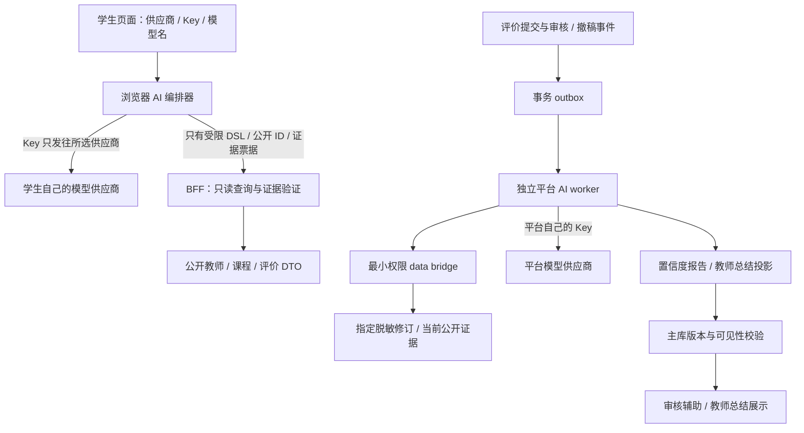

# AI 分层架构与职责总纲

状态：设计基线 v0.4，2026-10-18，尚未实施。学生自带模型与平台后台分析分离，学生模型**仅由浏览器直连供应商**。AI管理同站/admin按五组边界授权，学生数据接口另验独立active grant，见[15](15-anonymous-student-verification.md)。

## 1. 两条互不代用的 AI 链路

| 项目 | 学生自带模型（BYOK） | 平台分析 AI |
| --- | --- | --- |
| 目的 | 自然语言教师/课程查询、条件筛选、候选解释 | 学生评价置信度辅助分析、教师教学评价总结 |
| 配置者 | 学生在页面选择供应商、填 Key 和模型名 | 平台维护受控供应商、密钥、模型与提示词版本 |
| 执行地点 | 浏览器内编排，直接 HTTPS 调用供应商 | 独立 `apps/ai-worker`，异步后台执行 |
| Key 边界 | 只存在当前页面内存，本站服务器不接收 | 平台秘密管理设施，只有平台模型执行部署可读取 |
| 数据入口 | BFF 受控只读 search/evidence/validate，限公开 DTO | 受控 data bridge 读取指定脱敏修订或当前公开证据 |
| 状态/费用 | 页面临时状态，供应商直接向学生计费 | 持久任务、独立预算预留与用量对账 |
| 结果性质 | 学生模型生成的个人查询辅助，不进入平台公共结论 | 有版本、来源、失效和审核约束的分析投影 |
| 失败处理 | 留在普通查询；不回退为本站模型/代理 | 分析状态待处理或总结暂不可用，普通查询/原始评价继续 |

**积分系统正式取消。** 不存在积分账户、签到奖励、评价奖励、AI 扣积分、充值或“余额不足”路径。平台成本预算是运营保护，学生供应商账单是外部费用，两者都不是站内积分。

## 2. 系统拓扑

图中没有学生Key发给BFF或学生模型读待审内容的边。供应商即使相同，也不共享身份、Key、任务、账本或数据权限。只有独立平台Auth访问/刷新令牌由BFF保管；校园proof/subject/token仅专用verifier内存处理，不进入BFF或Supabase身份。学生模型Key另属当前页内存凭据。

## 3. 学生模型的能力边界

页面支持供应商注册表选择、密码型 Key 输入和模型名输入；显示实际 HTTPS 目标 origin、模型和将外发的数据类别。Key 不进入 localStorage、sessionStorage、IndexedDB、Cookie、URL、日志、埋点、错误上报、服务器请求或 Service Worker 缓存。退出、清除配置、离开页面或页面销毁时清理引用；JavaScript 无法保证物理内存擦除，不作此承诺。

浏览器两类 transport 严格分离：本站客户端仅携应用会话/CSRF，供应商客户端只向注册表固定目标发送学生 Key，并使用 `credentials: omit`。供应商必须支持目标站点的 CORS/预检与所需 header；不兼容时停止调用并提示更换供应商，不通过本站/第三方代理，不用 `no-cors` 或关闭浏览器安全策略绕过。[MDN CORS](https://developer.mozilla.org/en-US/docs/Web/HTTP/Guides/CORS)

模型先生成受限 DSL，服务端重新验证学校、课程、学期、筛选、排序、数量和对象权限，再返回确定性候选与最小公开证据。解释由学生模型生成，显示为“你的模型生成”。本站证据验证只证明引用仍公开、ID/版本/数值可匹配，不认证自由文本事实正确性；模型不能执行 SQL、任意 URL、审核或发布操作。

search/evidence/validate每次要求独立active、未撤销且scope满足的学生grant，管理员同样适用；组名或部署配置不能代替grant。grant仅证明首次验证时学生，无自动到期/续证/换绑。游客/普通用户仍可基础公开查询；平台不能阻止用户自行在站外调用自己的模型。

浏览器可显示进度；最终解释在引用与当前公开状态检查通过后展示。没有学生服务端 AI job、结果存储、平台费用预留或本站 SSE。用户取消是本地 AbortController 与停止后续步骤，不保证供应商立即停算/停费；断线后不透明重试付费请求。详细页面状态、协议与验收见 [12 学生自带模型](12-student-byok-ai.md)。

## 4. 平台分析的能力边界

平台 AI 通过独立受控数据桥分析指定评价修订：评价内容的具体性、课程情境、内部一致性、证据充分度和疑似滥用信号。结果包含置信等级、理由、限制、模型/提示词版本与证据片段。没有外部核验时不能把等级称为“真实概率”，不因为负面评价、文字短或表达方式给作者贴标签。

平台分析、总结治理、模型/策略/预算、学生供应商registry启停与平台Key轮换均接入同站/admin对应面板，按具体capability+scope管理。学生Key不可被管理员读取/收集；平台Key只写轮换/引用状态，不向前端GET回显。管理document不加载学生BYOK adapter，详见 [14](14-admin-workspace-and-security.md)。

system_admin按当前capability管理系统配置、registry、模型/策略、预算与秘密；content_admin仅报告/总结内容治理及固定目标、既有预算内的重分析申请，不能增授系统cap。校园认证原文/密文、subject/token/材料与tag/查重信息永不进入任何AI上下文、日志、结果或诊断采样。

初版结果用于审核辅助与可解释提示，不自动发表/删评、不修改学生原始分、不按置信度加权教师统计。人工审核仍按独立规则决定；模型失效不阻塞正常人工处理。待审内容只有平台受控分析角色能读指定脱敏修订，学生和公开检索角色永远不能读。

教师总结只使用当前已公开评价，默认至少5条有效样本；显示范围、样本量、时间、局限与可追溯来源。完整来源集变化会提升总结 epoch，撤稿在同一业务事务使旧总结失效。生成提交及每次读取都检查主库来源/epoch；总结是派生内容，HTTP no-store，不混进可长期缓存目录。详细报告、任务与来源模型见 [13 平台分析](13-platform-ai-analysis.md)。

## 5. 共同约束与独立故障域

- 学生输入、评价、导入文本和模型输出均不可信。模型指令不能扩大工具、数据或网络权限；所有查询都经过固定 schema 和只读 port。
- 作者映射、邮箱、学号、IP、学生证明、会话和管理备注不作为模型上下文；面向供应商只传完成任务所必需的内容。
- 学生模型错误不影响平台分析；平台分析配额耗尽不禁用学生自己的供应商或基础查询。平台仅控制自己的 search/evidence API 准入，不声称能限制被修改浏览器的供应商调用。
- 学生Key不可进入平台作业/账本/管理后台。已有平台Key不下发/回显，前端构建无秘密；仅授权管理员主动输入的新平台替换值可在管理文档短期内存，经专用write-only路径直写密管，不供浏览器模型调用。两类adapter仍独立exports和门禁。
- 外发前提示供应商、模型与数据类别；平台后台处理真实评价须确认供应商数据处理条件，学生自行选择供应商不等于允许外发站内私有数据。

## 6. 文档职责与验收

[12](12-student-byok-ai.md) 定义浏览器凭据、供应商兼容、只读检索、输出和取消；[13](13-platform-ai-analysis.md) 定义平台置信度、教师总结、持久任务和后台预算；[08](08-api-contracts.md) 定义本站 HTTP 接口；[06](06-capacity-and-performance.md) 定义独立容量与成本模型；[05](05-security-and-privacy.md) 定义隐私和攻击防护。

发布前分别证明：学生 Key 没有任何发向本站的请求/存储/遥测路径；不支持 CORS 不触发代理；恶意学生模型不能越权；平台分析结果不越过人工审核和原始统计；撤稿使旧总结不可再交付；两类 AI 的密钥、数据、任务与预算互不混用。当前仅为文档方案，没有上线可用模型或已通过的安全/效果验证。
