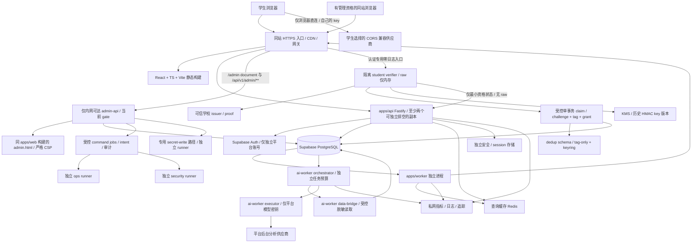

# 部署、可观测性与运维规划

> 状态：目标部署与运维约定，尚未创建运行环境、发布流程或供应商资源。需要在实现阶段将本文转为配置、自动化检查和演练证据。架构见 [系统架构](02-system-architecture.md)，容量验收见 [容量规划](06-capacity-and-performance.md)。管理功能全部在 `apps/web` 同源 `/admin`，权限仅采用五组及细 capability/scope，见 [管理工作区](14-admin-workspace-and-security.md)。学生资格与学校真实账号原文零落盘见 [匿名学生认证](15-anonymous-student-verification.md)。学生 AI 采用 [浏览器 BYOK 直连](12-student-byok-ai.md)，平台分析采用 [独立后台 AI](13-platform-ai-analysis.md)；本站不接收学生自己的供应商 key，不提供学生模型 relay/代理。

## 1. 初始部署拓扑

首发采用单仓库、单个前端工程 `apps/web`，其中普通站 document 与 `/admin` 的 `admin.html` 分入口构建，不再设独立管理前端工程或管理域名。普通 API 与 admin-api 可使用同一后端产物的不同运行模式，admin-api 独立部署、仅入口可经内网访问；普通模式不注册管理路由、不持管理凭据。两个普通 API 副本是避免单实例发布中断的初始意图，规格/故障域/承载量由压测确定，不自动满足 99.9% SLO。普通 `apps/worker`、平台 `apps/ai-worker` 与 `apps/command-runner` 独立资源/身份；平台 AI 隔离 orchestrator/data-bridge/executor，command-runner 按 ops/security/secret-write 分进程运行。公开业务 HTTP 不从 runner/worker 暴露。

生产站点只有一个前端 origin：入口把公开静态/普通 API、`/admin` document、`/api/v1/admin/**` 分流到对应处理器。`/admin` 必须顶层完整导航，后端当前管理员 gate 通过才返回 `admin.html` 和管理 CSP；无升权时仅提供不含私有 DTO 的最小 MFA/bootstrap 流程，普通学生无管理菜单和管理数据。菜单隐藏、bundle 冷加载或下载不到 bundle 均不是授权依据。本站业务数据经 BFF，浏览器不直连 Supabase、Redis、数据库或供应商控制台。学生模型连接仍**仅由浏览器直接请求其选择的供应商**，学生 key 从不被 admin-api、runners 或平台模型接收/代用。

普通身份使用 `__Host-sc_session`，管理员另有绑定当前普通 session/user 的短期 `__Host-sc_admin`。两者都为 Secure、HttpOnly、host-only、`Path=/`、无 Domain；管理升权还绑定 aal2、authTime、currentRoleVersion 与 sessionEpoch。待 P0 确认的默认值：普通会话空闲 12 小时/绝对 7 天，管理员升权空闲 15 分钟/绝对 60 分钟，高影响 intent 确认及执行前要求最近 5 分钟认证。admin-api 每次验证管理 CSRF、当前主库 capability+学校 scope；不能只验证 Cookie 签名或前端角色。Supabase token 只在后端，精确 Origin/redirect 白名单按环境配置。

两枚 Cookie 同源且同 Path，浏览器会把管理 Cookie 发到普通路径；入口转发普通 upstream 时必须剥离 `__Host-sc_admin`，普通私有路径保留普通 session，公开缓存白名单剥全部 Cookie/Authorization。普通服务没有管理 session 密钥，不接受、不记录管理 Cookie。此转发规则减少凭据暴露，但不隔离同源 XSS；HttpOnly 防脚本读值，也不能阻止恶意同源脚本携带 Cookie 调管理接口。[Cookie 前缀与属性](https://developer.mozilla.org/en-US/docs/Web/HTTP/Reference/Headers/Set-Cookie)、[XSS 边界](https://developer.mozilla.org/en-US/docs/Web/Security/Attacks/XSS)

API、普通 worker、ai-worker、安全存储、查询缓存和数据库尽量部署在经实测适合目标学生网络的同一区域或低延迟网络内。选型前分别验证校园浏览器到学生供应商的 CORS/网络路径，以及后台 executor 到平台供应商的路径，不能用服务器可达证明浏览器可用。跨区域容灾、数据库升配或只读副本属于后续选项，不能在尚无恢复演练时承诺自动容灾。

## 2. 环境隔离与配置清单

| 环境 | 数据与资源 | 约束 |
| --- | --- | --- |
| local | 本地数据库或专用开发 Supabase、合成数据、学生 mock origin/平台 stub、合成 issuer/verifier/查重账本 | 不接真实校园账号/材料，不复制生产 tag 账本或 HMAC key；学生测试 key 仍仅页内存 |
| test/CI | 临时数据库/缓存、确定性 fixture、模型和可信 issuer mock、独立测试 HMAC key | 覆盖五组/grant、零原文出口、跨版本并发、恢复 fail closed；不接生产资源 |
| staging | 独立 Supabase、两类 Redis、平台 AI 凭据/队列、隔离测试 verifier/KMS/账本 | 同等零落盘控制，用合成证明压测；不因“测试环境”复制真实学校身份或生产 tag |
| production | 隔离资源、密钥、备份、tag 账本恢复水位及告警 | 最小权限、审计、部署/运行身份分开；认证原文不进入任何环境持久化 |

每个临时预览环境有唯一域名和到期销毁策略，默认仅测试资源，不把生产 URL 当调试配置。生产业务副本需授权/脱敏；学生真实学校身份原本就不得持久化，不能用“拷贝后脱敏”进入 CI/开发/预览。生产 tag 账本与历史 KMS key 不进入应用数据快照、普通测试 fixture 或预览环境；它们的恢复演练在独立获准边界内进行，不能与 app/grant 导出合并。

生产配置至少分为下列类别，实际键名在实现时进入配置 schema；示例配置只写占位符：

- **公开构建参数：** 站点公开 URL、BFF 同站前缀、公开功能开关、经过兼容性测试的供应商公开元数据。前端 `VITE_*` 不存任何平台/学生 key、token、数据库密码或内部管理地址。学生自己的供应商/key/模型配置在页面填写，不能变成部署环境变量。
- **API 机密：** 受限 API 数据库角色连接串、Auth 服务端配置、Cookie/session 加密或签名材料、CSRF 配置、安全存储连接。学生 AI 只调用 `/api/v1/ai/student/search`、`/api/v1/ai/student/evidence`、`/api/v1/ai/student/evidence/validate` 受限数据端点；API 不持学生或平台模型密钥，不建立学生模型 job、SSE、成本预留。
- **admin-api 机密：** 独立管理运行角色、短期管理 session 验证材料、管理 CSRF/认证配置和受控 command 提交权限；不注入普通 API。仍按具体 capability 与学校 scope 限权，不使用数据库 owner 或 `isAdmin` 代替授权。管理入口同站，不能沿用“独立管理域名”作为安全条件。
- **command-runner 机密：** ops/security/secret-write 分进程按预定义动作拆分备份/恢复、发布回滚、缓存/限流、角色/会话撤销和密管写入权限，不共享万能账号；浏览器和普通 admin handler 不持通用基础设施/密管管理员令牌。runner 不接受任意 SQL、shell、URL、文件路径或自由脚本。
- **普通 worker 机密：** `apps/worker` 的 projector/importer 等模式仅持各自数据库角色与必要的公开缓存/CDN 权限；没有模型密钥，不消费平台模型队列。
- **平台 AI orchestrator：** `apps/ai-worker` 独立模式，仅持平台 job/预算/结果受控写入权限、任务协调凭据和访问内部 bridge/executor 的授权；不持作者映射或供应商模型 key。
- **平台 AI data-bridge：** 独立进程，仅以受控 reader 获取指定评价修订/公开证据、执行脱敏并返回最小 manifest；无作者映射、学生会话、管理员角色或供应商模型 key。pending 读取仅此受控路径可用，不能由学生 endpoint 访问。
- **平台 AI executor：** 独立进程，只持平台供应商模型 key 及必要内部调用认证，**无数据库/Redis 凭据**；只接受授权、有界输入/输出/模型的内部任务，不暴露公网代理。三种模式可用同一构建产物，部署身份、网络、机密和权限必须隔离。
- **学生认证 verifier：** 仅持可信 school/issuer 校验配置、去重账本受控能力和隔离 HMAC KMS key 使用权；普通 API、平台 Auth、admin-api、AI/普通 worker 不持这些权限。历史 key 版本只用于既定 HMAC 查重协议，不提供输入任意学校账号的管理员 MAC/查询服务；KMS/平台审计不记录 raw、计算输入或 tag。
- **迁移/备份机密：** 迁移角色仅给受审计基础设施流水线；日常备份/恢复由管理面板提交限定任务，凭据仅给获准 ops runner。tag-only 账本/历史 key 的恢复另有隔离身份与水位检查，不向普通备份处理器展开可与应用关联的明细。灾难 break-glass/首次 system_admin bootstrap 另有审计流程，不做网页 SQL/shell 终端。
- **容量配置：** 各副本连接池、最大副本数、admin-api/ops/security runner 的独立准入/队列/并行/任务期限、学生数据 API 限流、平台 AI 并发/等待/deadline/token/预算、普通 outbox 并行。20 并发、2 秒派发短等、45 秒生成仅属平台 AI，管理运维 command 另按类型预算，不能继承模型上限或无限执行。
- **安全配置：** 精确 Origin/redirect、可信代理链、会话生命周期、可信 issuer/学生 grant、verifier 零落盘开关/去重恢复水位与历史 key 集合、正文可见性、日志采集禁用、Data API 和角色能力检查。校园 SSO 不配置为平台 Auth provider，不能自动写入校园 `auth.identities`。

本站持有的密钥使用部署平台机密管理设施注入，不写入仓库、镜像、文档、前端 sourcemap、异常响应和构建日志。按环境、用途、供应商拆分凭证，建立轮换/撤销/到期告警。学生 BYOK key 根本不进入该设施：仅当前页内存，离开/刷新后重新输入；不进 Cookie、localStorage、sessionStorage、IndexedDB、Service Worker、URL、后端、遥测或任何持久存储。不能为方便客服调试要求上传或截图 key。

平台秘密管理面板只 GET `keyRef`、版本、掩码状态、用途/到期/轮换结果，不读回明文。获准管理员输入新平台秘密时，使用独立 write-only、no-log、短期授权绑定的替换路径，直达密管专用 secret-write runner/秘密设施；明文不经过普通 admin handler、intent 参数、普通 command 队列、业务数据库、审计/错误正文或前端持久存储。后续激活只使用有期限的 stagedVersion/keyRef 元数据和目标版本/影响，结果仅返回版本与状态，不能用“查看密钥”接口回显明文。学生自己的 key 始终不走此管理写入路径。

## 3. 运行安全与基础设施边界

业务 schema 不配置为 Data API 暴露 schema；普通 API/worker 以及拥有 SQL 能力的 AI orchestrator/data-bridge 使用非 owner、非 `BYPASSRLS` 的受限角色，AI executor 无数据库身份，不把 `service_role` 当业务万能凭证。关闭不用的 Data API，并从外部验证该入口不能获取业务数据；保留 Auth 所需能力。Supabase 支持只用可信后端直连数据库时禁用 Data API，但这不代替 SQL 权限和 RLS。[Supabase 数据接入安全](https://supabase.com/docs/guides/database/secure-data)、[Data API 安全配置](https://supabase.com/docs/guides/api/securing-your-api)

数据库/Redis 不开放给浏览器，生产仅允许部署服务和必要运维网络连接；可用的网络限制由选定平台与套餐核实。使用 TLS 并验证服务器证书，不能以“TLS 已开启”为由跳过证书校验。容器使用非 root、最小写入目录、资源上限、只需的出网目的地和自动重启；调试端口及指标端点不对公网暴露。

### 3.1 同站管理 document 与授权边界

`apps/web` 构建普通入口和独立 `admin.html`，不是两个前端项目。入口 `/admin` 和深层管理 document 请求先走后端当前身份/升权/capability gate，再返回管理 HTML；缺少升权但具有进入资格的账号只能进入最小 MFA/bootstrap，不能先加载私有 DTO。进入管理工作区前停止/abort BYOK 模型调用、提升本地 runGeneration 并清理学生 key、证据/模型响应；完整 document 导航卸载普通页面。退出管理、角色撤销、升权失效时清理管理请求/DTO/预览/intent、撤销管理 Cookie，再全页返回普通站。pagehide 先遮蔽敏感内容；pageshow/bfcache、切账号、401/403 或角色变更均先重查会话与当前能力，不能直接还原历史私有 DOM。跨标签通知只帮助清 UI，不是服务端撤销保证。

管理 document 的 HTTP CSP 单独设置 `connect-src 'self'`，不含任何 BYOK 供应商；使用受控 script-src（无任意 inline/eval）、`object-src 'none'`、`base-uri 'none'`、`frame-ancestors 'none'`、`form-action 'self'`。不将不可信评价、AI 结果、导入预览或日志当 HTML 执行，不加载第三方脚本、会话回放、远程图表 iframe 或供应商控制台。静态资源可以内容哈希缓存，但 HTML/私有 DTO/intent 为 no-store；`/admin` 不进入预渲染、预取、离线缓存或普通 SPA fallback。直接 `/admin.html`、尾斜杠、深链接及存储 origin 的别名必须同 gate 或拒绝，不能从公开静态 bucket/CDN 直接拿到受保护 document。冷加载、刷新、退回历史与错误/MFA document 均验证正确安全头，不能仅 SPA 切路由后宣称收紧了 document CSP。[CSP 的页面响应策略](https://developer.mozilla.org/en-US/docs/Web/HTTP/Reference/Headers/Content-Security-Policy)

同源不同 document、菜单隐藏、代码拆包和 HttpOnly Cookie 都不是 XSS 隔离。旧普通站标签页、被控制的同源脚本或能控制管理请求的 Service Worker 仍是风险；不能假设清除一个页面的 JS 状态就能撤销这些能力。前后两种 document 都要限制脚本来源、净化用户/模型文本、禁用危险 DOM 注入，首发不部署可控制管理 document 的通用 Service Worker。admin-api 始终检验管理 CSRF、最近认证、两层会话绑定和当前数据库权限，高影响命令再用短期 intent 及目标版本保护。

权限组固定且只有 `system_admin` 系统管理员、`content_admin` 内容管理员、`verified_student` 学生（认证）、`user` 用户、`guest` 游客。具体 capability/scope 以 [14](14-admin-workspace-and-security.md) 为准；内容审核、运维/安全职责与 runner 是能力或工作负载隔离，不是新增用户组。`system_admin` 管系统/授权/导入/AI 配置预算/运维，`content_admin` 仅内容审核、举报、申诉、置信报告和总结治理；内容管理员无秘密、授权、备份恢复/发布等系统能力。任何组都不是数据库 owner 或全能 `isAdmin`。

保留最后有效 system_admin：移除/降权/过期变更在数据库并发约束下保证，不只做页面提示。初始化至少两名独立 system_admin 以承担具体高敏双人复核，不设置旧 owner 组。管理员身份不自动满足学生资格；评价等学生专有动作必须校验独立当前匿名 grant。普通 user/guest 无管理入口，未授权面板不取数据，猜路径/下载 bundle 不得能力。任何管理员均无还原真实学校身份的功能，调查仅限平台账户/内容行为，不提供学校身份揭示。

### 3.2 站内运维面板与受控命令

所有日常管理与运维功能必须有同站 `/admin` 面板。面板只调用 `/api/v1/admin/**` 的固定能力；低风险短事务领域动作可走受控 route，长时/高影响运维动作创建/查询授权 command jobs，由独立 ops/security runners 最小权限执行。浏览器不直连基础设施控制台，秘密替换单走专用 secret-write 路径。不能把备份/回滚/限流等留作“只有 CLI 可做”，也不能为覆盖 UI 加入任意 SQL/shell/URL 终端。

| 站内面板 | 可见/可控范围 | 执行与隔离 |
| --- | --- | --- |
| 评价审核、举报、申诉 | content_admin/system_admin 中有内容 capability 的指定学校/对象，禁止自审 | 固定命令与 expectedVersion；分析提示不代替人审 |
| 置信报告与总结治理 | content_admin/system_admin 中对应内容 capability；仅指定脱敏分析/总结 | 不改原分、不自动审学生评价；不获得供应商 key、模型配置/预算或待审数据任意遍历权 |
| 教师、课程、数据导入 | system_admin 的来源/学校、差异预览、校验与发布 | 有界导入 job、失败样本脱敏、按版本发布；content_admin 无导入权限，无 SQL 文本框 |
| 平台 AI 系统配置 | system_admin 的供应商/策略版本/预算/系统开关 | 固定种类/目标/版本；无自由 prompt 或学生代理，平台 key 只显示 keyRef |
| 账号、匿名 grant、授权、会话与安全事件 | system_admin 的具体 capability/scope，授权与平台行为调查分权 | 固定 security command；不显示校园账号/身份、查重 tag/digest 或提供反向关联；不能手填学号发 grant |
| 监控与诊断 | system_admin 对应只读 capability 的聚合指标/事件；content_admin 仅内容队列所需状态 | 有界 DTO、无校园身份/tag/key/私有正文；不 iframe 供应商控制台 |
| 缓存与限流 | system_admin 对目标学校/路由/版本的预览、失效、重建与配置 | 白名单命令；不能任意 Redis 脚本或清 session/去重 tag/预算账本 |
| 队列与后台任务 | system_admin 按类型查看/控制任务；content_admin 仅获准内容流程 | 有界重放、版本/fencing；不编辑任意 payload，不越权恢复已撤销任务 |
| 备份、恢复与演练 | system_admin 对恢复点/环境/数据丢失风险和进度的具体 capability | ops runner 固定模板，高风险按 [14](14-admin-workspace-and-security.md) 双人；无全库下载/任意路径，tag 账本只露恢复安全状态 |
| 发布与回滚 | system_admin 的获准 immutable artifact、兼容性/影响预览和 command | 无自由 shell/SQL；不回退权限、epoch、kill、匿名去重水位或历史 key 集合 |
| 平台秘密与轮换 | system_admin 的 keyRef/掩码/到期与替换能力，content_admin 无权 | secret-write 路径仅元数据进入激活命令；不读明文、不写业务库；校园 raw/tag 与学生 key 不进入 |

高影响动作先在站内生成可审查预览，再签发默认 5 分钟、单次消费的 intent，绑定 actor/action/目标 version/digest/scope、当前 app/admin 会话与认证状态；确认与执行前要求最近 5 分钟认证。只有具体高风险动作要求独立第二人，不能把所有点击都变成双人审批。确认与建 job 原子消费 intent，相同确认返回同一 job，改参数重新预览；目标变更、角色/会话撤销、kill 关闭使执行失效。runner 领取、不可逆动作前和最终提交前重查当前主库授权/控制版本，超出认证或复核期限进入 `needs_reauthorization` 由站内再认证/确认，不能拿旧消息或 runner 高权限静默续权。

撤权、会话失效和kill在主库控制路径立即提交，不排在长任务/费用核对后。既有外部动作尽力取消/补偿，未知继续保守占成本/在途，不假报成功。管理executionState统一queued/running/needs_reauthorization/succeeded/failed/cancel_requested/cancelled/uncertain；accepted仅指HTTP受理，unknown为口语描述而非持久枚举，202不表示执行完成。撤权仍允许受限记录既有副作用/费用/审计，不再执行新特权步骤。

schema migration、灾难 break-glass 和初始 system_admin 信任根引导保留受审计基础设施能力，站内显示状态/固定流水线结果，不开放网页任意执行。日常高敏授权启用前至少准备两名独立、已核验且具备相应复核 capability/scope 的 system_admin，避免双人流程死锁；禁止公开注册/隐藏 URL/抢首账号成为 system_admin。最后有效 system_admin 保护由数据库锁/约束保证；应急凭据恢复后轮换。此引导不产生额外 owner 权限组。

### 3.3 学生认证零原文落盘与独立去重设施

平台登录是独立 platform account，不能绑定/自动导入校园账号。只接受可信 school/issuer proof，不接受自填学号/姓名/email；校园 SSO 不接平台 Auth provider，校园 subject/姓名/email/token 不进 `auth.users`、`auth.identities`、metadata/日志，平台 Auth 无权读 verifier 内 identity。`private.student_grants` 仅平台 userId/随机 grantId、school scope、验证策略/级别、active/revoked 与版本，无校园信息/tag/关联指针。首版只证明验证时符合学生条件，不自动过期/续证或宣称当前在校；管理组不替代独立 grant。

raw 仅在独立 `apps/student-verifier` 内存暂态处理：学号、学校姓名/email/凭据/subject、callback code、access/refresh token、材料与原文。验证服务的短期内部断言仅给获准原子 claim 函数；普通 BFF 只收到最小资格状态，无 raw/tag。`private.student_verification_challenges` 在验证前创建、无校园身份/tag；单 PostgreSQL 事务完成 challenge 校验/消费、唯一 tag 与 grant 创建，避免先烧资格再发票据。具体并发、响应丢失与恢复以 [15](15-anonymous-student-verification.md) 为准，不另造 ticket 协议。管理员无学校身份还原/揭示，调查只围绕平台账户行为。

必须在**第一处接收敏感流量的入口**就禁采集/落盘，不能先入通用网关日志再由应用删除。认证专用路径不记录 body、callback code/query、authorization/cookie、response、trace payload、session replay、请求/错误对象；禁代理/WAF/APM 采样、body 磁盘缓冲/临时文件、抓包持久化、离线缓存/Service Worker、持久队列、数据库、对象、备份、core/heap dump。verifier 执行环境禁 swap/休眠/自动内存快照及会把内存持久化的诊断；发行/运维流程用合成哨兵验证这些控制，平台不能满足就不开启认证，不以“日志已脱敏”替代零原文落盘。

隔离 verifier 用独立 secret keyed HMAC-SHA256，按 [15](15-anonymous-student-verification.md) 固定域/学校/canonical identity namespace/稳定 subject 的长度前缀编码，保留前导零；不同 issuer 先统一权威 namespace/身份，不能换 issuer/盐重领。`dedup.student_claim_tags(key_version, tag)` 仅两列，控制元数据在 `dedup.student_keyring_registry`；与 app/grant **无持久业务 join**，不含 user/grant/claim/challenge ID、认证时间/IP/trace，tag/digest 不进用户表/日志/admin DTO。备份不增加关联导出；同 PostgreSQL 原子事务带来的 WAL/xmin/物理备份与时序侧信道仍可能关联，逻辑隔离不是密码学不可关联。

删除账号、撤销 grant 仍保留已消费 tag tombstone，不因 app 会话过期/注销而重计；原 grant 不自动续证或换绑。撤销后的同账号补救只按平台处置恢复原 grant，不重新消费别的 proof；丢失账号只靠预设平台恢复凭据，不能让管理员用学号/校园材料查回账号。tag 是 pseudonym，完整服务失陷/密钥泄露/侧信道仍可能关联，不宣称绝对匿名；任何产品/管理员能力不得反查学校身份。

KMS 保留全部仍覆盖历史领取的 HMAC key/version，新认证检查全部保留版本候选 tag；跨版本并发、UNIQUE 与领取原子协议依 [15](15-anonymous-student-verification.md) 验收。轮换不是删旧 key/清表重置；raw 未存，不能简单全表重算旧 tag。管理面板只显示 key 版本健康、账本恢复安全状态、粗粒度吞吐/错误与启停，不显示 digest/账本行、不提供任意学校 ID 的 HMAC/已领取查询。KMS 使用权只给 verifier，恢复操作不把 secret/raw/tag 明细搬到普通 ops/admin 进程。

tag-only 账本、其必要持久日志与 KMS 历史版本独立备份/恢复，应用库恢复不得把查重账本一起回退或从低水位复制覆盖。恢复后的“新学生认证”有独立 fail-closed 开关：完整去重水位/历史 key 集合/领取状态未证实时不再发新 grant，不因业务站 RTO 到时而放行。任何已确认认证的新 tag/tombstone 不可在恢复后消失；若所选持久化/备份方案不能证明这一点，就不能声称恢复后继续保证一学生一账号。

### 3.4 普通数据与 AI 运行边界

查询缓存与会话/安全存储至少有独立实例或经验证的独立资源隔离；仅分 Redis key 前缀不构成故障隔离。前者允许驱逐、丢失、清空；后者不允许因查询缓存占满内存而丢掉 session、学生 API 限流或平台模型并发状态。平台分析队列、费用预留、并发预算与普通 outbox/worker 隔离，关键事实留 PostgreSQL，Redis 丢失不丢业务事件。三种 ai-worker 模式用内部认证和固定能力接口协作，executor 的出网限定到获准平台供应商，不能被复用成学生模型代理。

积分系统正式取消，数据库、路由、任务、定时器、页面、配置和权限均不预留积分奖励/扣减/消费路径。平台供应商费用预算继续存在，与积分无关。学生 BYOK 页面/受限数据 API、平台评价修订分析、平台教师总结分别设独立开关：关闭平台分析不影响学生直连与普通查询，关闭学生数据 API 不会替学生停止已经发出的供应商调用。

学生页面的 provider adapter 使用正常 CORS 请求与兼容供应商协议，不发送本站 Cookie、会话、CSRF token 或内部身份到供应商。供应商 CORS/预检不支持时标为不兼容；浏览器通常无法精确区分全部网络/CORS 原因，页面可提示检查供应商兼容性。禁止 `no-cors`、公共 CORS 代理、本站 relay、开发代理进入生产或“自动切换平台 key”。CSP `connect-src` 与供应商配置策略、HTTPS/认证 header 协议同时核验；可连通不能替代用户确认发送数据范围。[CORS 机制](https://developer.mozilla.org/en-US/docs/Web/HTTP/Guides/CORS)、[Request.mode](https://developer.mozilla.org/en-US/docs/Web/API/Request/mode)

学生 BYOK 区域禁用会话回放、DOM/表单抓取、fetch header/body 捕获和自动错误上下文序列化；按默认不采集设计，而不是先上传再脱敏。不得向遥测发送 key、供应商配置原始对象、模型对话、输出或已获证据正文。前端依赖、第三方脚本、XSS/CSP 与输出净化检查是 key 仅内存设计的重要边界；内存存放不能抵挡同页恶意脚本或用户设备插件。

平台的 `private.review_ai_assessments` 仅保存指定修订的可解释置信等级/证据强度，不当作真伪概率、不改分、不自动审核/发表学生评价。`published.teacher_ai_summaries` 只用当前 published 且有效样本至少 5 条，完整依赖 manifest（含选样/过滤/计数与中间步骤依赖，不只是逐句引用）写入 `private.teacher_ai_summary_evidence`。总结经自动 schema/来源/范围/文本安全/完整 manifest+epoch 门禁后，由受控应用命令自动公开；executor 无数据库/发表权，敏感争议或低证据输出转人工或拒绝，抽查不阻塞每条正常总结。所有公开来源集变化在事务内递增 `teacherSummaryEpoch`，读取与发布从主库 gate 复验完整来源、generation/epoch/阈值、门禁状态与有效期；旧总结立即不展示，派生内容独立 `no-store`，不内嵌 CDN 目录。15 分钟为有效自动总结可用目标、需人工 case 单列，不能作为旧总结展示窗口；原总分规则不按分析置信等级加权。

## 4. 构建、发布与排空

### 每日缓存同步的应用调度

数据库缓存统一后端管理。普通worker的cache-sync已确定每日把运行缓存写入Supabase PostgreSQL非公开cache_persistence表，默认Asia/Shanghai 03:00；同项目/环境/scope/日期日槽位唯一，租约/fence保证多副本/补跑幂等。不另选缓存服务商；具体项目/低权限SQL连接/迁移/容量未验收前任务关闭，当前仅文档。

按[16](16-backend-cache-and-daily-sync.md)序列化后端固定版本的白名单目录缓存，缺块/过期先限额重建，不Redis全量dump/SCAN混版本。分批短事务写cache_persistence.snapshots/snapshot_chunks staging，schema/摘要/完整性/SQL回读通过后，同Supabase短事务激活ready/active指针并记job成功。adapter专用SQL凭据无owner/BYPASSRLS/service-role，不进前端/job/日志。写入提交未知先查原快照/job，失败保留安全未超龄已知好版本，禁止半包加载；连接/IO/WAL/体积/保留量/deadline独立预算，避免拖主库。

初始副本最大源年龄30小时，sourceAsOf不因重试改新；最近成功/下次计划/年龄/体积/校验/错误在同站缓存面板显示。加载用于预热前证明目录版本仍当前且满足API预算，超龄/版本未知限额回源或拒绝。当前30/60秒投影、内容/总结/权限gate不改，紧急撤除不等次日。快照不含评分/正文/registry、账号作者/授权/资格、tag/校园原文或Key，不作备份恢复依据。

计划任务用固定工作负载身份；手动重试需system_admin+ops:cache-sync及当前scope/命令授权，content_admin无系统发布权限；旧fence/已撤权手动命令不可激活。排空保留阶段，不切未验证版本，重启沿原任务恢复。告警覆盖漏跑、源年龄、连续失败、校验/激活及失效异常。

### 常规发布流水线

计划建立以下流水线，现阶段文档不代表命令已存在：

1. 锁定 Node/包管理器与依赖 lockfile，安装后检查类型、静态规则、前后端 import 边界、构建产物和机密扫描。`packages/contracts` 仅纯类型与常量，不携带后端实现、数据库客户端或浏览器私密配置。
2. 对角色/RLS、HTTP 契约、认证/CSRF、审核/撤回、幂等、outbox、学生 API 与平台预算测试；覆盖五组及独立学生 grant、最后 system_admin 并发保护、管理 gate/升权/intent/runner 复验、pending/模型执行器隔离。匿名认证另测可信 proof、零原文落盘、tag/app 无持久 join、全历史 key 候选查重、并发/失败恢复与恢复水位，不实现未验证 ticket 协议。
3. 在全新测试库从零执行迁移，并用上一稳定版本的数据库样本执行升级；检查 migration lock、锁等待和向后兼容。发布 artifact 使用内容摘要或不可变版本号。
4. staging 发布候选 artifact，执行入口分流/Cookie 剥离、冷加载管理/MFA/CSP、public 缓存、Data API、内容失效、BYOK 零回传与 worker/runner 回滚检查；秘密 GET 仅 keyRef。合成校园 raw 哨兵覆盖 callback/错误/超时/崩溃，检查代理缓冲、日志/APM/trace/磁盘/dump/DB/备份均无原文，tag-only 账本和管理界面无应用关联或 tag 展示；未证明则认证不开启。
5. 生产迁移先走审计 expand 流程；站内发布面板预览批准 artifact/安全契约后，由获准 system_admin 的 intent/command 经 ops runner 固定流水线发布 API/admin-api/worker/AI/runners。verifier/issuer/key 版本/账本发布另有独立回退约束与恢复水位 gate；不能将 app 回滚顺带回退查重事实。观察脱敏聚合指标，平台模型密钥只进 executor、HMAC key 仅给 verifier。
6. 同一 `apps/web` 的普通 HTML 和 admin.html 按完整 artifact 发布，先上传全部哈希资源再切换 document 指针。admin.html 仍从后端 gate/no-store 路径返回严格 CSP；不让 CDN 静态旁路它。公开投影按版本失效，禁止把安全存储/session/撤销记录作为发布清缓存目标。
7. 健康、关键路径与观察窗口通过后，站内发布面板保留 artifact/迁移/功能开关/command/intent、actor/runner 身份、指标与回滚点。日常发布权限由具体 capability 控制，本规划阶段不触发实际外部发布。

API 收到停止信号后从 readiness 移除、停止接收新请求，等待在途短请求结束；学生 search/evidence/validate 均为短请求，没有本站学生模型 SSE 或作业。学生供应商连接由浏览器直接管理，API 发布不提供对它的取消/计费保证；页面刷新清空自己的 key。平台 orchestrator 停止领取新任务并持久记录必要的取消意图，executor 的单次生成最长 45 秒，应在经实测的排空窗口内完成或尽力取消，orchestrator 按实际用量/未知保守策略记账。普通 worker 独立排空，副作用确认后才 ack，未完成由租约重领，禁止退出时删除事件。平台上游状态不明不得透明重复调用；所有进程退出前关闭其自身连接池和遥测。

admin-api 与 ops/security runners 独立排空。runner 停止领取新 command，未发生外部副作用的任务可留待当前权限重新核验后执行；已发生或结果未知的动作持久记录阶段、目标版本和 provider request，按预定义恢复/补偿策略处理，不在重启时透明重复。撤销/kill 的主库控制路径在 drain 期间保留独立预算，不能为了等任务或账单“优雅结束”而延后关闭权限。部署不恢复已消费/过期 intent，也不重置 command 的幂等与撤销状态。

健康检查分工：`liveness` 仅证明进程可运行，避免外部故障触发无限重启；`readiness` 判断该实例能否安全处理其声明流量。公开读、私有写、学生数据 API、admin-api、ops/security runners、平台 orchestrator/bridge/executor 分别报告能力状态；管理面板读取获准的脱敏能力 DTO，外部浏览器不直读私网指标端点。学生供应商不进入 API readiness，平台供应商或某类管理任务故障不能将普通 API/worker 判死。公网健康响应不暴露连接串、角色或机密。

## 5. 数据库迁移与回滚

采用 expand-contract，避免将应用回滚等同于倒放破坏性 SQL：

1. **Expand：** 新增兼容字段/表/索引与权限，保留旧读写；大型索引/回填单独计划，确认所需锁、磁盘、复制与事务限制。
2. **兼容应用：** 发布能兼容新旧结构的代码；必要时双写需有明确源数据、幂等约束与校验，不能长期无人负责。
3. **分批回填：** worker 按检查点、有界批次、短事务进行；限速并允许暂停，不占满交互请求连接预算。
4. **验证切换：** 比对行数、聚合、状态、权限和 outbox 投影，先灰度读新结构，再全面切换。
5. **Contract：** 观察窗口和旧版本回滚期限结束，确认所有实例、任务、脚本已停止访问旧结构后，才移除旧列/表/权限。

新增表、函数、view、序列和默认权限均进入安全审查。不能只验证表 RLS 而忽略函数 `SECURITY DEFINER`、view 权限和默认 `EXECUTE`。数据库对象 owner 与应用运行角色分开；用户上下文必须事务级隔离，连接复用不得残留上一请求身份。

日常应用回滚通过同站面板预览 approved artifact、schema/安全契约影响，intent 后由 ops runner 部署兼容版本、切换两 document 指针。不能回退权限组/撤销、roleVersion、sessionEpoch、teacherSummaryEpoch、kill 关闭、秘密撤销、command/intent 状态、学生去重 tag/tombstone 水位或历史 key 集合。低于最小安全契约/不支持五组与匿名认证边界的旧 artifact 禁止上线；不能恢复旧六组、owner 全权、真实学校身份留存或旧 Cookie 逻辑。修复期相关认证/管理能力保持关闭。

已执行不可兼容 contract、数据损坏或批量误删时，停止相关写入、保留证据，按恢复流程处理，不自动执行“down migration”删除新数据。恢复旧数据库可能丢失恢复点后的合法写入，也可能带回旧权限，因此恢复必须重放安全控制记录、先使旧升权失效，不能仅回滚数据库和前端即恢复管理操作。

## 6. 可观测性与告警

普通业务记录 requestId/traceId、路由模板、耗时、结果码、版本/缓存与脱敏错误类别，平台 user ID 仅在获准平台审计范围使用；不能将该模板套到学生认证专用入口。认证链路禁 raw/query/code/body/header/异常对象/跨服务 trace 采集，不输出 tag/digest，也不把 app ID 与 tag 或精确时序连接起来。学校学号/姓名/email/凭据/SSO subject/token/材料均不进入日志、APM、支持附件、数据库或备份；不是“加密/哈希后另存原文”。其他路径也不记录 Cookie、token、评价正文、学生 key、prompt 或输出。学生 AI/秘密写入禁请求体捕获，拒绝字段也不回显/记录值，BYOK 区域关闭自动浏览器抓取。

管理面板与 secret write-only 路径同样不启用会话回放、原始表单/请求体或 Cookie 捕获。审计记录 capability/scope、roleVersion/sessionEpoch、目标 version/digest、intent/command ID、二次认证时间、具体要求的第二审批人、runner 工作负载身份与阶段结果，不记录 secret 原文或可还原的 payload。管理日志/审计查看也经同站面板的独立只读权限与时间范围/分页限制，不能开放任意全文导出。

| 维度 | 必需指标 | 告警或诊断重点 |
| --- | --- | --- |
| 入口/API | 请求率、分状态码错误率、路由 p50/p95/p99、在途请求、拒绝数、响应字节 | 公开请求 SLO 与错误预算；429/503 不能被聚合隐藏 |
| CDN/查询缓存 | 边缘和源站命中率、回源率、缓存字节、失效失败/延迟、键增长 | 热点变更、冷缓存、穿透和高基数输入 |
| 每日缓存写Supabase | 计划/最近成功、sourceAsOf/年龄、序列化/SQL批写/校验/激活耗时、行数/字节/DB体积与WAL、重试/租约/unknown、清理/源版本差 | 一日槽位/完整激活、无半包/旧fence覆盖，保留量和资源独立；超龄不加载，安全失效不等次日 |
| DB/连接池 | active/idle/等待、获取连接耗时、statement timeout、锁等待、慢查询、CPU/IO/磁盘 | 预留被侵占、长事务、连接泄漏、重试放大 |
| 安全/session | 会话读取失败、资格校验失败、CSRF 拒绝、按原因限流、权限异常 | 区分真实攻击、配置错误与依赖故障；避免一概触发封禁 |
| 匿名学生认证 | 按 school/issuer 粗粒度的请求/拒绝/超时/并发、KMS/key 版本可用、账本恢复健康、零落盘检测 | 不使用 app ID、canonicalStableId、tag、claimId、精确领取时间/IP 作标签/诊断样本；不建 app 与 tag 的 trace 关联；面板不显示 raw/digest |
| 管理入口/升权 | admin document gate、MFA/升权过期、capability/scope 拒绝、管理 CSRF、普通 upstream 剥离失败 | 管理 Cookie 不进普通服务日志；角色撤销即失效；严格 CSP 不与 BYOK CSP 混用 |
| 管理命令/runners | 按种类/环境聚合受理率、队列年龄/长度、执行/失败/uncertain、needs_reauthorization、intent过期、版本冲突、撤销延迟 | 独立预算、撤销/kill保留通道、幂等和当前发起/必要复核者权限；不只报202成功率 |
| outbox/worker | 最老未完成事件年龄、待处理数量、重试、死信、处理时延、投影版本差 | 普通投影新鲜度、撤回失效优先级、卡住的租约 |
| 学生 AI 数据 API | search/evidence/validate 请求率、状态、延迟、限流、证据失效、查询成本 | pending/跨对象读取拒绝、主库复验、独立池/准入预算；不采集学生 key、模型账单或供应商请求内容 |
| 平台后台 AI | 持久积压/最老年龄、派发等待、执行数、内部首 token/生成耗时、供应商错误、取消、token/预留/结算 | 20 并发等只属平台；未知费用/占槽、预算、过期任务、三模式能力边界 |
| 平台派生结果 | 指定修订分析/有效总结新鲜度、人工例外、完整 manifest/epoch gate 失败、invalidated 数量、重生成去重 | 修订分析 p95≤5 分钟、有效自动总结 p95≤15 分钟为后台目标，人工例外 case 单列；失效立即不展示，无旧总结 stale 窗口 |
| 恢复/备份 | 备份最近成功时间、可恢复点、加密/读取测试、最近恢复演练结果 | RPO/RTO 不能只看“任务成功” |

指标标签仅使用低基数字段；教师 ID、完整 URL、查询词、userId、requestId 不作为通用指标标签。高基数细节进入受控日志/追踪。发布版本、route template 和错误类别必须能聚合；安全事件按需提高采样，但不能把评价正文当调试样本。

初始告警按 [容量文档](06-capacity-and-performance.md) SLO/预算配置；连接耗尽、正文/总结 gate、撤回积压、安全存储、备份过期/平台超预算、BYOK key 回传、校园 raw 意外落盘、tag 关联字段、去重恢复水位不完整或历史 HMAC key 缺失为优先事件。认证安全不明自动关闭新认证，不创建带 raw/tag 的告警样本。学生直连供应商无本站账单/取消/费用遥测，兼容性只用 mock/测试 key 排查。阈值与负责人/runbook 在 staging 固化，不用“提高采样”破坏零原文采集。

## 7. 备份、恢复与灾难边界

普通业务初始恢复目标 **RPO≤15 分钟、RTO≤2 小时**，均须所选能力/实际规模演练验证，恢复范围为安全公开读与核心写入；平台分析可延后，学生自己的供应商不在本站保证内。**学生去重账本另有不可退让的安全门槛：已确认领取消耗的 tag/tombstone 不得因恢复丢失后继续接受新认证。** 普通业务 15 分钟 RPO 不适用于放行有重复领取风险的恢复；无法证明完整水位/全部历史 key/领取状态时，新认证无限期保持 fail closed 直至核验，不能为了 2 小时 RTO 清表或重新计额。raw 从未持久化，也不在任何恢复源中。

Supabase 的备份、PITR 保留窗口及可用条件随所选项目能力核验；数据库备份不包含 Storage 对象本体，定制角色密码也需要单独安全管理。恢复可能造成服务不可用且耗时受数据库规模影响，不能直接把供应商功能名视为本系统 RTO 证明。[Supabase 数据库备份与 PITR](https://supabase.com/docs/guides/platform/backups)

备份范围：

- PostgreSQL 业务数据、审核/撤回、outbox、平台 AI job/reservation/provider_calls、分析/完整 manifest/总结、teacherSummaryEpoch、匿名学生 grant 与**仅独立平台账号**的 Auth 数据；不含任何校园 identity/token/材料。总结可重建但 manifest/epoch 丢失后不继续公开，平台 grant 不含 tag/查重关联。
- 隔离 tag-only 查重账本、删除/撤销后的 tombstone、必要的无 app 关联持久日志与完整恢复水位。备份保留不能让仍需防重复的 tag 过期，不能与 app/grant 数据合并导出或增加 appUserId/claimId/精确时间/IP 关系；恢复程序只能在隔离 verifier/ledger 边界读取这些行，普通面板只见安全状态。
- KMS 中全部仍覆盖已领取历史的 HMAC key 版本及其恢复/使用策略，密钥备份与 tag 账本分权保存，不能导出明文交管理员。raw 不存在，密钥丢失就不能重算旧 tag；key 版本不完整或不可用时新认证关闭，不通过改用新 key 从零开始来冒充恢复。
- schema migrations、数据库角色/grant/RLS 定义、公开投影重建逻辑、部署配置和不可变 artifact；机密本身通过独立受控设施备份/恢复，绝不放普通配置仓库。
- 管理 capability/scope、角色版本、sessionEpoch、kill/撤销记录、command/intent 状态与独立安全审计时间线。关键安全撤销与控制水位需有受保护的恢复后核对来源；不能只依赖将被回退的同一快照。已消费/失效 intent 永不从备份恢复成可执行。
- 如有普通业务获准附件，另做对象版本/清单/加密/删除和备份；**不引入学生认证材料存储**。学生学号/姓名/校园 email/凭据/SSO subject/token/材料、callback raw/code/query、原文日志/dump 不在对象或备份里，不能以加密备份为例外。
- 运行缓存可重建；每日写入Supabase的cache_persistence快照也是可丢弃预热副本，与业务表同故障域，不代替PITR或恢复会话/资格/查重事实。若物理备份附带缓存表，恢复后先置不可加载，核验sourceAsOf/当前源版本/禁止交付水位/清单完整性才重新开放，不因备份带回ready就交付。日job/manifest恢复不重放已成功日槽位或旧fence，安全/session仍不得复活已撤销会话，重大恢复要求重新登录。
- 学生自己的 key、供应商配置、模型对话/结果不在本站备份范围，因为本站从未接收或持久化。恢复流程不能从学生浏览器“补采”这些数据；平台费用账本恢复不代表能恢复学生供应商账单。

至少在首次上线前、数据库重大迁移后和定期演练时执行以下恢复步骤：

日常 system_admin 在 `/admin` 恢复面板选择恢复点/目标，预览丢失写入、停写、权限/内容复活与学生查重水位风险，intent/二次认证/具体高敏双人后提交固定 command，content_admin 无此能力。ops runner 恢复应用库；查重账本/历史 key 另走隔离恢复，不把其行传给面板/普通 runner。断线或站点暂不可用不等于取消，不重复创建恢复任务。全站无法核验授权才用审计 break-glass，不开网页 SQL/通用控制台。

1. 在隔离环境选择明确恢复点，记录故障时刻、最后可恢复事务时刻、恢复开始与结束时间，确认预期数据丢失范围。
2. ops runner 使用获准的备份/PITR 路径恢复，核对数据库版本、扩展、Auth 配置、角色/grant/RLS、默认权限和 Data API 关闭；恢复/轮换自定义角色凭据，凭据不回传浏览器。阶段开始前重查 command/intent、目标版本与当前授权，主库不能核验时不开展新的敏感动作。
3. 验证教师/课程、审核、匿名 grant、幂等、AI 账本/outbox、manifest/epoch。匿名认证入口先关闭，由隔离 verifier/ledger 恢复程序核对完整去重水位、全部 tombstone/历史 key 和领取协议状态，证明没有已确认的新 tag 丢失或被回退；不能只数行或 `SELECT 1`。未知模型调用保守占槽/预算，不从空计数重启。
4. 重放恢复点后的撤回、封禁、角色降权/移除、sessionEpoch/roleVersion、kill 关闭、秘密撤销、公开源集变更和删除决定，重新校验 teacherSummaryEpoch。默认撤销全部旧管理升权/未消费 intent，恢复当前 capability/scope 后重新 MFA；无法核对时相关正文、总结与管理写入保持关闭，旧备份不能使私有内容、旧总结或旧管理员权限复活。
5. 清空查询缓存并切换命名空间，重建投影/索引；outbox 幂等重放，平台旧上下文不能再发布结果。学生已发至其供应商的数据和用户已有副本无法由本站收回，事故记录须说明边界。
6. 受限角色验证公开查询/越权/CSRF、评价与证据、总结 gate、平台预算、五权限组和独立学生 grant、最后 system_admin 保护、管理会话/queued command/secret/回滚。使用合成 issuer 身份测试领取并发、历史 key 与恢复 fail closed，哨兵 raw 不进入日志/磁盘/备份；测试数据不使用真实校园信息。
7. 依次恢复公开目录、可核验正文/写入、已有有效 grant 的学生 API、普通后台及平台分析；管理需重新登录/MFA，内容和系统边界不变。新学生认证最后单独启用，只有去重水位、历史 key 和领取状态全部核验才能开放；缺新 tag/密钥就保持关闭、记录明确原因，不以普通业务 RTO 达标为由绕过。

备份加密/分权/保留策略必须区分可清理业务数据和持续防重复所需 tag tombstone；删除平台账号不触发删除 tag。站内 system_admin 只看授权恢复元数据/健康，不读校园 raw、digest、完整 tag 清单或 key；content_admin 无备份系统能力。固定恢复/密管/break-glass 留不含 raw/tag 关联的审计，并提前演练密钥与账本独立恢复；不能事故后才发现历史 key 丢失或账本不可恢复。

## 8. 常见故障 Runbook

以下日常动作按五组边界在同站管理面板发起/查看：system_admin 管系统能力，content_admin 仅获准内容能力，仍逐项 capability+scope；记录 intent/runner/目标版本，不要求常规跳转控制台/仅用 CLI。全站故障、migration 和首次 system_admin bootstrap 的例外按第 3.2 节审计。学生认证 raw 与 tag 明细不因面板覆盖要求而可见，任何管理员无真实学校身份揭示功能。

| 事件 | 首要动作 | 恢复与验证 |
| --- | --- | --- |
| 公共查询突增 | 查看边缘命中、回源和池等待；开启已配置的有界准入，暂停低优先级重算 | 确认基本查询 SLO 与数据库稳定后逐级解除；记录合法用户拒绝数 |
| 查询缓存 Redis 故障 | 不把流量全部穿透 DB；保留允许的有效 CDN 快照并限制回源 | 恢复实例、按热度有界预热；检查失效事件、投影版本和回源峰值 |
| 安全/session 存储故障 | 按依赖范围关闭会话鉴权、写入、学生数据 API 或平台新任务；匿名公开投影可继续 | 验证 session/学生限流/平台槽位，必要时重新登录；不能跳过鉴权，也不能宣称已停止学生直连调用 |
| DB 慢、池耗尽 | 限制新事务、暂停导入/回填，检查锁与慢查询；不给全部池盲目加连接 | 处理根因后小步放流，检查回滚/取消和连接归还，确认正文没有走旧缓存 |
| 管理轮询/command 积压 | 从监控/队列面板查看独立管理池与任务种类，停止非必要轮询/导出，按固定命令限量暂停 | 公共学生查询预留不被占用；撤销/kill 走保留通道；重放先核验当前 actor/capability/scope/目标版本，旧 intent 不复用 |
| 管理 document/CSP 错配 | 关闭管理入口、撤销升权，排查入口 fallback/CDN/旧 HTML；普通查询按范围继续 | 顶层冷加载重新验证 admin gate 与 `connect-src 'self'`，清 BYOK 状态；不能只热切 SPA 路由或放宽 CSP 兜底 |
| 管理员降权/退出/紧急 kill | 主库即时更新 roleVersion/sessionEpoch/开关，作废升权与未执行 intent，不排队等任务结束 | 浏览器清 DTO/命令预览并全页退出；runner 执行前再次拒绝旧授权，未知外部费用单独保守核对，不阻塞撤销 |
| 可信 issuer/verifier 过载或不可用 | 独立关闭/限量新认证，页面显示认证暂不可用；平台账号登录和普通查询按自身依赖继续 | 核验 issuer 信任/时效、原文仅内存与资源上限，不能自填学号兜底、排队存 raw 或让 content_admin 手工认定学生 |
| 去重账本恢复缺新 tag / tombstone | 新认证立即 fail closed，保护当前账本/独立恢复水位，不从应用备份覆盖 | 隔离恢复补齐全部已确认消耗与领取状态后才开放；若不能补齐则保持关闭，不清表、不重置认证次数，不让同生再领 |
| 历史 HMAC key 缺失/KMS 不可用 | 关闭新认证，禁改用新 key 从空额度继续；已有 tag/tombstone 不删 | 经授权隔离恢复历史版本、全版本查重及并发测试；raw 未存不能重算旧 tag，key 永久丢失需承认去重不可安全恢复，保持关闭 |
| 校园 raw/tag 关联意外落盘 | 停认证入口/采集与诊断链路，按隐私事件保留不含原文的最小证据 | 查明入口日志/缓冲/APM/dump/对象/备份出口并处置，不复制 raw 给管理员/工单/模型；修复并合成哨兵复验，tag/应用关系不得保留为调查工具 |
| worker 停止/积压 | 保护数据库交互预算，定位最老事件与租约；撤回/失效优先处理 | 幂等重放，验证重复副作用、单调版本与 CDN 抽样回读 |
| ai-worker 停止/积压 | 分别定位 orchestrator/bridge/executor，暂停平台新派发；普通 worker 与学生数据 API 保持独立 | 核对未知调用/账本/租约，按版本去重重放；先验证源集/epoch，不能重新展示 invalidated 总结 |
| CDN 失效失败 | 正文保持 no-store 与权威可见性检查；对要求立即隐藏的公开字段关闭相应共享缓存入口 | 重试失效与多节点回读，版本切换；不以单个 purge API 的 200 响应宣布完成 |
| 学生供应商 CORS/网络/额度错误 | 页面提示供应商不兼容或不可用，保留普通筛选；不 relay、不 `no-cors`、不切换平台 key | 用独立 mock origin 与测试 key 复现；不索要学生 key，不采集完整配置/对话，学生账单由供应商处理 |
| 平台供应商慢/配额超限 | 仅关闭平台派发，尽力取消超时；原分、普通查询与学生数据 API 继续 | 对账平台未决预留/未知占槽，以有限真实平台调用验证后恢复；总结失效就显示暂无 |
| BYOK key 意外回传/记录 | 关闭受影响前端版本/学生 BYOK 开关，停止抓取链路并保留最小审计 | 清除不当日志/存储、修复 XSS/遥测或错误序列化，按授权通知受影响学生自行在供应商撤销/轮换；不收集 key 作二次核对 |
| 错误版本发布 | 发布/回滚面板显示 artifact/安全契约差异，关闭受影响能力，意图确认后由 runner 部署兼容版本 | 验证 schema、两层会话、capability/scope、撤回/总结、command；不回退撤销/epoch/kill、消费过的 intent 或执行破坏性 down SQL |
| 密钥泄露/越权 | 撤销受影响凭证、关闭受影响入口、保留审计证据 | 轮换、相关会话失效、确认角色/RLS/外部入口，核对暴露范围后恢复 |
| 误删/数据损坏 | 恢复面板预览固定恢复点/目标/数据丢失/权限风险，停止相关写入与重算，保留当前副本/审计 | 获准 runner 按演练模板恢复，重放撤回/降权/kill/秘密撤销，先废止旧升权与 intent，再逐步恢复；站点不可用才走审计 break-glass |

所有 runbook 区分承载不足与安全事实不明。前者只可返回允许的陈旧公开目录/降低非核心功能；后者关闭受影响能力。管理两层会话/capability/scope/CSRF/intent、学生 grant/可信 proof/历史 tag 查重、正文/总结 gate 均不能 fail open；不能清 tag 重置额度、回退学校身份留存、复活旧总结、改走学生代理或把 SQL/shell/秘密/raw 放浏览器。调查仅平台账户行为，处理事故也不新增真实学校身份揭示能力。

事故记录包含：触发条件、用户影响时段、公开/私有/AI 影响范围、数据丢失或泄露范围、采取的控制、实际恢复时间、费用影响、后续负责人。涉及用户或外部组织通知时由明确授权的组织流程执行，自动化运行身份不默认拥有对外发送权限。

## 9. 上线门槛与持续工作

上线前形成可审查的证据：

- 每环境资源与机密隔离；同一 apps/web 的普通/admin document、入口 `/api/v1/admin/**` 到内网 admin-api 的分流、普通 upstream 剥管理 Cookie、public 剥所有身份、Auth redirect/可信代理检查通过。
- `/admin` 完整 document 导航/冷刷新/深链接/浏览器返回均先 gate，再给严格管理 CSP，`connect-src 'self'` 无 BYOK origin；普通学生无菜单/私有 DTO，bundle 下载和隐藏路由不当授权。进入 abort/清学生 key/响应，退出或撤销清管理状态并全页返回。
- `__Host-sc_session` 与短时 `__Host-sc_admin` 的 session/user/aal2/authTime/currentRoleVersion/sessionEpoch 绑定、空闲/绝对期限、最近 5 分钟认证、独立 admin CSRF 及主库具体 capability+学校 scope 均通过；同源 XSS 场景不被宣称已由 Cookie/Path/CSP 隔离。
- 权限组仅 system_admin/content_admin/verified_student/user/guest；细 capability/scope、职责和 runners 不增加用户组。content_admin 不能取系统配置/秘密/授权/恢复，system_admin 不因身份获得学生资格；跨 scope/伪造 isAdmin/旧 intent/撤销后 queued job/旧安全契约均拒绝，最后 system_admin 并发保护及初始化两人高敏复核通过。
- 普通业务连接确认为非 owner/非 `BYPASSRLS`，匿名直连/Data API 无法读业务数据；受限角色越权负例通过。
- 公共缓存身份无关、无 `Set-Cookie` 或私有字段；正文与总结 no-store；来源新增/替换/撤回的同步 epoch、完整 manifest（包括未显式引用来源）gate、旧版本/ETag/缓存回填、CDN 失效失败通过。
- 学生 BYOK 明确仅浏览器直连；测试哨兵 key 不出现在本站网络请求/存储/遥测/日志，CORS 失败不 relay/no-cors/fallback；供应商、key、模型名在当前页配置，刷新清空 key。
- 学生 search/evidence/validate 有身份、独立 API 限流和 DSL/对象/来源验证；不能读 pending，不能提交 key/原始对话/模型输出，不产生平台模型 job/SSE/费用预留。
- 最大副本与池预算一致，ai-worker 仅 orchestrator/bridge 持最小 SQL 能力，executor 无 DB/Redis，普通 worker 无模型 key；热/冷缓存、两类 Redis 故障、DB 慢与平台取消/记账测试完成。
- 日常管理面板覆盖审核/数据/AI/角色安全/监控/缓存/限流/队列/备份恢复/发布回滚/秘密轮换；均走固定命令和独立 ops/security runners，不要求仅 CLI、不提供浏览器直控制台/SQL/shell/自由 URL。恢复和发布等高影响动作有具体可审查预览与短期 intent，双人只按明确高风险策略适用。
- command 独立资源/队列/幂等，领取/副作用/提交前重查权限与版本；撤销/kill 不等待外部 unknown/费用结算，恢复/回滚不能复活角色、Cookie、旧 intent、内容 epoch 或已关闭开关。
- secret GET 只 keyRef/掩码；替换仅 write-only no-log 密管命令，不进业务库、普通任务 payload、遥测或响应；学生 BYOK key 从不走此通道，管理区不展示平台密钥明文。
- 平台 Auth 仅独立账号，校园 SSO 不写 auth.identities/users/metadata；可信 proof 仅 verifier 内存，短内部断言只给原子 claim。grant 仅平台 user/grant ID、匿名状态/scope/策略级别/版本，无校园信息/tag；初版不自动续证/到期重领，不宣称当前在校。任何管理员无真实学校身份还原/揭示或 tag/digest 查询。
- 合成校园身份/token/callback 哨兵在 DB/日志/APM/trace/错误/缓存/SW/队列/对象/临时文件/备份/core/heap dump 中均为零；零落盘配置在首次入口、WAF/代理和运行环境实测，不只验证应用代码。
- HMAC-SHA256 keyed secret隔离、固定域+学校+canonical identity namespace+稳定subject（多issuer先归一）、全历史key查重、UNIQUE/领取并发与故障幂等按[15](15-anonymous-student-verification.md)通过；tag-only账本与app/grant无业务join/claimId/精确时间IP/trace，digest不给管理员。删号/撤销保留tombstone，轮换不清表重置，不宣称绝对匿名。
- tag 账本/历史 key 独立备份恢复、完整水位与已确认领取不丢失通过；恢复缺新 tag、缺历史 key、KMS 异常或领取状态不明时新认证关闭。raw 不在备份，失 key 不能靠重算/新 key 代替旧去重；普通业务 RPO/RTO 不覆盖该安全缺口。
- 监控与告警实际送达负责人；备份读取及完整恢复演练有 RPO/RTO 实测记录；回滚 artifact 可用。
- 平台供应商配额/单次上限/数据处理范围/成本预算已填写，否则平台分析开关关闭；学生直连供应商兼容性单独验证。学生工具、平台修订分析、平台总结开关独立，普通教师/课程查询可独立上线。
- 积分系统正式移除，平台置信等级不改原分、不加权总分、不自动审核/发表学生评价；指定修订脱敏、教师总结 current published/样本至少 5 条/异步低成本生成和应用自动公开门禁均有证据，人工例外 case 单列。

持续工作按数据增长和选课周期安排：检查连接/成本与缓存热度、审视慢查询和 outbox、验证备份可读与撤回收敛、演练密钥轮换和恢复、清理过期预览资源。重大变更或流量模型改变后重估容量，不把首轮测试结果永久沿用。
