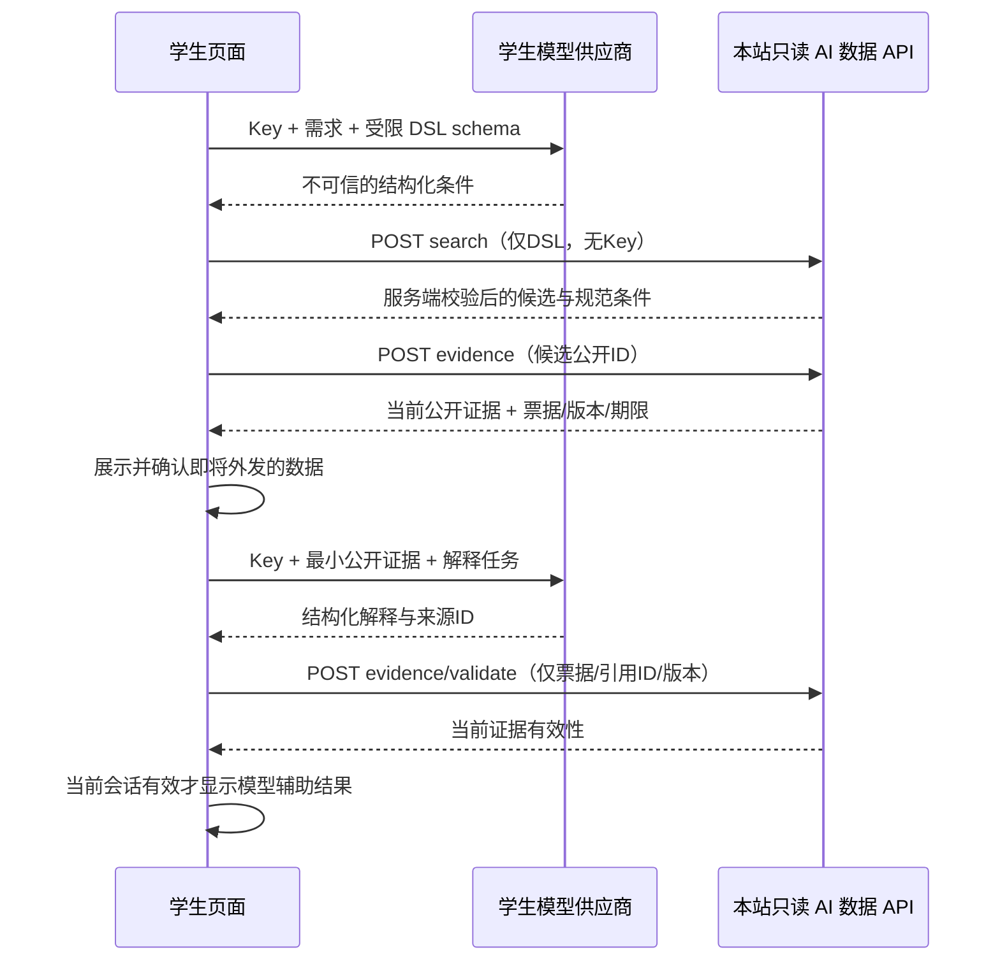

# 学生自带模型：页面配置与浏览器直连

状态：用户已确认仅浏览器直连，设计待实现。BYOK（Bring Your Own Key）表示学生使用自己的供应商账户，不购买或消耗站内积分。平台分析 AI 另见 [13](13-platform-ai-analysis.md)。

## 1. 页面与使用流程

学生在教师/课程查询页打开“使用自己的模型”，填写：

| 字段 | 行为 |
| --- | --- |
| 供应商 | 从经验证的供应商注册表选择；显示实际 HTTPS origin、协议和浏览器兼容状态 |
| API Key | 密码型输入，默认遮罩，允许本人显式查看/清除；只保留当前页面内存 |
| 模型名 | 学生手动填写，校验非空、长度及协议允许字符；不强制绑定平台模型 |

不上传 Key 验证配置，不把 Key 作为表单提交到本站，不自动联网枚举供应商模型。只有学生点击“连接测试”或“开始查询”，才按展示的目标发起供应商请求；连接测试可能计费，应提前说明。切换供应商必须清空旧 Key，不自动把同一 Key 发送到新 origin；切换模型重新确认配置。

展示“Key 仅当前页面使用，刷新后需重填”“所选供应商将收到你的提问与选定公开教学资料”“模型费用由供应商向你收取”。首次外发前展示实际域名、模型、发送的数据类别与可展开证据清单；增加评价节选或变更供应商时重新确认。用户拒绝外发时仍可普通检索。

不得在 URL 参数、分享链接、自动填充的远程配置或导入提示词中接受 Key/自动更换目标域名。首期不提供 Key 记住、跨端同步或云端密钥保管。供应商/模型的非秘密偏好若将来要保存，单独定义白名单，不能顺带序列化整个配置对象。

## 2. 供应商注册表与兼容性

注册表是平台维护的非秘密配置：`providerId`、展示名、固定 HTTPS origin/path 模板、协议版本、鉴权 header 名、可用浏览器、允许的请求字段、响应/流解析 adapter、CORS 验证时间与声明。模型名由用户提供，不用于拼装 host 或任意路径；需要路径型模型参数时严格转义并限定协议模板。

不承诺所有供应商可用。启用条件是在真实部署 origin、目标浏览器上验证预检、POST、鉴权 header 和响应读取；SDK/后端可调用不代表浏览器可调用。供应商变更 CORS 后将其标记不可用，页面提示选择其他兼容供应商。

首期只开放注册表审核过的 HTTPS 目标；不提供任意 URL、localhost、内网 IP、URL 用户密码、非 HTTPS 或第三方 CORS 中转站。新增自建/其他供应商由运维完成 endpoint、协议、CORS 和 CSP 验证后加入注册表，页面仍由学生填其自己的 Key/模型。

registry维护/发布统一接入本站 `/admin/ai/browser-providers`，要求对应配置/发布capability和scope，并走版本化安全发布流程；供应商目标origin/CSP变化不能当普通文字编辑热切。当前页面的Key绑定providerId+registryVersion+精确origin，任一信任目标版本变化即停止调用并清Key，由学生重新输入确认，不自动把旧Key发送到新目标。管理员始终不能读取或索取学生Key。

registry配置/发布限system_admin当前组内capability/scope，content_admin无此系统能力。用户主分类固定五组；管理组不自动取得学生资格或本页数据API权限，见[15](15-anonymous-student-verification.md)。

浏览器不能为对方设置 Access-Control-Allow-Origin。`no-cors` 无法提供正常的模型 API 响应读取，也不能被当成兼容方案；不推荐安装关闭安全限制的扩展。[CORS](https://developer.mozilla.org/en-US/docs/Web/HTTP/Guides/CORS)、[Fetch 请求模式](https://developer.mozilla.org/en-US/docs/Web/API/Request/mode)

## 3. 密钥与请求隔离

Key 只存在密码输入状态和最小 transport 闭包，不存全局 store、调试状态树、localStorage、sessionStorage、IndexedDB、Cookie、URL、Service Worker 或服务器；不进入 console、事件记录、session replay、错误上报、CSP 上报正文、复制诊断或自动保存表单。页面关闭、退出、离开 AI 工作区、清除配置时取消在途调用并清理引用；不能保证 JS 字符串物理归零。

本站 data client 与供应商 model client 是不同模块，不能共享默认 Authorization、Cookie、CSRF 或请求拦截器。供应商请求仅向注册表精确目标发送 Key：`mode: cors`、`credentials: omit`、`cache: no-store`、`redirect: error`、`referrerPolicy: no-referrer`；鉴权使用协议认可的 header，不把 Key 放 URL/query。拒绝需要 URL Key 或不能安全直连的 adapter。[OWASP 浏览器存储安全](https://cheatsheetseries.owasp.org/cheatsheets/HTML5_Security_Cheat_Sheet.html)

CSP connect-src 仅允许 self 和当前版本获准供应商 origin，不用 `https:`/`*` 兜底；供应商更新需要同步静态安全头和注册表。敏感配置区禁用第三方统计/session replay；模型文本按安全纯文本/Markdown 渲染，不执行 HTML/脚本/图片追踪链接。[CSP connect-src](https://developer.mozilla.org/en-US/docs/Web/HTTP/Reference/Headers/Content-Security-Policy/connect-src)

Key 必须被页面脚本读取才能调用；这意味着 XSS、恶意浏览器扩展或被控制的前端构建仍可能窃取 Key。内存保存缩小持久泄漏范围，不等于绝对保密。建议用户使用有额度限制、可随时撤销的专用供应商 Key；平台不替用户管理或保证其供应商账单。

管理员也通过同一前端站点进入/admin，但必须完整卸载学生document，进入前abort本地模型流程、清Key与解释。管理document使用connect-src self且不导入browser adapter，返回学生页需重新输入Key。pagehide/pageshow/BFCache和切账号先清理/重验，不直接恢复旧Key；同源管理页面不能凭此读取学生内存或把学生Key上传密管。细节见 [14](14-admin-workspace-and-security.md)。

## 4. 查询与证据流水线



原始提问和学生模型输出默认不上传本站。若需要教师/课程名解析，search 的受限 DSL 可含有界文本名称，由服务端解析为已授权公开 ID；不能将对话 transcript、供应商 request 对象或 Key 打包到检索请求。缺少学期、课程歧义或无结果先澄清，不擅自放宽硬条件。

模型 DSL 示例：

```json
{
  "schemaVersion": 1,
  "courseNames": ["高等数学"],
  "termId": "resolved-public-term-id",
  "campuses": ["犀浦"],
  "excludeTimes": [{ "weekday": 3, "periodStart": 5, "periodEnd": 8, "weeks": [1, 3, 5] }],
  "requirements": { "minPublishedReviews": 5, "minClarity": 4 },
  "preferences": [{ "field": "clarity", "direction": "desc" }],
  "limit": 10
}
```

search/evidence/validate每次校验独立active且未撤销的学生grant及scope，管理员也不豁免；部署配置只能进一步缩小grant学校范围，不信模型institution/role。grant仅证明首次验证时学生，无自动到期/续证/换绑。初始课程≤5、排除时间≤20、limit≤20、评分1–5、问题≤2000字符，未知字段拒绝。SQL参数化且有预算；样本不足或时间未知如实标记。候选ID/排序/数值由确定代码控制，模型只为已检索候选解释。

evidence 返回最多20个候选、40条评价节选，总UTF-8响应≤32KiB，包含必要教学资料、证据公开ID、revision/generation、dataVersion、teacherSummaryEpoch（涉及平台总结时）、`evidenceReceipt` 和 `expiresAt`。票据由服务端签名、绑定主体和完整证据集合摘要，有效期建议2分钟；不是读取未公开数据的授权凭证，validate必须重查主库，不能仅验证签名/过期。票据、本站Cookie/CSRF与内部主体不进入供应商上下文，只发送其对应的公开资料。

解释完成后验证：模型返回 ID/引用都在集合内，数值与资料一致，后端确认完整使用证据集仍可公开。任何来源撤稿/版本变更或资格/会话失效都作废整个该轮解释，而非只删除脚注。票据过期需用户显式重新获取/查询，不自动无限付费重跑。

## 5. 输出可信度与展示边界

页面将“数据库筛选结果”“你的模型解释”“平台教师总结”分区标注。模型不能改教师评分、候选ID、学校、课表冲突结果或平台置信度结论。没有数据就显示未知；不能把低难度当高质量，不能从姓名或描述推断敏感属性。

本站 validate 只核对访问资格、证据版本/可见性、引用与结构化数值，不能证明自由文本真假。即使证据有效，模型仍可能误读或编造解释；候选卡片优先显示来自数据库的事实，并提供原始评价入口。不能以“证据验证通过”包装成平台认证答案。

学生模型回答只用于当前页面，不上传成为公开教师总结、审核决定或评价置信度。无平台持久聊天历史、服务端模型作业和结果表。默认不展示未经最终检查的解释 token；可以在本地显示“解析条件/获取资料/生成解释”等阶段。

用户已得到的公开资料可能被其复制或外发，平台无法从供应商侧撤回已发送内容。撤稿约束覆盖平台后续证据获取/验证和诚实客户端后续展示，不承诺控制被修改的浏览器、已下载资料或供应商保留行为。

## 6. 本地状态、取消与故障

本地状态：`unconfigured → ready → parsing → searching → confirming_data → explaining → validating → completed`，任意执行态可到 `cancelled | failed | invalidated`。配置变更、查询变更或退出提升本地 runGeneration，旧流/响应不能覆盖新结果；AbortController 取消所有关联 fetch。页面刷新丢失 Key 和临时回答，不提供服务端恢复。

界面每次仅允许一个模型工作流；初始每次最多两次模型调用，输入/证据/输出有 token/字节上限，本地整体截止建议45秒。它们是诚实客户端保护，不能约束学生自行修改页面或另用自己的 Key；供应商账户预算必须由学生设置。

本站对 search/evidence/validate 独立限流、有界查询、会话/学生资格与 CSRF 检查；平台分析预算不足不能拒绝这些仍有基础设施配额的 API。本站不预留学生供应商费用、不扣积分，不声称掌握准确账单。停止按钮不能保证供应商停止计算或退款；付费调用失败/断连不自动重试，用户显式选择再调用。

校园认证流的账号/subject/姓名/邮箱/学号/token/材料及其密文、HMAC tag和查重信息都不属于AI证据或诊断数据，不接收、不外发、不采样留存。认证由隔离verifier处理，本站AI数据API只读取独立平台grant最小状态，不连接校园身份或查重集合。

错误按受控类别显示：未配置、供应商不兼容、网络/跨域失败、Key无效、模型不支持、供应商限额、模型输出不合格、本站搜索繁忙、证据已变化。浏览器常不能精确区分 CORS、DNS 与网络错误，提示检查兼容状态，不臆称 Key 无效，不上传供应商原始错误/请求对象。[CORS 错误可见性](https://developer.mozilla.org/en-US/docs/Web/HTTP/Guides/CORS)

## 7. 验收

- 用合成 Key 标记检查所有网络、存储、日志、错误报告、构建产物和分析事件：标记只允许出现在所选供应商鉴权 header 和页面临时内存，本站不得收到。
- 验证真实 origin 的预检、协议和响应读取；CORS失败不会产生本站/第三方relay或no-cors重试；供应商重定向被拒绝。
- 切换供应商清 Key，跨会话/标签页无共享，离开页面/退出清理；旧响应无法覆盖新查询，失败不重复计费调用。
- 恶意模型输出尝试SQL、跨学校、私有评价、作者邮箱、超量ID、修改原分或插入HTML均不能扩大能力；后端拒绝Key等额外字段且拒绝日志记录请求正文。
- 生成完成前撤稿、退出或资格撤销时不展示旧解释；票据未过期也须检查主库；模型引用伪造不能混进数据库卡片。
- 区分平台总结与个人模型答案；没有配置/CORS兼容模型仍可正常查询和阅读平台已有效生成的总结。

这些为待实现的发布门槛，不能用前端单测替代真实浏览器的 CORS、CSP、网络和泄漏检查。
