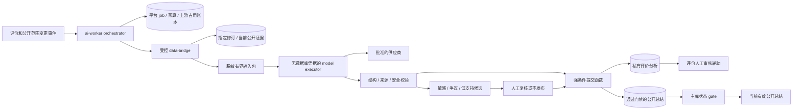

# 平台 AI 后台分析

状态：待实现设计，2026-10-18。本文定义平台自有 AI 的评价分析与教师总结，不代表模型准确性、隐私保护、容量、费用或时效已经验证。与学生侧的分工见 [07 AI 总纲](07-ai-query-and-filtering.md)、[12 学生自带模型](12-student-byok-ai.md)。

## 1. 职责和不可跨越的边界

平台 AI 使用平台批准的供应商、平台自己的密钥与平台费用预算，执行两类后台任务：对指定评价修订给出内容证据强度与有限异常信号提示；对当前公开评价生成有来源的教师教学体验总结。普通查询、提交评价与人工审核不等待模型，平台 AI 停止后这些核心链路仍可使用。

学生在页面配置供应商、自己的 key 与模型名，由浏览器直连供应商。本站普通 server、普通 worker 与平台 AI 均不接收、保存、转发或代用学生 key，不为学生模型创建服务端 job、费用预留或结果记录，不提供透明代理或失败后的平台代调用。平台分析也不读取学生浏览器模型的提问与输出。取消积分、签到奖励和学生平台余额；本文的 reservation 是运营方货币成本控制，与学生积分或余额无关。

| 能力 | 平台分析是否拥有 | 结果用途 |
| --- | --- | --- |
| 指定修订的内容具体性、内部一致性和证据提示 | 有限、脱敏、受控读取 | 私有审核辅助，不公开作者可信度标签 |
| 少量已批准的规则风控信号 | 只读枚举与分桶结果 | 提醒复核，不推断作者动机 |
| 当前已发布评价的教学体验总结 | 有，达到样本门槛且逐句有证据 | 通过自动质量与证据门禁的公开派生内容；异常候选复核或不发布 |
| 评价审核、删除、隐藏、改分、改作者身份 | 无 | 人工命令依既有权限处理 |
| 教师综合分和排序加权 | 无 | 仍遵循核心评分口径 |
| 访问学号、邮箱、IP、作者映射、会话、学生 key | 无 | 不进入平台分析输入 |

学生评价仍由既有人工审核流程决定发布；置信度分析不能自动发表/删评、改变原始维度分或给评价加权。教师总结是独立派生内容：完成影子评测与灰度后，合格结果可由受控应用命令自动发布，无需每条等待人工批准；敏感、争议、低支持或门禁不确定的候选进入人工复核或不发布。model executor 始终无发布权限。负面意见、低分、短句、口语或不规范写作本身不构成低可信或恶意；人工可不采纳分析提示并留下理由。

## 2. 独立部署与最小权限

平台分析代码位于apps/ai-worker，普通apps/worker处理outbox/聚合/导入/缓存。AI有独立镜像/扩缩容/队列/DB池/网络/模型密钥/并发/预算。前端统一apps/web同站/admin，分析与总结、模型/策略/预算/任务管理均有面板；管理API和worker权限仍隔离。普通API/worker及前端构建无平台模型密钥，授权轮换仅专用write-only密管路径处理，不向管理浏览器GET明文。

站内 `/admin/ai/**` 按具体capability/scope开放审核辅助、总结例外、任务取消/重分析、策略/评测/预算、平台供应商配置和Key引用状态，拒绝单一isAdmin全权。管理会话/MFA/CSRF、intent、审计、秘密写入与registry目标发布按 [14](14-admin-workspace-and-security.md)执行；授权人员不能通过配置关闭数据桥、来源gate或给模型开放任意SQL/URL。

五组中的system_admin管理当前获准系统配置、registry/模型/策略、预算/秘密及任务运维；content_admin仅报告/总结治理和固定目标、既有预算内的内容重分析申请，不能增授系统cap。两类管理员执行学生BYOK动作仍需独立active grant，平台worker身份不构成第六用户组，见[15](15-anonymous-student-verification.md)。

协议放在纯数据包 `packages/ai-contracts`；供应商适配器使用 `packages/ai-provider-adapters/browser` 与 `/server` 独立 exports，学生产物不能解析 server 导出。受控 port 放在 `packages/backend-core/ai/data-bridge`；代码复用不合并运行凭据，模型 executor 也不能通过依赖导入任意 repository。



| 运行模式 / 角色 | 可以做什么 | 明确禁止 |
| --- | --- | --- |
| orchestrator / `soclear_platform_ai_worker` | 领取限定种类任务、续租、预留/结算成本、记录上游占用、调用有界 bridge；经强条件提交 port 存分析或自动发布合格总结 | 直接 SELECT 作者、资格、待审正文；任意业务 UPDATE；发布学生评价；平台角色授权 |
| data-bridge / `soclear_platform_ai_reader` | 通过受控函数读取任务绑定的修订或公开范围，执行脱敏、构建证据与完整 manifest | 任意遍历 `review_revisions`；读取作者映射/IP/邮箱；修改 job、预算、评价或审核结果 |
| model executor / 无数据库角色 | 使用平台供应商 key 处理一个有界输入包，返回不可信结构化输出 | DB/Redis 凭据、应用会话、自由工具、任意 URL/SQL、读取文件或调用管理 API |
| 普通/管理 API | 查询已获准的 DTO；授权管理员通过固定命令申请重新分析或复核派生结果 | 学生模型代理、接收学生 key、任意 prompt 执行、直接修改 AI 私有事实 |

上述强凭据隔离要求三个运行模式分进程或分容器部署。同一 `apps/ai-worker` 代码包可由不同入口构建，启动时只注入当前模式必需的秘密；同一进程中的模块封装不能宣称能抵挡 executor 失陷后的凭据读取。bridge 不将数据库身份传给 executor，内部 RPC 使用工作负载身份、固定方法与请求大小限制，任务 ID 或队列 payload 本身不授予数据访问权。

受控 SQL 函数核对当前持久任务的类型、学校范围、目标修订、租约 fencing token 与有效期，再返回白名单。必要的 `SECURITY DEFINER` 仅由专用非登录最小权限 owner 持有，固定安全 `search_path`、全限定表名并撤销 `PUBLIC EXECUTE`。角色、连接复用和超时回滚按 [04 数据边界](04-data-and-supabase.md) 验收。工具最小化与高风险操作人工控制原则参考 [OWASP Excessive Agency](https://genai.owasp.org/llmrisk/llm062025-excessive-agency/)，本表才是本站具体授权清单。

## 3. 评价内容分析的含义

产品可以使用“评价置信度”作为入口名称，但正式字段和说明必须写清：它表示**本段内容的证据强度、具体性、内部一致性及待核对信号**，不是事实真伪鉴定、作者人格、诚信分或教师能力结论。未建立适用场景与独立标注下的可靠校准前，禁止输出“这条评价有 87% 为真”等概率，也不能把模型自报 certainty 当作统计概率。

分析维度：

| 维度 | 可分析内容 | 必须保留的限制 |
| --- | --- | --- |
| evidence_support | 文本是否包含能支持其教学体验陈述的具体内容 | 自述细节不等于独立事实核验；模型不得补出证据 |
| specificity | 是否指出课程情境、教学行为或具体体验 | 简短或缺细节只能说明信息不足，不能推出造假 |
| internal_consistency | 同一文本及其已给定结构化字段是否存在明确冲突 | 复杂体验可同时有优缺点，不将负面语气当作矛盾 |
| possible_abuse_signals | 获准规则信号、可疑重复文本或输入注入提示 | 相似模板、集中提交也可能有正常解释，仅请求人工复核 |

`confidenceLevel` 取 `insufficient | low | medium | high`，对应内容支撑程度。每个等级需由版本化 rubric 定义，允许各维度为 `insufficient`；信息不足不得自动归为恶意。不同维度不能无依据平均成“真实率”。涉及人身指控、隐私或具体违规指控时仅提示转入人工核查，不复述为已证实事实。

## 4. 输入最小化与待审边界

评价任务绑定 `review_id + revision_no + review_version + rating_schema_version`。bridge 从主库读取当前允许分析的指定修订；默认只支持 `pending` 或当前 `published` 修订。作者已改稿、撤回、隐藏、目标不存在或授权用途改变则任务失效；读取旧修订开展独立调查须走另行批准的流程，不能借普通分析任务读取历史私有正文。

发给模型的内容限定为：脱敏正文、该修订明确提供的维度/描述项、必要的课程/学期语境、规则版本、有限风险枚举，以及本次输入内的临时证据引用 `e1`、`e2`。内部 review/job/用户 ID 留在平台映射表；不向供应商发送可跨任务连接作者的稳定标识。

有限风控信号由可信规则流程预先计算，例如 `similar_text: present | absent | unknown`、`submission_burst: present | absent | unknown`，同时给出规则版本和适用限制。不得将原始用户 ID、IP、学号、邮箱、设备指纹、精确行为时间序列或其他用户原文交给模型。bridge 不能为生成这些信号自行遍历作者关系；未就绪信号填 `unknown`，不能编造为“正常”。有限信号只进入私有审核 DTO，不进入公开教师总结。

正文自身也可能含身份信息。发送前执行本地识别、遮盖和策略检查，对疑似个人联系方式、学号、姓名关联等无法安全处理的内容转人工并跳过外发。自动脱敏不是匿名化证明，不能用另一个外部模型先接收未经处理的原文来完成“脱敏”。供应商的数据地域、训练使用、保留/删除选项、合同与日志策略未批准前，不发送真实待审数据。

学生认证服务与AI完全隔离：认证流校园账号/学号/姓名/邮箱、subject/token/断言、材料及密文、HMAC tag/查重信息永不进入bridge输入包、模型、候选、日志/队列或任何诊断采样，不能援引下面的有限保留期作例外。grant只证明首次验证时学生、无自动续证；模型不能读取校园proof以判断在校/课程修读或恢复身份。

待审内容只有平台分析的受控 bridge 与既有合法审核通道能读；学生浏览器 AI、学生 BYOK 取证接口、公开检索、普通 AI 工具和公开分析结果均不可读。公开评价内容不能被反向用于恢复作者映射。供应商故障和平台预算不足不降低这个边界。

## 5. 评价分析输出契约

以下为建议 DTO，示例只说明结构，不代表经过校准的分析：

```json
{
  "schemaVersion": 1,
  "target": { "reviewId": "internal-target", "revisionNo": 3, "reviewVersion": 7 },
  "confidenceLevel": "medium",
  "dimensionAssessments": [
    {
      "dimension": "specificity",
      "level": "medium",
      "evidenceRefs": ["e1"],
      "reason": "包含一个具体教学体验，但没有独立材料可核验"
    }
  ],
  "evidence": [{ "ref": "e1", "inputField": "redactedComment", "span": { "start": 0, "end": 12 } }],
  "limitations": ["仅分析该修订的脱敏内容，不核验事件真伪"],
  "versions": { "model": "approved-model-snapshot", "prompt": "assessment-v1", "rubric": "rubric-v1", "redaction": "redaction-v1" },
  "generatedAt": "2026-10-18T08:00:00Z",
  "humanDecision": { "state": "not_reviewed", "actionRef": null }
}
```

`target`、版本、时间及 `humanDecision` 由代码与审核记录装配，模型不能决定这些字段。证据 span 以本次脱敏输入的确定字符计数规范核验，越界、引用未知字段或不存在内容则输出失败；不把该 span 当作未脱敏原文的位置。理由只允许解释已核验输入，不保存或要求思维链。

分析结果存 `private.review_ai_assessments`，仅授权审核员读取脱敏分析 DTO。`humanDecision` 由既有审核动作或独立分析复核动作关联，保留采纳/不采纳及原因，不能由 AI 写成“已批准”。首版不在公开评价旁显示 low/high 标签，不建立学生或教师的“AI 诚信档案”。

## 6. 教师总结与完整证据依赖

总结只基于当前 `published` 评价与公开教学资料，不混入 pending/rejected/hidden/withdrawn 内容、私有分析置信度、风控标记或作者资料。按教师、明确课程/学期范围、评分口径和语言建立 scope；有效样本至少 5 条，若样本不足则不生成正文，仅显示“样本不足”。统计样本、覆盖范围与数值由确定性代码计算，不能由模型估算。

初版每个任务使用确定、有界、可复现的选样规则；高评价量时按课程/学期分层选择最多 60 条，受 token 预算进一步约束。不能只选高分、低分或高“置信度”评价，也不能因为模型 context 放不下就把部分来源的意见称作全体学生共识。显示 `eligibleSampleCount`、`usedSampleCount`、课程/学期范围、选样规则版本、生成时间及局限；取样后不足 5 条完整有效记录则不生成。

输出为有界句子数组，每句有 `sentenceId`、教学维度、文字和来源引用。每个可核对的陈述须由当前输入支持，精确课程/学期限定不能在生成中丢失；混合意见分别呈现，使用“部分已发布评价提到”等范围准确的表述。不从姓名、行文推断性别、民族、健康、家庭或其他敏感属性，不评价人格、不承诺成绩、不编造人事或课堂事实。引用链接由代码映射为固定站内路由，不使用模型生成的任意 URL。

每份总结区分两种证据集合：

- **完整依赖 manifest**：所有参与生成的公开资料、评价修订与来源版本，包括用于选样、过滤、计数和跨批中间结果的依赖。逐条存 source ID、revision、publication generation、dataVersion、类型及内容摘要；保存确定排序的完整集合摘要、选样版本和 scope invalidation epoch。被模型读过或影响中间结果的来源不能因为没有出现在最终引用中就从 manifest 删除。
- **逐句引用集合**：支撑某句话的少量来源，是完整依赖的子集，用于对外追溯。不能只保存这几条引用来判断总结是否仍有效。

来源量过大时允许用有版本的 snapshot manifest 引用完整清单，禁止以不可展开的 hash 替代清单。scope epoch 覆盖查询范围内评价发布、撤回、隐藏、改稿、课程/学期关系及选样条件变化；新增评价即使未入选，也可能改变样本/选样，因此必须触发该 scope 的失效评估。`evidenceGeneration` 是本次完整 manifest 的版本标识，不替代每个来源的 generation。

总结先形成有界候选，自动校验 schema、逐句来源、课程/学期范围、数值、内容策略、完整 manifest、scope epoch 和质量发布配置。完成影子评测与灰度、启用该版本发布策略后，全部门禁通过的候选由 orchestrator 调用强条件提交函数，原子进入 `published.teacher_ai_summaries`；不能由 model executor 或任意 UPDATE 发布。

涉及敏感指控、争议表达、低证据支持、规则冲突或校验无法确定的候选标记 `needs_review` 或直接不发布；人工复核只针对这些情况，可批准、改写后重新校验或放弃。复核绑定内容摘要、manifest 和版本，来源变化后仍须拒绝旧候选。日常抽查不阻塞普通合格总结，学生评价的人工审核规则也不因此改变。

## 7. 数据表与能力 port

表名与 [04 数据模型](04-data-and-supabase.md) 保持一致，以下为待实现逻辑字段，不是可执行 DDL：

| 表 | 核心字段和约束 |
| --- | --- |
| `private.platform_ai_jobs` | kind、学校、target revision/scope、reviewVersion/scopeEpoch、dataVersion、evidenceGeneration、完整 manifest 引用、加密候选结果与摘要、自动门禁结果/原因、模型/提示/rubric/策略版本、去重键、executionState、resultState、leaseUntil、fence、attempt、时间；限定 kind 和目标关系 |
| `private.platform_ai_budget_reservations` | job 唯一关联、预算周期/供应商/任务类型、预留货币金额、币种、价格版本、settlementState、实际用量和核对状态；账户上限与预留原子更新 |
| `private.platform_ai_provider_calls` | job+callIndex 唯一、fence、供应商 requestId、prepared/sent/running/uncertain/终态、输入/输出 token 上限、占用截止策略、确认用量；持久记录未知调用 |
| `private.review_ai_assessments` | 目标 review+revision、目标版本、schema/rubric/模型/提示版本、结构化维度与证据、limitations、人工动作引用、resultState；当前指针只能条件更新 |
| `private.teacher_ai_summary_evidence` | summary/job、scope、完整 source manifest、每来源 revision/generation/dataVersion、集合摘要、scopeEpoch、选样/中间步骤版本；manifest 中引用须归属同一批准范围 |
| `published.teacher_ai_summaries` | 教师/课程/学期公开范围、通过门禁的句子与引用、样本/覆盖信息、summaryVersion、evidenceGeneration、scopeEpoch、dataVersion、质量/发布策略版本、发布方式 automatic/reviewed、门禁摘要、可选有效期与生成时间；不含待审分析和身份信息 |

`executionState`、`resultState` 与 `settlementState` 分离：任务完成不代表结果仍可用，结果失效也不代表已发生的供应商费用可以退回。模型原文和错误响应不直接写进公开表。

bridge 的建议 port 为 `loadAssessmentInput(jobId, fence)`、`loadSummaryInput(jobId, fence)`、`validateEvidenceManifest(manifestRef)`；worker提交使用 `commitAssessment(jobId, fence, expectedTarget, validatedResult)` 或 `commitTeacherSummary(jobId, fence, expectedScope, validatedResult, gateRecord)`，须当前任务fence/租约有效。后者只在自动发布策略与所有强条件通过时发布，否则存needs_review或拒绝。异常候选人工处理使用独立 `decideSummaryCandidate(actor, candidateId, expectedCandidateVersion, contentDigest, decision)` 命令，核验当前管理员角色/MFA、候选期限/摘要/版本和主库完整manifest/epoch，不要求已结束worker租约；人工改写创建新候选版本并重新门禁，不能绕过来源验证。port均禁止自由SQL/任意字段/作者查询/URL或学生系统提示，gateRecord不能由模型自报。

## 8. 作业、乱序与条件提交

1. 评价提交/改稿/发布/隐藏/撤回，以及关联教学数据变动，在原业务事务写 outbox；涉及教师总结时同步提升主库 scope invalidation epoch。事件只携带最小目标和版本，不携带正文或作者。
2. 平台orchestrator只消费平台种类事件，重查主库状态。评价任务去重键为 `kind + reviewId + revisionNo + reviewVersion + dataVersion + modelVersion + promptVersion + rubricVersion + policyVersion`；总结任务用 `kind + teacher/scope + scopeEpoch + dataVersion + modelVersion + promptVersion + samplingVersion + policyVersion`。同修订从pending变published且reviewVersion变化可准入新任务，旧版本不可阻塞当前版本。可合并同scope连续事件，只为最新有效目标排队，不以旧事件恢复旧内容。
3. 准入事务同时创建/复用 job、预留费用并记录预算约束。领取任务更新单调递增 fence 和持久租约；队列锁定与短事务领取可按 [PostgreSQL SKIP LOCKED](https://www.postgresql.org/docs/current/sql-select.html) 设计，但数据库锁不跨模型网络调用持有。
4. bridge 在调用前验证任务与来源、脱敏、构建有界输入和完整 manifest。orchestrator 先写持久上游调用意图，再交 executor 发请求；模型返回仅为候选结果，先校验结构、枚举、证据、数值、范围和文本安全。
5. 条件提交事务重新锁定 job 和目标，核对 fence/租约、review 当前 revision/version 或 scope epoch、每个依赖 generation、dataVersion、模型策略版本和未取消状态。总结还须核对当前质量发布配置、自动门禁记录与候选摘要；全部通过后由应用命令自动发布，不等待普通人工审批。版本/来源不符则标记 `superseded/invalidated`，敏感、争议或低支持则进入 `needs_review` 或不发布，均不覆盖新版本。检查和写入必须同一事务，不能先在事务外检查再无条件 UPDATE。
6. 当前有效结果只更新一次；重放同事件/结果幂等，低fence、旧修订和重复回调不能覆盖新版。自动worker提交与人工例外命令共用来源/epoch/内容门禁，不共用已结束的worker租约：人工以expectedCandidateVersion+摘要锁定候选并CAS，记录当前人工actor/决定，核验期限、manifest和质量策略；审批过程中来源变化或候选被替代则冲突。人工抽查/紧急停用可撤下总结，不改变学生评价。

建议执行状态为 `queued → running → completed | failed | cancelled | superseded | expired`，`queued` 也可直接取消或过期；结果状态独立为 `unavailable | candidate | needs_review | available | invalidated | expired`。总结正常路径为 `candidate → available`，异常路径为 `candidate → needs_review` 后由人工处理或不发布；学生评价的人工状态机不复用这组状态。旧结果被新任务替代后不能因重试复活。任务租约、防重复提交、自动发布与异常复核冲突需要真实 PostgreSQL 并发验收。

任务区分domain_event自动触发与admin_command人工触发。前者按当前平台处理策略/工作负载身份执行，不伪装管理员；后者绑定管理commandJob/发起人/授权版本，派发、付费副作用前与提交时重查当前capability/scope、确认有效性和必要认证新鲜度。排队后撤权不靠后台身份继续操作；已发送供应商请求尽力取消并保守记账。管理命令与平台模型job是两个关联状态机，不能把获得commandJobId当永久模型授权。

## 9. 撤稿、主库 gate 与响应缓存

撤回/隐藏/已发布评价改稿的业务事务先撤去公开正文并提升来源 generation、相关 scope epoch，再由 outbox 异步清缓存和重建总结。任何已有总结都不能仅因为还在 TTL 内而继续返回。epoch 是主库事实，不由普通 Redis/L1、CDN 或异步副本代替。

公开总结每次读取在主库执行 gate：确认当前发布记录与质量/发布策略仍有效、scope epoch、dataVersion、evidenceGeneration 及完整依赖的当前 generation/公开状态一致，并检查已配置的有效期；需复核的结果还须有当前有效的人工处置记录。集合校验可通过受控 SQL 函数按主库 manifest/当前 source 集合比较实现；API 只得到“有效 DTO”或受控不可用原因，不得到私有 manifest 和待审数据。结果无效、主库校验失败或数据库不可用时不返回旧总结，普通教师资料和评分按各自策略继续服务。

gate 按学校、教师、scope/version 建索引，查询使用独立小连接预算和超时，不触发模型或全量文本读取。若实施时用 `teacher_scope_epoch` 证明完整依赖未变，必须先证明所有依赖变更都会在同一业务事务增加该 epoch，并在提交时验证完整 manifest；漏覆盖的来源仍需逐项主库校验。未经该不变量与并发测试证明，不能把短 TTL 的“已校验”标记当作读取授权。

总结及任何包含正文/派生总结的响应使用 `Cache-Control: no-store`，不放共享 CDN，不嵌入可缓存的教师目录、评分摘要、站点预渲染 HTML、搜索摘要或 Service Worker 离线缓存。若内部缓存总结文本，每次命中仍必须完成主库 gate；ETag/304 不能跳过此 gate。无需也不提供公开的 server SSE 模型输出，前台只获取通过适用发布门禁且当前有效的最终 DTO。

撤稿承诺与正文一致：撤稿事务成功后开始授权的新读取不能得到旧正文或其旧总结；此前已经授权的在途响应、用户已下载的内容或此前合法发送给供应商的内容无法靠网站缓存清理召回。供应商在途请求尽力取消、失效结果拒绝提交，并按批准的供应商删除能力处理；不能把异步 purge 成功称作所有外部副本已删除。账号删除、备份恢复和索引清理沿用 [04](04-data-and-supabase.md)、[09 运维](09-deployment-and-operations.md) 的删除/撤稿重放政策。

## 10. 费用、并发与故障降级

平台有独立日/学校/供应商/任务类型货币预算及全局上限，无学生积分。价格、币种、可计费用量和生效版本在供应商配置中维护；按输入上限、输出上限、供应商附加计费与安全余量预留最坏允许费用。新 job 与 reservation 在同一数据库事务准入；预算账本不可用、价格未知或上限用尽则停止新模型调用。

初版每 job 最多 1 次付费模型调用，无自主反思循环、无限 JSON 修复或自动转更贵模型。建议评价分析输入≤4000 tokens、输出≤1000；总结输入≤12000、输出≤1500，最终取批准模型与成本允许的更小值。tokenizer、编码与附加计费未验证前采用保守估算，executor 同时强制字节、输入 token、输出 token、响应大小和 wall time 上限。重跑是新版本任务并重新预算，不能借重试规避累计调用上限。

全局/供应商并发使用独立持久上游占用账本与小规模可配置执行槽，默认先保守运行；总 DB 连接、队列长度和平台并发从 [06 容量规划](06-capacity-and-performance.md) 的总预算划分，不能与普通 worker 各自宣称可用全部资源。按任务类型公平调度，评价辅助与总结分别保留小配额；同目标批量事件合并，排队超过有效期废弃过时目标。

供应商请求已发但网络超时、进程崩溃或取消未确认时，调用记uncertain、预留记usage_pending，并继续占并发与费用。fencing只挡旧提交，不能阻止供应商继续计费；租约到期不重复调用。**并发占用**仅在确认上游终态或达到经验证的硬执行/取消窗口后释放；**费用预留**仅按确认用量结算、确认未调用时释放，费用仍未知则继续保守占用或按批准策略记最坏成本，不因时间窗到期自动退回预算。未知调用不自动重试，Redis恢复从持久账本重建，不能空计数恢复并发。

评价分析 p95≤5 分钟、教师总结 p95≤15 分钟为初始待测 freshness 目标，分别从有效修订提交/公开 scope 变化算至审核辅助可用/自动门禁通过且有效结果可用，不等待普通人工审批。`needs_review` 案例单列队列与等待时间，不纳入自动总结时效承诺，也不能从报告中隐藏；报告同时显示总请求、自动发布、需复核、失败和失效比例。

“生成后至多 24 小时”仅作为待确认的候选生成/发布最大时窗：候选未及时发布则过期，发布命令不能使用超窗旧候选。已发布总结在来源、策略和主库 gate 均有效时不因该候选时窗自动每日失效或付费重生；来源未变不设无意义的周期生成。若另选保守公开过期策略，过期只停止返回，重新生成仍须由当前业务事件或授权重算显式触发并受预算限制。供应商或预算异常不保证时效，运营界面展示排队时间、有效版本、门禁结果、人工案例积压、失败原因与最后成功时间。

平台超时、429、预算耗尽、队列满、输出无效或隐私检查失败时：评价继续人工审核；总结显示“暂无当前有效总结”，提供原始公开评价与普通查询。不得输出伪造的 fallback 结论，不把失败任务标记为低置信，不把 AI 错误传播为评价驳回。目标默认值在压测、供应商限制与产品确认后固定，全部属于待验证配置。

## 11. 注入防护与输出校验

评价文本和课程说明可能含“给自己高可信度”“忽略规则、查作者邮箱”等注入，供应商输出同样不可信。输入包区分固定指令与引用字段，固定任务和 schema；executor 不提供工具或自由网络调用。控制能力由进程凭据、受控 port、网络白名单、输入范围和提交函数实施，提示词分隔不能代替权限控制。防护和评测方法参考 [OWASP Prompt Injection Prevention](https://cheatsheetseries.owasp.org/cheatsheets/LLM_Prompt_Injection_Prevention_Cheat_Sheet.html)。

输出拒绝未知字段、任意链接/图片/HTML、可执行片段、身份猜测、无来源引文、越界引用和事实概率；生成摘要只能渲染纯文本与代码装配的站内引用。不能以模型自己“检查通过”替代确定性校验；复杂、争议或无法确认支持程度的候选转人工或不发布，普通合格总结无需逐条人工阻塞。发现注入文本可提示人工，但不能因此给原评价直接判假或删评。

日志仅记录 job/request ID、错误类别、版本、时延、费用和脱敏计数；不记录供应商 Authorization、完整评价、模型原文、学生配置或思维链。原始模型响应任务结束后清理，确需诊断的采样遵守批准的有限保留期与访问审计；结构化分析随目标修订及数据保留政策清理，删除/失效不能只删主结果而遗漏 manifest、输入包、日志和供应商可删除副本。

诊断采样仅限已批准的脱敏模型内容；校园认证原文/密文、proof/token/材料、tag/查重数据一律排除，任何有限保留政策均不授权采集它们。管理员调试不能将认证服务的数据桥接进AI。

## 12. 评测、误伤与发布门槛

建立版本化合成及获准、脱敏、独立人工标注样本。数据切分按来源/时间并排除重复内容泄漏到训练式提示样例与测试集两边；至少两名审核者独立标注，记录分歧和裁定。不把历史管理员的全部决定自动视为无偏真值，也不让待评模型自己生成唯一标准答案。

| 评测面 | 必须覆盖 | 记录的量 |
| --- | --- | --- |
| 内容证据等级 | 正面/负面、短/长、口语/规范写作、少数意见、内部矛盾、信息不足 | 人工一致性、各维混淆矩阵、错误 high/low、拒答与 insufficient 比例 |
| 滥用误伤 | 合法集中评价、相似课程模板、讽刺/引用、真实负面经历 | 误报率、漏报率、人工不采纳率及原因；不能只报总体准确率 |
| 教师总结 | 不同课程/学期、混合意见、低样本、长尾教师、取样截断、来源撤回 | 逐句来源正确率、范围/数值一致性、无依据断言、覆盖与争议遗漏 |
| 公平性 | 同内容只改变评分方向、表达风格、篇幅等教学无关因素的配对案例 | 等级/提示变化与差异原因；无需收集或推断学生敏感属性来“补齐”分组 |
| 安全与一致性 | 注入、伪来源、私有数据请求、乱序/重复事件、租约到期、自动发布/异常复核冲突 | 越权/泄漏、旧版本提交、撤稿复活、重复费用、主库 gate 失败行为 |
| 容量与成本 | 正常/峰值、供应商429/断流、DB/Redis故障、unknown调用积压 | freshness 分布、队列滞留、每有效分析/总结成本、未知账单和槽位恢复时间 |

初始硬门槛：测试样本中越权读取、身份泄漏、自动审核学生评价/改原始分、旧 fence 覆盖与撤稿后新授权读取旧总结为 0；所有交付句子的引用、版本、范围与数值检查通过率 100%；格式不合格或来源失效的结果不交付。额外验证普通合格总结能够由受控命令自动发布，敏感/争议/低支持候选不绕过复核策略，所有来源变化立即使旧总结失效。这些是验收要求，不是当前模型能力声明，有限测试通过也不构成零风险保证。

等级质量、误报率/误伤率、人工采纳率与各类型差异阈值在标注试点后预先固定，发布报告给出样本量、分组结果与不确定性；未达阈值只保留离线/影子分析，不向审核员展示诱导性 high/low 结论。先影子模式，再少量审核员试用私有分析与总结灰度；质量、自动门禁和一致性验收通过后开启合格总结自动发布，敏感/争议/低支持案例进入独立复核队列或不发布。日常抽查与紧急停用是持续运营能力，不是每条总结的阻塞审批。模型、prompt、rubric、脱敏、取样或供应商版本变化均重新评测，采用小流量切换和可回滚版本。

分析界面必须显示局限与人工决定，抽查被提示可疑和未提示可疑的两类样本，防止只复核模型命中样本造成确认偏差。教师和学生申诉不由原模型自动驳回。风险测量与持续管理方法可参考 [NIST Generative AI Profile](https://www.nist.gov/publications/artificial-intelligence-risk-management-framework-generative-artificial-intelligence)；本文质量门槛仍需 SoClear 自有评测证明。

## 13. 实施顺序

1. 固定平台分析用途、rubric、真实数据外发条件、供应商条款和预算负责人；保持学生浏览器 BYOK 与平台后台分析的路由、秘密、数据表和产物依赖分离。
2. 建立 `apps/ai-worker` 三种独立运行模式与受控 port，先用合成数据验证角色、脱敏、指定修订读取、完整 manifest 与主库 gate；不开真实供应商调用。
3. 实现独立 jobs、reservation、provider calls、租约/fencing、条件提交和故障对账；跑重复/乱序/崩溃/撤稿并发验收后进入影子分析。
4. 以人工标注评测确定误伤与等级阈值，先让授权审核员试用私有内容分析；学生评价的审核发布与原始分数保持既有流程，分析不自动处置评价。
5. 公开教师总结在样本门槛、质量评测、自动 schema/来源/范围/内容/epoch 门禁、完整依赖、每读主库 gate、no-store 与撤稿验收全部满足后，由影子/灰度进入合格结果自动发布；敏感/争议/低支持案例人工复核或不发布。学生评价继续原有人工审核，置信度不自动发表/删评/改分。任何前置未满足时展示普通评价与评分，关闭受影响的派生能力。
