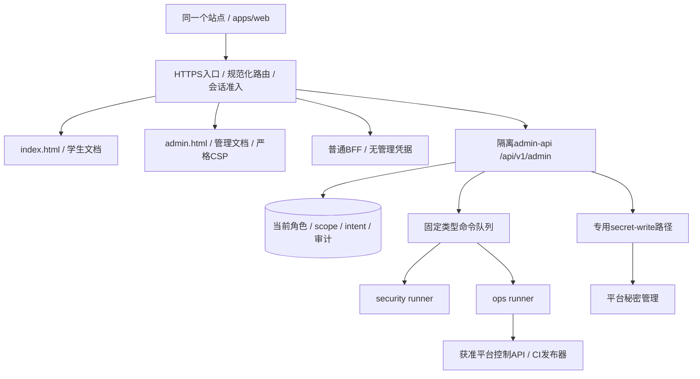
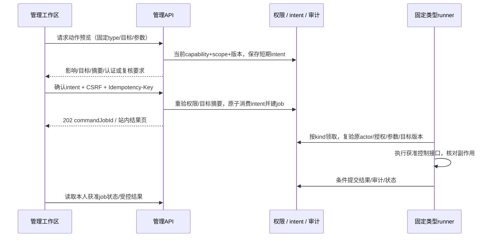

# 同站管理工作区与安全控制

状态：五权限组与匿名学生认证设计基线，2026-10-18，待实现。平台全部管理能力在同站/admin接入，只有当前system_admin或content_admin按具体权限可见可控。本文不代表后台已实现；学生认证的零真实学校信息持久化与一人一次授予协议见[15](15-anonymous-student-verification.md)。

## 1. 一个站点，完整管理入口

前端统一为 `apps/web`：普通学生页面和同源 `/admin/**` 管理工作区共用工程、设计组件与身份体系，不再建设 `apps/admin` 或单独管理域名。管理员在站点导航中看到“平台管理”，按本人当前能力显示对应模块；普通学生不显示入口、不加载管理私有数据，直接访问管理文档或API也不能绕过后端。

“全部接入”指每项支持的平台管理功能均有站内列表/详情/操作/结果/审计界面，不能只给 CLI、SQL Editor、服务器脚本或外部控制台链接。功能注册表同时绑定页面、API、capability、scope、风险等级、工作流类型和验收；没有页面的管理动作不能作为已交付功能。未配置的供应商集成显示不可用原因，不伪装执行成功。

管理员不是全权布尔值。管理请求要求当前显式管理员组、`admin:enter`、具体capability、学校/资源scope、对象状态、有效升权及CSRF；组内capability可缩减，不能用数字等级或“高于学生”推导权限。导航隐藏、JS是否可下载都不是授权。[OWASP授权设计](https://cheatsheetseries.owasp.org/cheatsheets/Authorization_Cheat_Sheet.html)

## 2. 同站文档与后端拓扑

入口将 `/api/v1/admin/**` 送往仅内网可达的隔离admin-api，普通BFF没有管理、恢复或平台模型凭据。`apps/command-runner`按security/ops/secret-write分部署；这些是工作负载模式，不是用户权限组。security模式只处理平台账户/授权/行为处置，不提供真实学校身份调查或查重账本读取。平台AI三模式和普通worker仍隔离，前端同站不合并服务端高权限。

管理路由使用同一前端构建内的独立 `admin.html` 文档入口。由普通站进入管理区必须顶层导航、完整卸载旧文档；离开时亦完整导航，不能用 `history.pushState`/组件切换声称更换了CSP。管理HTML先由服务端确认应用会话和当前管理资格：未登录去统一站点登录（returnTo仅允许站内白名单）；非管理员403；管理员尚未升权只见最小MFA/重新认证页，无工作区数据；成功后才加载对应功能。

管理HTML使用严格脚本策略、`connect-src 'self'`、禁用framing及无关第三方脚本，不连接学生模型供应商，不渲染模型原生HTML。学生文档单独使用供应商registry所需CSP。前端资源hash JS可复用，管理文档、API、导出和错误响应均no-store，入口禁共享缓存；不可把 `/admin` 未命中回退到公开SPA HTML而跳过准入。[MDN CSP](https://developer.mozilla.org/en-US/docs/Web/HTTP/Guides/CSP)

首期不注册能覆盖根站点/admin或管理API的Service Worker；no-store不阻止已有SW合成导航响应。若从旧构建升级，需显式清理/核验旧SW控制状态，无法证明时不在该受控页面开启管理功能。未来离线能力只能使用不会覆盖管理路径的独立scope并重新验收，不能靠SW脚本中的“if admin就跳过”宣称隔离。

**同源路径与双Cookie不构成浏览器安全隔离。** 普通页的XSS仍可能向同源管理API发请求，HttpOnly只限制脚本直接读Cookie。需要站点整体XSS防护、短期升权、动作验证和高影响操作确认；不能声称单独管理文档消除了同源风险。[同源策略](https://developer.mozilla.org/en-US/docs/Web/Security/Defenses/Same-origin_policy)

## 3. 固定五组、能力与范围

唯一用户主分类为system_admin、content_admin、verified_student、user、guest，名称与[01](01-product-and-scope.md)一致。mainGroup为单值，guest表示未登录且不落持久组记录；非管理员已登录主体由当前学生grant派生user或verified_student。管理员组必须显式授权，一次仅生效一个，不合并两组或旧角色模板。

| 权限组 | 职责与允许范围 | 不由组名自动取得 |
| --- | --- | --- |
| 系统管理员 `system_admin` | 系统配置、平台账户/权限治理、教学目录/映射/导入、平台AI供应商/模型/策略/预算、受控秘密写入和运维任务 | DB owner/service_role、任意执行、绕过审批、学生资格或学生AI权限、学校真实身份/查重账本 |
| 内容管理员 `content_admin` | 人工审核、举报/申诉、脱敏置信度阅读、教师总结例外/重算/撤下等内容治理；需要目录内容修正时授专门窄cap | 系统管理授权、系统组授予、秘密写入、模型/预算/registry系统配置、备份恢复/发布和广域数据导入 |
| 学生（认证）`verified_student` | 当前学校scope内的学生评价/点赞/受控BYOK数据能力 | 任何管理导航/DTO/命令，不因认证得管理员权 |
| 用户 `user` | 普通登录、本人记录、撤回/申诉/删除与平台账户恢复 | 学生新增提交/学生AI数据或管理权 |
| 游客 `guest` | 公共教师/课程/评价/有效总结查询 | 持久身份记录、私有数据、学生或管理能力 |

组不是数字等级，也不是全权模板。系统capability只分配给system_admin；content_admin只能在内容职责集合中缩减/按scope授权，禁止为其添加系统cap以变相升级。system_admin也必须逐动作具备注册cap，不能仅凭组名审核、看私有内容或绕过学生资格。SQL运行账号、worker模式、capability名不再构成其他用户组。

管理员自身若要学生评价/点赞或BYOK数据接口，仍检查独立有效学生grant；没有grant就拒绝。平台账户分类与学生资格分开保存，grant撤销不撤销管理员授权，撤销管理组也不凭空恢复学生资格；grant初版不自动到期。管理员组切换需要固定授权命令/版本检查，不允许客户端换mainGroup或user_metadata。

学校scope未知拒绝；全平台scope显式授予，空值不等于无限。只有具备可委派范围的system_admin可管理组/能力绑定；不能自升权、自改授权边界、授出超范围能力或撤销最后一个有效system_admin。并发变更在DB事务锁/约束下检查。两个独立system_admin按具体高影响策略互相复核，不新增“审批员/owner”等用户组；系统管理员永远不是数据库owner。

## 4. 页面与操作覆盖矩阵

下表是首版管理功能清单。所有行以前述两种当前管理员组、admin:enter及scope为前置，capability由同一注册表生成页面/路由门禁；列出的组是职责上限，实际可按组内cap/scope缩减。单独授予content_admin系统cap是非法绑定，不能成为新增权限层级。

| 站内路径 | 功能与可操作项 | 具体capability示例 / 限制 |
| --- | --- | --- |
| `/admin` | 概览、待办、本人权限/升权状态、获准告警 | 两管理员组，`dashboard:read`，仅本人scope |
| `/admin/reviews` | 分页审核、指定修订发布/驳回、紧急隐藏、版本比较 | 内容职责，`reviews:moderate` / `reviews:hide`；不能自审或改原文原分 |
| `/admin/reports`、`/admin/appeals` | 平台内容核查、申诉答复、处理与重开 | 内容职责，`reports:resolve` / `appeals:resolve`；无学校身份核查 |
| `/admin/catalog` | 教师、学院、课程、学期维护/归档；有限显示文字修正 | system_admin：`catalog:write`；content_admin仅另授`catalog:correct-content`且限允许字段/对象，非导入/结构/来源改写 |
| `/admin/timetable`、`/admin/mappings` | 开课时间地点、来源/同名歧义映射、差异核对 | system_admin，`timetable:write` / `mappings:resolve`；不静默合并未知映射 |
| `/admin/imports` | 上传、校验、dry-run差异、发布/取消、批次结果 | system_admin，`imports:prepare` / `imports:publish`，digest/版本绑定 |
| `/admin/accounts` | 平台账号封禁/解封、会话撤销、受限账户恢复支持 | system_admin，`accounts:manage`；无校园账号/密码/学生Key/真实身份恢复 |
| `/admin/student-verifications` | 独立grant的scope/active/revoked/版本；撤销/按平台原因恢复原grant、验证服务/策略状态 | system_admin，`students:manage-grant`；首次验证时学生，无自动过期/续证；不得读tag/学校原文、直接授新grant或换绑 |
| `/admin/privacy-requests` | 本人撤回/删除请求、平台保留例外与清理结果 | system_admin `privacy:process`处理账户删除；content_admin `privacy:resolve-content`只处理内容范围，二者都无认证原文 |
| `/admin/ai/assessments` | 指定修订的脱敏置信度/证据/局限与复核 | 内容职责，`ai:assessment-read`；无作者诚信分、不改原分 |
| `/admin/ai/summaries` | 总结失效、例外复核、受控重算/撤下与内容修正 | 内容职责，`ai:summary-manage`；全manifest/epoch门禁，不改模型/预算/密钥 |
| `/admin/ai/jobs` | 平台任务/失败/unknown用量、取消和受限重分析 | system_admin `ai:operate`；内容职责仅`ai:request-content-reanalysis`固定目标且受既有预算，不调整系统额度 |
| `/admin/ai/providers`、`/admin/ai/models` | 平台供应商/模型版本、固定目标、Key配置状态 | system_admin，`ai:configure`；仅keyRef/密管版本/状态，无旧值片段/hash |
| `/admin/ai/policies` | prompt/rubric/脱敏/选样、评测/灰度/回滚 | system_admin，`ai:policy-publish`；不能扩工具/数据权限 |
| `/admin/ai/budgets` | 平台费用上限/用量/预留/核对 | system_admin，`ai:budget-manage`；非学生积分，未知费用不放行 |
| `/admin/ai/browser-providers` | 学生registry、协议/CORS/CSP验收、启停 | system_admin，`providers:configure` / `providers:publish-browser-registry`，新信任目标须安全发布 |
| `/admin/security/roles` | 两管理员组授权、固定五组分类、组内cap/scope、期限和撤销 | system_admin，`roles:grant`；不建新组，不自升权，保护最后system_admin |
| `/admin/security/audit` | 平台操作/拒绝审计、内容处置历史与有限导出 | system_admin `audit:read/export`；content_admin仅`audit:read-content`自有内容scope；均无校园数据/tag/秘密 |
| `/admin/security/account-cases` | 按目的/对象/期限核查平台账户行为、申诉与处置 | system_admin，`accounts:audit-behavior`；仅最少平台事实，无校园身份揭示/查重账本，不能从tag找账户 |
| `/admin/operations/feature-flags`、`/rate-limits` | 功能范围、灰度、route预算和限流配置 | system_admin，`ops:configure`；不能关鉴权/CSRF/撤稿gate/匿名认证边界 |
| `/admin/operations/cache` | 后端缓存/每日服务商同步：计划/时区、目标引用、源水位/年龄、最近成功/版本/失败阶段、定向失效/重建和原日槽位补跑 | system_admin：`ops:observe`查看，`ops:cache-invalidate`定向失效，`ops:cache-sync`同步重试；目标/策略/日程需`ops:configure`及相应门禁。无凭据/原始快照，不清会话/费用/查重账本，详见[16](16-backend-cache-and-daily-sync.md) |
| `/admin/operations/jobs` | 普通积压/死信重放/取消、worker排空 | system_admin，`ops:job-manage`；固定类型/版本，不能重放认证原文或重复授予 |
| `/admin/operations/metrics` | 脱敏运行/日志摘要、告警和事件结果 | system_admin，`ops:observe`；认证查重仅不关联主体的安全聚合，无原文/tag |
| `/admin/operations/backups` | 备份/恢复点、触发/验证和演练 | system_admin，`backups:manage`；不下载全库，不将真实学校信息纳备份 |
| `/admin/operations/restore` | 恢复点/影响、隔离演练、受控恢复与核验 | system_admin，`restores:execute`；重验权限/撤稿/匿名认证tombstone不复活 |
| `/admin/operations/releases` | 可信artifact、预检、灰度发布/回滚、结果 | system_admin，`releases:execute`；固定CI制品，无执行脚本上传 |
| `/admin/secrets` | 平台秘密keyRef/版本/状态，受控write-only替换/激活 | system_admin，`secrets:write`等专用cap；content_admin无此能力，学生Key永不上传 |

未来新增任何管理能力也必须接入本表同类注册项，包含错误、空状态、并发冲突和审计入口。模块暂不可用时展示原因/负责人，不用外部管理员口令、平台console或隐藏HTTP接口代替站内日常操作。

## 5. 应用身份与管理员升权

普通身份仍用 `__Host-sc_session`。管理区另设 `__Host-sc_admin` 不透明升权会话，Secure/HttpOnly/Path=/、无Domain，绑定用户、普通应用session、sessionEpoch、当前roleVersion、已核验AAL、认证时间和失效时间。两Cookie同host，`__Host-`要求Path=/，不能声称通过Path将它隔离到/admin。[MDN Set-Cookie](https://developer.mozilla.org/en-US/docs/Web/HTTP/Reference/Headers/Set-Cookie)

默认升权空闲15分钟、绝对60分钟；高影响操作确认与执行前要求最近5分钟认证，均为P0待固定配置。管理资格+MFA须由服务端验证，不能提交 `isAdmin:true` 或自报 `aal2`。未升权挑战采用绑定普通session的一次性challenge与专用CSRF，成功后换成绑定admin会话的CSRF；挑战token不能调用管理业务API。

每请求重查应用session、当前system_admin或content_admin、授权版本/capability/scope，DB再次验关键对象。roleVersion字段表示当前组和cap绑定的有效授权版本，不能用旧token主组或菜单缓存裁决；组/范围变化、封禁、撤销同步使升权和intent失效。多标签通知只改善UI。普通upstream前剥adminCookie，公共缓存前剥全部身份；普通服务不持admin验证秘密。

进入管理前中止学生模型调用、清除页内Key与未交付解释；管理文档不挂载BYOK配置或供应商adapter。退出管理撤销升权、清理管理查询缓存/DOM后顶层导航回普通站。pagehide/pageshow、bfcache恢复、切账号、401/403和角色变更都先遮蔽旧管理内容、重新检查会话，不直接恢复敏感面板。已读取、截图或导出的副本无法远程收回。

## 6. 管理动作与异步命令

低风险短事务领域动作直接走受控route，重验组/capability/对象/CSRF/expectedVersion/幂等并审计。恢复、发布、大批导入、system_admin授权提升、重大平台账户处置等具体高影响操作使用站内预览与不可替换intent；只有明确类型要求独立复核，不给所有点击加通用审批。校园真实身份揭示不是可审批能力，而是禁止功能。

intent默认5分钟/单次消费，绑定actor、当前mainGroup、app/adminSession、action/scope、目标/配置版本、参数摘要、文件/artifact digest、认证新鲜度及必要复核。变参重预览，消费与建job同事务，重复确认返回同job，异参409。系统授权提升/生产恢复等指定高敏类型由另一名当前system_admin且具相应approve cap/scope者复核，申请者不自批；content_admin不能通过复核票据授系统权。复核者撤权或目标变化则批准失效。

作业不是永久授权。领取、关键副作用和授权提交前重查actor当前mainGroup、capability/scope/策略/目标，防system_admin降为content_admin后旧系统任务继续；第二人也验其当前组/能力/范围。认证/复核过期needs_reauthorization，站内重新确认，不借worker续权。撤销阻止未开始特权步骤；已有外部请求尽力取消/核对，受限记录事实/费用/审计仍继续。lease/fence/幂等/外部requestId各防重复/乱序，重领不透明重发。

命令type是服务端固定枚举，每种有独立schema/目标/执行器；禁止任意命令字符串、SQL、shell、URL、文件路径、环境变量、cron文本或可执行上传。发布只选择可信CI产物和固定环境；恢复只选已登记备份/恢复点和计划；数据导入只处理经校验的staging格式。日志和界面状态区分queued/running/needs_reauthorization/succeeded/failed/cancel_requested/cancelled/uncertain，不把“已请求取消”当外部副作用已撤销。

授权与关键提交必须在同一事务、按一致锁顺序处理当前授权版本，角色撤销与关键DB写入有明确线性化顺序。外部操作记录最后一次授权检查与副作用发起时间；队列/审批/会话过期的规则和外部不可逆边界分别验收。[OWASP 交易授权](https://cheatsheetseries.owasp.org/cheatsheets/Transaction_Authorization_Cheat_Sheet.html)

## 7. 秘密、身份与高敏配置

管理页面展示平台Key的keyRef、密管版本、配置状态和轮换时间，GET无原值/值片段/值hash。仅当前system_admin且具专用秘密写cap者可主动输入新平台Key，以新鲜认证的write-only/no-log路径直密管；content_admin绝无此cap。原值不进普通admin handler/intent/队列/DB/审计/错误，仅stagedVersion/keyRef参与激活。失败无旧Key回显；学生Key仍绝不进本站。

秘密写入先申请一次性writeNonce/写入票据，绑定actor/adminSession/能力/keyRef/获准provider origin/expectedSecretVersion与短期有效期；专用 `/api/v1/admin/secrets/:keyRef/replace` 接受票据并直接写密管stagedVersion，通用intent/job仅持引用。原值不参与普通幂等body摘要或请求采样；单次票据原子消费防重放，重复返回409后用不含原值的版本状态核对，不能声称未读取摘要却比较了两个秘密正文。激活仍核验当前授权、目标与期望版本，不能把长时间前的写入票据当永久轮换权限。

平台secret slot绑定用途、providerId和获准origin，不能借修改endpoint把已有Key发送到新域名。模型/供应商配置是数据，不允许注入header脚本、工具、SQL或任意出网。学生浏览器registry变更还需协议/CORS/CSP验收和安全发布：同providerId的origin/registryVersion变化必须中止旧调用、清页内Key并重新让学生输入确认，不自动把原Key迁到新域名；发布者与新信任目标复核按高敏策略分离。

组/权限管理只改五组授权与组内cap/scope，不编辑Auth系统表/user_metadata授管理权，也不能绕过学生认证协议。内容管理员不因有账号处置界面就取得系统授权；修改mainGroup或扩授capability由受控system_admin流程处理。原学生分数/修订不可任意覆写，内容修正、撤稿、目录更正与重聚合走各自版本命令。

### 7.1 真实学校身份不在管理能力范围

平台账户与学校认证分离，不把校园认证provider接入Supabase登录，不从认证流自动填邮箱/subject到auth.identities。用户自主选择的平台登录/恢复凭据另行定义，不能证明学生身份。认证原文、学号、姓名、学校邮箱/凭据、SSO subject/token、文档均零持久化，不进Auth身份/DB/对象/日志/APM/队列/备份/面板；取消“材料7天”。system_admin也无上传认证原件、勾选成功或学校身份揭示后门。

专用验证服务一次性内存验证可信proof、处理稳定subject，通过KMS/HSM计算HMAC-SHA-256。输入按15长度前缀编码domain、institution、统一canonical namespace/subject，多个issuer归一，不用issuer切换绕查重，不用MD5/无密钥hash。原文和查重key调用仅隔离验证身份可达；系统秘密页不读写K_dedup。system_admin可按专门cap查看无个人关联的策略/keyring版本状态，发起15批准的安全轮换/恢复核验工作流；不得调用任意MAC oracle、删除历史key或清tag来重开资格。

查重集合仅tag+keyVersion，无appUserId/grantId/claimId/时间/IP关联列。平台grant按15保留平台userId、随机grantId、学校scope、验证策略/级别、active/revoked和版本，无tag/学校原文。初版不设自动到期/续证；仅证明首次验证时学生。admin不可按账户/tag/时间查询、搜索、导出集合或联表。HMAC非绝对匿名，处理时点、网络、issuer、DB时序、服务串通/密钥泄露仍有风险，见15。

认证面板只管理已有grant的有限状态/撤销及平台恢复原因，不展示原件/tag/“当前在校详情”。可信proof未通过不能授verified，管理员不能手填学号/勾选成功。15原子领取处理同账户已有active grant/响应丢失，返回既有状态而非新授予；revoked只可按平台原因恢复原grant，无tag映射不能安全续证/换绑。删号/撤销保留无关联tombstone，不为第二账户放行。账户丢失仅用本地平台凭据恢复原账户；无法恢复时不以学校身份找回或重发。

平台行为case可以按目的/scope查看最少平台账户行为事实、核查滥用并处置，不查询真实学校身份或尝试反推HMAC。没有identity:reveal/学校身份调查能力，即使两名system_admin审批也不能启用。普通内容管理列表和模型仍无稳定作者关联、真实身份或查重信息。

管理审计记录平台actor/会话引用/组/动作/capability/scope/对象/版本/intent/job/结果/时间，不含Cookie、Key、学校认证原文/查重tag/claim关联或完整模型内容；查重账本不能增补审计列来间接关联平台账户。私有导出经当前权限和短期下载，无长期公开链接；错误无内部凭据。

## 8. 日常管理与基础设施边界

日常平台管理、任务重试、授权、隐私处理、恢复/发布及结果在站内完成。云资源首次连接、独立信任根初始化、初始system_admin引导和灾难break-glass为审计基础设施流程，不提供未登录自举或把DB owner密码塞前端。应急也不得收集/恢复校园真实身份、开放查重账本或绕一次认证约束；恢复后回填审计、回收应急凭据并站内展示状态。

初始至少准备两名独立system_admin，均已验证MFA且具首批grant/approve scope，支持高影响双人复核；不能只建一人后找不存在的复核者。初始化只核验独立平台账户及获准部署/人员流程，不收集校园身份或赋学生grant，禁止公开抢注。完成后日常授权回站内；最后有效system_admin不得无人承接自动到期，期限与继任同事务核验/告警，异常才走受审计应急。

高影响流程接入某个供应商控制面需真实API/CI能力、最小令牌和幂等/核验支持。P0核实支持范围，未接通时页面明确禁用原因；发布门槛按功能注册表记录未完成项，不声称所有控制都已实现。迁移只运行审核过的版本化CI流程，不提供管理员在线任意SQL终端。

## 9. 验收与文档联动

- 覆盖矩阵每个动作都有页面、权限、API、工作流/执行器、状态、审计和负向测试；普通学生看不到入口，直接HTML/API/导出也被拒绝。
- 五组主分类单值；guest无持久组，user/verified_student按独立active grant派生，两管理员显式互斥；不按数字等级/组名继承学生能力。admin无学生grant时评价/学生AI拒绝；grant撤销与管理授权独立，不宣称当前在校。
- 管理员仅见/控组内capability+scope；content_admin不能授system_admin/写secret/改系统预算或恢复发布；跨校/对象、自报isAdmin/user_metadata、自升权、第五组以外新层级、删除最后system_admin和并发绕过均拒绝。
- /admin完整文档加载与严格CSP真实生效；SPA路径切换不能混用学生文档，BYOK Key/adapter不进入管理DOM，退出/后退/切账号不会直接恢复旧管理内容。
- 应用session不能替代admin升权；空闲/绝对时限、MFA、CSRF、roleVersion/sessionEpoch撤销、Cookie转发剥离、同源XSS攻击路径均测试。
- intent参数/目标版本/文件digest/确认主体不能调包；重复/过期/越权确认不建新job，队列延迟后撤权与认证过期不能继续执行，外部unknown操作不透明重试。
- 平台secret只写不读、原值不入队列/存储/日志；registry新origin不复用旧学生Key，模型供应商配置不能突破出网/工具范围。
- 认证canary原文不在Auth身份/DB/日志/队列/对象/备份/管理页面；手填学号/换issuer不能认证或重复领取。集合仅tag+keyVersion无admin查询/联表，grant无tag/学校原文；删号tombstone保留。按15验原子授予、响应丢失/同账户恢复，无自动续证/新账户换绑；恢复缺口或丢历史key时关新认证。
- 系统管理员和内容管理员都不能揭示真实学校身份或读取查重账本；平台行为核查和审计只用受控平台事实。通过给case审批、换cap/新组、恢复旧备份或改HMAC版本均不能绕过零原文/一人一次边界。
- 缓存清理/备份恢复/应用回滚不复活旧权限、Cookie、作者信息、撤稿正文/总结或未知费用额度；安全事实不明时相关管理操作拒绝。

架构、数据、API、部署和验收见[02](02-system-architecture.md)、[03](03-project-structure.md)、[04](04-data-and-supabase.md)、[05](05-security-and-privacy.md)、[08](08-api-contracts.md)、[09](09-deployment-and-operations.md)、[10](10-roadmap-and-acceptance.md)；匿名学生认证以[15](15-anonymous-student-verification.md)为专门协议。本次仅规划，须真实浏览器、DB角色、并发/异步执行与基础设施验收。
