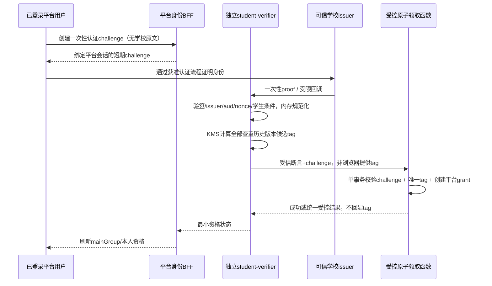

# 五个权限组与学生匿名认证查重

状态：设计基线 v0.4，2026-10-18，待实现。用户明确要求系统管理员、内容管理员、学生（认证）、用户、游客五个权限组，学生认证不保存真实学校账号信息，同一学生不得领取多份认证。本文替代旧管理员角色模板和认证材料留存方案。

## 1. 权限组与学生资格分开

| 显示组 / canonical ID | 判定 | 核心能力 |
| --- | --- | --- |
| 系统管理员 / `system_admin` | 当前显式授予的系统管理组 | 本人capability/scope内的系统配置、账户权限、教学数据/导入、平台AI配置预算与运维 |
| 内容管理员 / `content_admin` | 当前显式授予的内容管理组 | 本人capability/scope内的评价/举报/申诉、脱敏分析、教师总结治理与受限内容修正 |
| 学生（认证） / `verified_student` | 普通平台账号具有当前有效、未撤销的匿名学生grant | 用户能力，加学生评价/点赞与BYOK受控数据接口 |
| 用户 / `user` | 已登录平台账号，无有效学生grant且不属于管理组 | 公开查询、本人记录/撤回/申诉/恢复/删除，发起学生认证 |
| 游客 / `guest` | 未登录请求，不建游客账号表 | 获准公开查询/阅读，不写入评价或获取私有数据 |

`mainGroup` 为单值展示/组策略：显式管理组优先，否则按学生grant派生学生/用户，未登录为游客。管理组互斥，同账号不能同时system_admin和content_admin；变更以版本化受控命令完成。组不是数字等级，不用 `role >= student` 放行。管理员若要执行学生专有行为，也须独立有效学生grant，不因管理组绕过一次性查重；学生grant不授予管理权。

组限定capability的最大集合，capability绑定只做组内缩减/学校和对象scope，不能给content_admin加系统权限来突破组。system_admin是业务管理组，不是数据库owner，不默认无审计全权；最终有效system_admin保护、初始双人授权与管理升权见 [14](14-admin-workspace-and-security.md)。系统自动任务是工作负载身份，不是第六个用户组。

## 2. 保证范围与最少留存

保证目标：在当前学校、获准的稳定学生身份命名空间内，同一可信学生身份最多成功领取一份平台学生资格。不能只提交学号/其摘要即认证，必须由可信学校issuer或已核验proof adapter证明控制该身份且验证时符合学生条件；学校数据源未接通时认证入口关闭，不能由管理员直接填“学生=true”绕过。

**学校真实账号相关数据零持久化**：不保存原始/可还原的学号、姓名、学校邮箱、学校登录名/密码、学校SSO subject/完整断言/access或refresh token、认证材料/截图/原文、这些字段的密文副本。它们不进入Supabase Auth身份/metadata、业务DB、日志/异常/URL采样、APM/WAF、Redis、队列、对象存储、浏览器持久存储或备份。已有“人工材料最长7天”方案取消，人工流程也不能上传存档校园证件。

平台账号是独立随机内部ID及平台自选登录/恢复凭据，不把学校SSO当Supabase登录provider，不使用真实姓名/学校邮箱登录。可选平台邮箱登录/恢复只接受独立非校园联系方式，已知学校域在准入时拒绝，不能为调试/恢复索取校园邮箱或从认证流自动填充。独立平台联系方式也不证明学生身份，须按自己的用途/隐私说明处理，不能因此声称整个平台没有任何用户自愿提供的联系信息。默认优先支持不依赖真实联系方式的平台凭据和预设恢复方式；受支持适配器在P0验证，未具备时不能借校园SSO/材料留存绕过。

保留的学生认证数据仅两类，逻辑上不建立join：

1. **查重集合**：密钥版本+HMAC标签，不含平台userId、grantId、claimId、认证时间、学校原文、IP或可用于业务关联的列；学校/身份命名空间已经参与MAC输入。
2. **平台资格grant**：平台userId、随机grantId、学校scope、验证策略/级别（“验证时符合学生条件”）、active/revoked状态与版本。无标签、学号、学校subject、凭据、证明材料或可反查校园身份的指针。

这是最小化、去标识的防重设计，**不称为绝对匿名或完全不可关联**。标签依然是需保护的假名数据；专用验证服务在处理中短时知道身份，DB高权/WAL/事务时序和外部issuer可产生侧信道，完整服务失陷超出“只偷业务表”保护范围。任何管理员UI都不能浏览标签集合或通过学校账号反查平台用户。[OWASP 最小化敏感信息存储](https://cheatsheetseries.owasp.org/cheatsheets/Cryptographic_Storage_Cheat_Sheet.html)

## 3. 采用 HMAC-SHA-256，避免 MD5 学号字典

```text
message = length_prefixed_encode(
  "soclear/student-claim/v1",
  institution_id,
  canonical_identity_namespace,
  canonical_stable_student_subject
)

tag_v = HMAC-SHA-256(K_dedup_v, message)  # 完整32字节，禁止截断
```

学号通常低熵且格式可预测，MD5或裸SHA-256可枚举整段学号后匹配，公开盐也不能阻止这种离线匹配。随机逐行盐会破坏直接确定性查重，不能当本需求的默认替代。HMAC使用独立高熵秘密，使仅取得查重库的人无法直接枚举匹配；Key泄漏或MAC接口成为查询oracle后仍有风险，不作不可破解承诺。MAC采用维护良好的密码库/KMS能力，不自行拼接hash。[NIST HMAC](https://csrc.nist.gov/pubs/fips/198-1/final)、[RFC 6151 MD5 安全说明](https://www.rfc-editor.org/info/rfc6151/)

Key仅由专用验证身份调用KMS/HSM，独立于Auth、会话、票据、模型和密管业务Key；不下发前端/普通API/AI/管理员。不提供“输入任意学号返回HMAC/是否注册”的公共或管理员接口。只有验证了可信学生proof后才能计算/消费，输出仅资格结果，不返标签。

身份规范化是安全配置：保留前导零，按issuer规范处理大小写/空白与Unicode，拒绝模糊自动猜测。使用长度前缀/确定编码防字段串联歧义；规范版本固定，不能换大小写规则即重领。优先学校提供稳定、不可重分配、本站专用pairwise不透明subject；学校只有学号时必须核实其唯一性、重用、换号/转学/双学籍政策。OIDC pairwise subject有助跨站减少关联，但其issuer和sector稳定性须核验，不能单凭名字保证匿名或同人唯一。[OIDC Subject Identifiers](https://openid.net/specs/openid-connect-core-1_0.html#SubjectIDTypes)

多proof adapter必须先映射到**同一学校的canonical namespace与同一稳定学生subject**再MAC。不能把可切换的登录issuer/用户名/学院或浏览器传入school作为额外盐，让同人绕过查重；无法可靠统一两来源时只启用一个权威来源。对同一现实人拥有不同学号/多学校身份，若学校不给稳定同人标识，系统不能凭HMAC自动判同人，应明确保证为“同一权威稳定学生身份一次”，不虚称跨身份全球自然人唯一。

## 4. 验证服务与数据流



`apps/student-verifier` 是独立进程/运行身份；只有它处理学校proof及MAC，普通BFF、管理API、AI、worker不读取校园身份。优先浏览器在学校自己的域完成登录，平台不索取学校密码；若特殊adapter必须短时处理原文，只在隔离内存内使用，用后销毁引用，不启用缓存/自动重试落盘/崩溃转储。外部issuer自己的数据与日志不由本站控制，需要核实其处理边界，不能声称替学校删除已有账号信息。

学校OAuth/SSO不能配置为Supabase Auth登录provider，防止SDK自动保存auth.identities/provider_token/email等。回调由专用入口消费，优先form_post或后端通道；无法避免一次性code URL时，整个代理/CDN/WAF/日志/错误链禁止query采集、Referrer和跟踪，立即清理地址。原始完整proof/token不写进challenge、audit、cookie或页面，也不转给模型；Supabase Auth只管理独立平台身份。

## 5. 原子领取、并发防重与响应丢失

认证**之前**创建challenge，默认5分钟：仅保存随机challenge摘要、平台userId/appSession绑定、sessionEpoch、scope提示、用途、expiresAt与消费状态。无学生身份或标签。作用是CSRF/nonce/重放防护，不是已验证身份的可交易领取券；客户端不能提交tag、自报已验证、换userId或转给其他账号。

验证服务通过工作负载身份提交短期有界内部断言，绑定challenge、受信scope、proof策略、当前查重keyringGeneration、各历史版本候选tag和有效期；不经浏览器、普通任务队列或日志。断言用独立服务签名/认证，数据库只能由获准claim执行身份调用受控函数，不允许普通API/管理员直接构造标签或授予grant。

单个PostgreSQL事务完成：

1. 按固定顺序锁当前keyring配置、目标平台账号/资格与challenge，确认会话/账号有效、proof用途/期限/一次性、issuer策略及namespace正确；旧keyring generation拒绝并重新内部准备。claim可对keyring用共享锁、对账号/challenge用行锁；轮换激活更新同一keyring记录并与claim互斥，不把全站领取串行化为一个排他锁。学校/KMS网络调用在事务外完成。
2. 若同一平台账号已有active资格，返回已有状态，不再消费新的学生身份；已有revoked/历史资格不允许自动再次领取或换身份，走本人平台账号补救流程。
3. 对候选历史标签做受控存在检查；任一命中则拒绝创建第二份grant，不透露标签或已绑定平台账号。候选格式/版本集由当前keyring严格限定，不能漏历史版本。
4. 插入当前写版本tag（`UNIQUE(key_version, tag)`），创建唯一平台grant、提升资格版本并消费challenge，同事务commit。两账号并发同身份最终争同一当前tag，唯一冲突使整笔回滚；不能先SELECT无记录再分别无约束插入。使用受控ON CONFLICT/事务重试而不在异常detail泄漏tag。[PostgreSQL 事务隔离](https://www.postgresql.org/docs/current/transaction-iso.html)
5. 原始身份/proof/候选tag与内部断言不进入持久幂等结果或错误日志；challenge无标签引用，grant无标签引用，查重行无challenge/user关联列。消费状态只回同一账号最小结果。

DB提交前失败全部回滚，不能先烧掉tag再给学生异步发领取票据；提交后响应丢失，原账号查询自己的grant即可恢复，不重复授予，也不需要保存tag↔user映射。challenge重放只可返回绑定账号已有状态，换账号/过期会话拒绝。数据库超时不确定先查该平台账号资格，不透明重跑学校登录/新建第二账号。

零原文日志要求覆盖数据库SQL参数/慢查询/审计/异常detail和WAL外的采样；原文根本不进DB，HMAC参数也不打印。即使业务表无join，同事务WAL/物理备份、xmin与提交时序仍可能关联匿名记录和资格授予，这个方案不能宣称密码学不可关联；更强要求须另评估成熟匿名凭证/盲签名及其恢复/撤销模型，不能临时自造密码协议。

## 6. 资格语义、删除、撤销与账号丢失

首版匿名grant证明“首次验证时满足学校学生条件”，不自动宣称**当前仍在校**或已修读某门课程。初版不设自动续证/到期重领；应用会话过期、改平台登录方式、同账号恢复均保留原grant，学生专有权限另受active/revoked和平台风险控制。

查重集合不保存绑定关系，因此不能仅凭“这个标签已出现”证明当前账号就是最初那个学生，也不能安全支持“查重命中就给新账号换绑/续资格”。禁止renew-if-tag-exists、重新报名、管理员清tag放行或借另一个已认证学生proof更新资格。未来如需要每学期真实在校续证，必须另立ADR：评估用户自持且绑定原平台账号的匿名凭证，或经用户新授权的最小假名绑定；在没有协议与恢复/撤销证明前保持关闭，不能悄悄增加tag↔user表。

撤销资格将该平台grant置revoked并使学生能力立即失效；可在同一平台账号按已审核的**平台**处置撤销原因决定恢复原grant，不重新认证/占新标签，不靠校园身份材料恢复。账号删除清理账号/资格/作者映射等按批准策略处理，但无关联查重标签保留为“已消费”tombstone，不能删号后在第二账号重领。

平台账号恢复使用事先设置的平台安全凭据/恢复码等证明同一账号控制权，不要求上传校园账号、证件或原学号；丢失全部平台恢复凭据时，本方案无法从查重表找回其平台账号，不为方便找回而恢复真实身份映射或任意重发资格。认证页提前说明该取舍并引导保存平台恢复方式；原有撤回/申诉/删除渠道仍保留本人控制权要求。

“永远不重复”与“删除全部查重痕迹”不能同时成立。tombstone的用途、保留范围、密钥保管与删除请求处理在采集前明确；若组织决定清除它，须承认之后不能继续保证历史同身份不重领，不以代码假装两者都满足。

## 7. 密钥轮换与灾难恢复

K_dedup由KMS/HSM保护，密管管理人员也不能通过站内页面下载原值/任意调用MAC oracle。旧业务模型Key轮换不改变去重Key。查重历史版本在控制表记录不可删的检查集合，旧Key只保留MAC-check能力、新写使用当前版本；只有学校proof已验证且用途正确的verifier可请求候选。

由于不存原始身份，不能离线把旧tag重算成新Key的tag。每次新验证对**全部仍代表已消费记录的历史Key**生成候选并检查，命中任何版本都拒绝第二份；新领取仅写当前版本。keyringGeneration在消费事务内锁定，与轮换激活线性化，旧节点漏算新/旧版本会拒绝而非放行。不能换盐、改namespace、删旧Key/清账本来“完成轮换”。

旧Key泄漏时更换新Key不能使已泄漏标签重新安全，也不能丢弃旧检查直接继续认；暂停新认证，评估字典泄露范围与可验证的迁移/外部匿名发行方方案。历史Key丢失或查重集合恢复不完整时无法证明不重复，**关闭新认证**，保留已获准账号和基础查询；待完整恢复后再准入。

查重集合、keyring版本和当前消费恢复水位是安全关键数据，恢复必须覆盖所有曾成功授予的领取；通用RPO≤15分钟不能允许丢掉这15分钟的查重记录。须独立受保护的完整WAL/防回退备份或等价恢复核验方案，不能通过在DB外复制tag+userId事件来补账。恢复缺口无法证明补齐时保持认证关闭；现有grant恢复也不能自动触发重新领取。raw身份永远不进入备份，MAC Key与标签备份分权保存，恢复测试同时验证不可清空重复额度。

## 8. 前端、管理员与验收

学生在个人页只看到“未认证/认证成功（验证时学生）/已撤销/暂不可用”、学校scope、平台策略说明、恢复提示；不会看到学号掩码、学校账号、HMAC标签或证明图片。系统管理员在同站管理区管理验证策略/服务状态/匿名资格状态/撤销/恢复原grant，内容管理员只能看处理内容所需的资格布尔提示，不浏览认证材料；任何组均无学校身份揭示/反查/标签导出能力。

认证service的group或grant字段不允许普通用户自改，系统管理员也不能直接把未验证用户写成verified_student、删除tag重认或绕过原子claim；必须由获准issuer+专用命令产生。审核/风控可使用平台账号行为事实，不可还原校园身份，不向平台AI或学生供应商发送认证数据。

上线证据至少包括：

- 五组单值分类、管理两组互斥、管理员不自动拥有学生权限、内容管理员不能提权到系统管理；未知组/capability默认拒绝。
- 同身份多账号/同账号多identity/重放challenge/并发和keyring切换，最多一次领取；模拟commit前失败和commit后响应丢失不会烧资格或再发资格。
- 真实issuer签名/nonce/aud/有效期/学生条件与稳定subject不满足则拒绝；伪造学号/摘要和替换issuer/学校/namespace不通过。
- 合成学号/姓名/邮箱/密码/SSO subject/token金丝雀遍历代理/WAF/APM/DB/Auth.identities/Redis/对象/队列/日志/备份，无任何原文、密文副本；查重tag无user/grant/challenge/time/IP关联列，资格无tag。
- 管理员、普通API、模型、导出/审计和任意MAC调用都不能读取/枚举学校身份或标签；私有平台行为case不变成校园实名调查。
- 删除/封禁/恢复/密钥轮换和备份回退不重置已消费标签；缺历史Key/恢复水位时新认证fail closed，基础查询不受拖累。
- 文案不宣称当前在校、真假鉴定、全球自然人唯一或密码学不可关联；不以自动重试/手工材料留存偷偷突破隐私和一次性约束。

实现前仍须确认学校可信来源、规范稳定ID、用途/保留政策、KMS能力和零日志基础设施。没有这些前置只可用合成数据开发，不能以“先收学号，之后再匿名化”上线。
