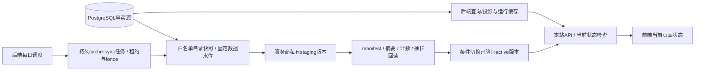

# 后端统一缓存与每日服务商同步

状态：设计基线 v0.5，2026-10-18，待实现。用户要求数据库缓存统一由后端处理，每天同步一次到服务商。本文暂按“后端维护运行缓存，每日向缓存服务商发布一次获准公开的缓存快照”设计；服务商名称、托管缓存/CDN能力和目标资源仍待确定。此处没有创建实际定时任务或执行外部同步。若用户所指为每日从Supabase拉取或向对象存储备份，须调整同步方向与验收，不能混同这些用途。

## 1. 统一责任与数据范围

PostgreSQL仍是业务事实源，业务写入成功以数据库事务提交为准。后端cache-management统一管理缓存键、查询规范化、版本、容量、TTL、填充、刷新、失效、快照与服务商adapter。前端只访问本站API，保留当前页面渲染/请求去重状态，不维护数据库副本、持久化查询结果或直连缓存服务商。浏览器学生模型直连不属于数据库缓存，继续按[12](12-student-byok-ai.md)执行。

数据库查询JSON交付浏览器统一`Cache-Control: no-store`，不进HTTP磁盘缓存、Service Worker或前端持久缓存。公开API的边缘缓存须由后端明确配置并验证“仅共享边缘缓存、浏览器不存”的分离能力；不能假定普通`max-age=0`等于不存储。服务商不支持此分离时该API退出CDN缓存，走后端Redis/有界回源后重新压测，静态哈希资源仍可长期浏览器缓存。

| 数据类别 | 后端运行策略 | 每日向服务商发布 |
| --- | --- | --- |
| 获准公开的教师/学院/课程/学期/开课目录 | 有界查询缓存，按版本/事件刷新；可用服务商预热副本 | 允许白名单字段的版本快照；显示数据时间，不标为实时 |
| 评分聚合/人数/动态排序、供应商registry和功能配置 | 沿用30/60秒或更严格的当前策略；源版本与剩余新鲜度受控 | 首版排除日快照，避免把一天前状态当当前结果/网络信任配置 |
| 评价正文、平台教师总结、学生AI证据 | 后端可按精确版本内部缓存，交付前逐次主库gate，HTTP no-store | 不发布；不能以日快照绕过撤稿、完整manifest或epoch |
| 平台账号/作者关系、会话/管理授权、grant/challenge、安全计数、费用/outbox事实 | 按私有与安全存储规则实时处理，不是可丢弃的公开缓存 | 不发布、不覆盖、不从日缓存恢复 |
| 校园认证原文/密文/材料、HMAC标签与查重集合、任何秘密/学生Key | 原文按[15](15-anonymous-student-verification.md)零持久化，其余各自隔离 | 严禁进入快照、manifest、日志、对象路径或服务商诊断 |

每日快照是可丢弃的查询加速/预热副本，不是写回数据库的队列、备份或恢复依据；不先只写缓存再一天落库。首版快照限定纯目录，不能夹带评分、正文、权限或registry。供应商存储副本必须默认私有，只由后端/受控入口读取；不发公开bucket URL或让前端直接下载整份目录，也不新增允许一天陈旧的查询接口。

## 2. 两个刷新周期

1. **后端运行缓存**：保留事件驱动/按需填充、single-flight、有界回源、单调版本失效。常规当前目录与评分公开投影仍以[06](06-capacity-and-performance.md)的p95≤30秒、最大60秒为目标；安全/撤稿仍实时查主库，认证独立fail closed。
2. **服务商快照**：每个学校/数据范围、每个Asia/Shanghai自然日一个计划发布槽位。默认计划时间为每日03:00（实施时锁定配置），不是每次进程启动后sleep 24小时。每天是一个逻辑发布，分批上传与同一任务的有限重试不新增日发布。

服务商预热副本允许最多30小时数据年龄作为初始规划值，以`sourceAsOf`计算，包含排队/导出/上传/分发耗时；管理面板显示`sourceAsOf`和`lastSuccessfulSyncAt`，不把重新上传时间伪装为新数据。30小时是每日副本可用于恢复缓存的上限，不替代当前API的60秒目标。副本超龄时不再加载，后端按额度回源重建；预算耗尽明确503，不能无限延长TTL。

后端可将日快照作为**预热基线**，但当前API使用它前必须以权威版本控制记录/可靠变更水位证明相关目录版本仍是当前，且复验窗口满足自身新鲜度预算；不能仅改时间戳就冒充当前。`sourceAsOf`保留源数据时点，当前版本复验时间另记，检查不到就有界回源/拒绝，不直接交付旧副本。只有另行接受一天数据陈旧预算后才能把当前API整体切成日数据，本轮未作此变更。

公开撤除/资料下线等安全变更可随时触发后端失效和服务商紧急撤除，不等待次日。这是对当前版本的禁止交付，不是额外日常全量发布。无法证明边缘撤除时先关闭相关公开路由或退出共享缓存；旧版本私有资源不能因路径可猜直接获取。

## 3. 后端构建与原子发布

任务日槽位唯一键为`cache-sync:{targetId}:{schoolScope}:{localDate}`，策略版本作为该任务绑定输入而非可增加第二个日槽位的维度；只含受控配置ID，不接受任意URL/路径/SQL。DB任务记录输入策略/源水位、版本、状态、租约/fence、重试、校验摘要与时间，无原始记录/凭据。发布前策略变更使未发布尝试失效并在同槽位重建，已成功日槽位不因改策略再日常全量发布；紧急禁止交付仍独立执行。日发布唯一约束在DB，不能只靠Redis锁。

1. 调度器在DB注册日槽位，多副本竞争同一任务；领取有界租约/fence，过期持有者不可激活。重启补扫漏跑槽位；跨日积压默认只构建最新到期快照，把旧槽位标明superseded，不能一次补发多个过时版本覆盖当前。
2. 从获准只读投影选择固定数据水位，使用有时限的一致快照/版本导出方案，分批读取；不能随分页混入多个目录版本。大数据先物化固定版本再导出，避免长事务阻塞主库。DB连接、CPU、出网/条数/字节和运行deadline有独立后台预算，交互与撤权优先。
3. 上传到新且不可变的staging命名空间。manifest只含策略/schema/scope、snapshotVersion、sourceAsOf、计数、分片摘要与大小；无作者、平台身份、原文或秘密。传输/存储加密，目标凭据仅后端adapter按scope使用，不获得数据库owner或其他bucket权限。
4. 校验字段、计数、分片完整性/摘要并从服务商抽样回读；同任务未完成不能公开半包。不因HTTP上传200直接标已发布。
5. 以条件版本更新或等价已验证机制激活新manifest指针，核对当前策略、安全撤除水位及fence；并发旧任务不能覆盖新版本。服务商不支持所需一致激活时用后端DB指针指向已验证私有版本，不对公网原地覆盖活跃键集合。
6. 记录完成，旧版本按有界保留清理，始终受删除/禁止交付清单约束。失败保留仍在年龄/安全范围内的已知好版本；上传结果未知先查询受控版本/摘要状态，不能无穷重传。回滚不能复活已撤除内容或回退安全水位。

## 4. 运维、配置与可见性

同站`/admin/operations/cache`显示当前运行缓存状态、每日计划/时区、目标引用、最近成功/下次时间、源水位/年龄、版本、大小、校验与失败阶段；target不可用显示真实原因，不展示凭据/快照原始记录。system_admin需当前`ops:observe`看状态，`ops:cache-sync`手动补跑/重试获准目标；目标/日程/策略变更另需`ops:configure`及相应高影响intent。content_admin无系统缓存发布权限。

手动补跑复用对应日槽位/同任务，不创建第二次默认日发布；紧急失效使用独立`ops:cache-invalidate`命令和禁止交付水位，不向前端开放自由cache key/flushall。目标更换、全量失效、回滚等高影响操作按[14](14-admin-workspace-and-security.md)预览/版本/新鲜认证/具体复核策略，任务执行前重验授权；计划任务使用明确范围的工作负载身份，不能借“系统任务”继续已撤权人的手动命令。

服务器配置只保存`CACHE_SYNC_TARGET_REF`、固定数据scope/白名单策略、`CACHE_SYNC_TIMEZONE=Asia/Shanghai`、`CACHE_SYNC_LOCAL_TIME=03:00`、30小时年龄上限、后台资源预算和秘密引用，生产数值需P0确认。服务商名称/资源/能力未选定时adapter保持未启用，不能假定Supabase、Redis或CDN已经提供此能力，也不创建Codex提醒代替应用任务。

监控至少记录计划延迟、成功日期、快照数据年龄、上传/校验/激活耗时、源水位差、体积/费用、重试/租约丢失/结果未知和清理失败；连续失败、年龄超限、内容撤除失效为告警。失败不清空已知好版本，不影响能安全回源的基础查询，安全状态不明的内容停止交付。

## 5. 验收与待定项

- 真实浏览器只请求本站API，无数据库/缓存服务商SDK或凭据，无数据库持久副本；当前页面状态与学生Key的独立内存规则正确。
- 多副本调度、重启/漏跑、跨日、手动重试都只有一个对应日槽位；旧fence、错scope/目标、任意URL/路径、非系统管理员不能发布。
- 模拟分片缺失、摘要错误、上传超时/结果未知、激活失败与服务商不可用，不出现半包或旧任务覆盖；源数据时间不因重试续新，超龄副本不加载，当前版本不能证明不交付。
- 评分/权限/registry/撤稿/认证不能从日副本取当前状态；校园原文、tag、私有账号与Key canary不进入快照/manifest/日志/对象路径。紧急失效/回滚不复活已撤除数据。
- 每日导出与高峰混合压测有独立DB/IO/出网预算，原30/60秒当前投影目标单独验证；日同步不是数据库备份或匿名查重恢复手段。

待确定：用户所指同步方向、具体缓存服务商/资源及凭据引用、数据规模/公开字段、日同步时刻与30小时目录快照最大年龄、目标区域/费用和原子激活能力。确认后更新本协议与对应适配器验收；当前无应用或真实外部同步。
