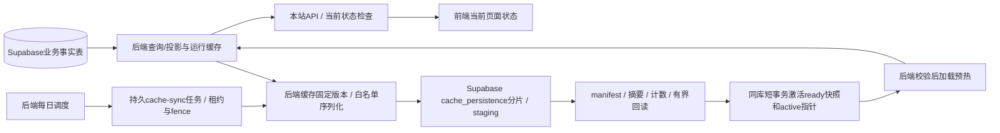

# 后端统一缓存与每日写入 Supabase

状态：设计基线 v0.6，2026-10-18，待实现。用户已明确同步方向为**后端每日将缓存写入Supabase**。默认落地为后端运行缓存的白名单快照，写入同项目Supabase PostgreSQL的独立非公开缓存表；不再引入待选缓存服务商。每日频率已确定，03:00 Asia/Shanghai为规划默认时刻。当前仅更新设计，没有创建实际表、任务或连接Supabase。

## 1. 统一责任与数据范围

Supabase PostgreSQL中的业务表仍是事实源，业务写入成功以事务提交为准。后端cache-management管理运行缓存的键、版本、容量、TTL、刷新/失效，cache-sync每天将获准缓存内容序列化写入Supabase的独立缓存表。**运行缓存 → Supabase缓存快照表**是每日写入链路；业务表 → 运行缓存的日常读取/刷新继续按当前策略进行。前端只取本站DTO并保留当前页面状态，不直连Supabase或缓存。浏览器学生模型按[12](12-student-byok-ai.md)另行直连。

数据库查询JSON交付浏览器统一`Cache-Control: no-store`，不进HTTP磁盘缓存、Service Worker或前端持久缓存。公开API的边缘缓存须由后端明确配置并验证“仅共享边缘缓存、浏览器不存”的分离能力；不能假定普通`max-age=0`等于不存储。服务商不支持此分离时该API退出CDN缓存，走后端Redis/有界回源后重新压测，静态哈希资源仍可长期浏览器缓存。

| 数据类别 | 后端运行策略 | 每日写入Supabase缓存表 |
| --- | --- | --- |
| 获准公开的教师/学院/课程/学期/开课目录 | 有界运行缓存，按版本/事件刷新；重启可加载已验证的Supabase快照预热 | 将获准字段/键/版本序列化为快照；记录源数据时间，不标为实时 |
| 评分聚合/人数/动态排序、供应商registry和功能配置 | 沿用30/60秒或更严格的当前策略；源版本与剩余新鲜度受控 | 首版排除日快照，避免把一天前状态当当前结果/网络信任配置 |
| 评价正文、平台教师总结、学生AI证据 | 后端可按精确版本内部缓存，交付前逐次主库gate，HTTP no-store | 不发布；不能以日快照绕过撤稿、完整manifest或epoch |
| 平台账号/作者关系、会话/管理授权、grant/challenge、安全计数、费用/outbox事实 | 按私有与安全存储规则实时处理，不是可丢弃的公开缓存 | 不发布、不覆盖、不从日缓存恢复 |
| 校园认证原文/密文/材料、HMAC标签与查重集合、任何秘密/学生Key | 原文按[15](15-anonymous-student-verification.md)零持久化，其余各自隔离 | 严禁进入缓存快照、manifest、SQL参数采样或诊断日志 |

每日写入的是可丢弃的查询缓存快照，不能反向覆盖业务事实表，也不能将新评价等先只存在Redis一天再批量落库。首版快照限定纯目录，不夹带评分、正文、权限或registry。目标是Supabase PostgreSQL缓存表，不是Supabase Storage bucket、CDN分发或数据库备份；不新增一天陈旧的查询接口。

### 1.1 Supabase落点与权限

新增非公开schema `cache_persistence`：`snapshots`记录snapshotId/scope/版本/源水位、sourceAsOf、schema/策略版本、总条数/大小、根摘要、staging/ready/invalidated状态；`snapshot_chunks`保存有界序列化缓存分片及编号/摘要/大小，唯一`(snapshot_id, chunk_no)`。`private.cache_sync_jobs`保留日槽位/租约/fence/重试，`private.cache_snapshot_manifests`保存验证后的清单和当前active快照指针。payload只含白名单缓存数据，不是整份Redis dump或任意键值备份。

schema不加入Data API exposed schemas，撤销PUBLIC/anon/authenticated的访问与默认授权，启用RLS默认拒绝；普通前端、管理API、平台AI不读取缓存分片。后端`supabase-cache-snapshot` adapter通过TLS和独立低权限SQL工作负载调用有界写分片/验证/激活port，无owner、BYPASSRLS或service-role万能凭据。快照加载和清理另有受限port/scope，不因能写快照取得业务表修改权。权限按[04](04-data-and-supabase.md)验收；参考[Supabase自定义schema](https://supabase.com/docs/guides/api/using-custom-schemas)、[RLS与授权](https://supabase.com/docs/guides/database/postgres/row-level-security)。

## 2. 两个刷新周期

1. **后端运行缓存**：保留事件驱动/按需填充、single-flight、有界回源、单调版本失效。常规当前目录与评分公开投影仍以[06](06-capacity-and-performance.md)的p95≤30秒、最大60秒为目标；安全/撤稿仍实时查主库，认证独立fail closed。
2. **Supabase持久缓存快照**：每个学校/数据范围、每个Asia/Shanghai自然日一个计划写入槽位，默认每日03:00（实施时锁定配置），不采用进程启动后sleep 24小时。分批写入和同任务有限重试不新增第二份日快照。

Supabase快照用于预热时的最大源数据年龄暂定30小时，以sourceAsOf计算，包含排队/缓存序列化/SQL写入耗时；面板显示sourceAsOf/lastSuccessfulSyncAt，不把重新写入时间伪装成新数据。超龄快照不加载，后端按额度从业务投影重建，预算耗尽503。30小时不替代当前API的60秒目标。

后端可将日快照作为**预热基线**，但当前API使用它前必须以权威版本控制记录/可靠变更水位证明相关目录版本仍是当前，且复验窗口满足自身新鲜度预算；不能仅改时间戳就冒充当前。`sourceAsOf`保留源数据时点，当前版本复验时间另记，检查不到就有界回源/拒绝，不直接交付旧副本。只有另行接受一天数据陈旧预算后才能把当前API整体切成日数据，本轮未作此变更。

公开撤除/资料下线等安全变更可随时触发后端失效和服务商紧急撤除，不等待次日。这是对当前版本的禁止交付，不是额外日常全量发布。无法证明边缘撤除时先关闭相关公开路由或退出共享缓存；旧版本私有资源不能因路径可猜直接获取。

## 3. 后端构建与原子写入

任务日槽位唯一键为`cache-sync:{targetId}:{schoolScope}:{localDate}`，策略版本作为该任务绑定输入而非可增加第二个日槽位的维度；只含受控配置ID，不接受任意URL/路径/SQL。DB任务记录输入策略/源水位、版本、状态、租约/fence、重试、校验摘要与时间，无原始记录/凭据。发布前策略变更使未发布尝试失效并在同槽位重建，已成功日槽位不因改策略再日常全量发布；紧急禁止交付仍独立执行。日发布唯一约束在DB，不能只靠Redis锁。

1. 调度器在DB注册日槽位，多副本竞争同一任务；领取有界租约/fence，过期持有者不可激活。重启补扫漏跑槽位；跨日积压默认只构建最新到期快照，把旧槽位标明superseded，不能一次补发多个过时版本覆盖当前。
2. 选定后端缓存中获准目录的固定版本/源水位，以不可变命名空间或有界快照读取分批序列化；不能随Redis SCAN拼出不同版本/不完整键集。缓存缺块或过期时先按限额从业务公开投影重建完整固定版本，不能直接把任意过期缓存写成新快照；不全量扫描整个Redis。DB连接、CPU、条数/字节和deadline有独立预算，交互与撤权优先。
3. 创建新的Supabase `cache_persistence.snapshots` staging记录，有界短事务逐批写`cache_persistence.snapshot_chunks`。仅受控schema字段可写，不把缓存key当SQL表/列名；同编号分片只接受同摘要幂等重试，内容冲突拒绝。manifest记录源水位、计数/大小和摘要，不含私有身份或秘密。
4. 任务进入validating时以当前fence冻结该尝试的分片写入，再验证白名单/schema、完整分片集、计数/总大小/根摘要并有界SQL回读；不能在验证后插入/改写分片。同摘要重试仅返回既有状态，不修改已验证内容。ready前仅校验port读取，普通loader不能见半包。
5. 在同一Supabase PostgreSQL短事务锁任务/目标指针，复验当前策略、源版本/禁止交付水位、完整验证状态与租约fence，标快照ready、条件切换active指针并记录job成功。旧任务/过期租约不能覆盖新版本，不在一个长事务中完成整份缓存传输。
6. 清理过期staging与旧ready版本，限制保留版本/总大小；清理与loader租约配合，不删除正在读取的分片。失败保留安全且未超龄的已知好版本；commit结果未知先查同日任务/快照状态再续原尝试，不能重复建日快照。回滚不得复活撤除内容或回退安全水位。

## 4. 运维、配置与可见性

同站`/admin/operations/cache`显示当前运行缓存状态、每日计划/时区、目标引用、最近成功/下次时间、源水位/年龄、版本、大小、校验与失败阶段；target不可用显示真实原因，不展示凭据/快照原始记录。system_admin需当前`ops:observe`看状态，`ops:cache-sync`手动补跑/重试获准目标；目标/日程/策略变更另需`ops:configure`及相应高影响intent。content_admin无系统缓存发布权限。

手动补跑复用对应日槽位/同任务，不创建第二次默认日发布；紧急失效使用独立`ops:cache-invalidate`命令和禁止交付水位，不向前端开放自由cache key/flushall。目标更换、全量失效、回滚等高影响操作按[14](14-admin-workspace-and-security.md)预览/版本/新鲜认证/具体复核策略，任务执行前重验授权；计划任务使用明确范围的工作负载身份，不能借“系统任务”继续已撤权人的手动命令。

服务器配置固定`CACHE_SYNC_TARGET=supabase_postgres`，`CACHE_SYNC_TARGET_REF`只引用获准Supabase项目/环境，schema固定为`cache_persistence`，另有scope/白名单、Asia/Shanghai、03:00、30小时年龄上限、总存储/批大小/资源预算和低权限连接秘密引用。凭据不出后端。具体项目、迁移、授权、容量和任务未验收前不启用真实写入；不开放任意URL/SQL/schema或接入另一缓存服务商。

监控记录计划延迟/成功日期、源年龄、序列化/SQL批写/校验/激活耗时、源版本差、行数/字节、数据库体积/WAL、重试/租约/提交未知和清理失败；连续失败/年龄超限/撤除失效告警。失败不清空已知好版本，能安全访问业务表时仍限额回源；Supabase整体故障按原依赖策略降级，不能用同库快照承诺独立可用。

## 5. 验收与待定项

- 真实浏览器只请求本站API，无数据库/缓存服务商SDK或凭据，无数据库持久副本；当前页面状态与学生Key的独立内存规则正确。
- 多副本调度、重启/漏跑、跨日、手动重试都只有一个对应日槽位；旧fence、错scope/目标、任意URL/路径、非系统管理员不能发布。
- 模拟缓存缺块/混版本、SQL批写超时/提交未知、分片缺失/摘要错误、激活失败与Supabase不可用，不出现半包或旧任务覆盖；源时间不续新，超龄/版本未知不加载，分片幂等冲突拒绝。
- 评分/权限/registry/撤稿/认证不能从日副本取当前状态；校园原文、tag、私有账号与Key canary不进入快照/manifest/日志/对象路径。紧急失效/回滚不复活已撤除数据。
- anon/authenticated、管理/AI/普通member无法经Data API/RPC/SQL读写快照；快照workload无业务表更新/owner权限。每日写入叠加峰值并测连接/IO/WAL、数据库体积/旧快照清理和重启加载；原30/60秒目标单独验证。缓存表与业务表同Supabase故障域，不能承诺数据库故障时靠这份快照仍可用，也不作数据库备份/查重恢复手段。

已确定：后端统一缓存、每日写入Supabase。实施前仍需固定具体Supabase项目/环境、缓存白名单、schema迁移/角色、03:00时刻和30小时预热上限、分片大小/保留量及容量预算；这些是实现参数，不再把同步方向/服务商列为未定。当前无应用或真实Supabase写入。
